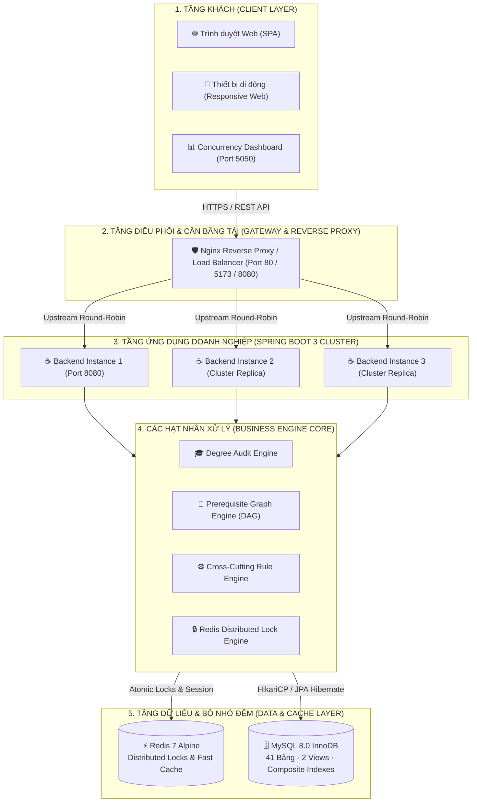
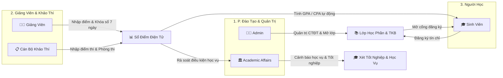

<div align="center">
  
  <h1>Hệ Thống Quản Lý Đào Tạo & Sinh Viên (SMS / UAMS)</h1>
  <p><strong>University Academic & Student Management System — Đại học theo học chế tín chỉ</strong></p>
  <p>Giải pháp toàn diện quản lý khung chương trình đào tạo, xếp thời khóa biểu, đăng ký tín chỉ chịu tải cao, tính điểm GPA/CPA tự động, kiểm soát học phí và xét tốt nghiệp.</p>

  [](backend/)
  [](backend/)
  [](frontend/)
  [](frontend/)
  [](database/)
  [](docker-compose.yml)
  [](frontend/nginx_main.conf)
  [](docker-compose.cluster.yml)
  [](tests/)
</div>

---

## 📑 Mục lục
1. [Tổng quan hệ thống](#-tổng-quan-hệ-thống)
2. [Kiến trúc công nghệ & Phân tầng](#-kiến-trúc-công-nghệ--phân-tầng)
3. [Các hạt nhân nghiệp vụ cốt lõi](#-các-hạt-nhân-nghiệp-vụ-cốt-lõi-business-engines)
4. [Phân hệ & Vai trò người dùng (5 Phân hệ)](#-phân-hệ--vai-trò-người-dùng-5-phân-hệ)
5. [Cấu trúc thư mục dự án](#-cấu-trúc-thư-mục-dự-án)
6. [Cài đặt & Khởi chạy nhanh (5 Lựa chọn)](#-cài-đặt--khởi-chạy-nhanh)
7. [Tài khoản kiểm thử trải nghiệm](#-tài-khoản-kiểm-thử-trải-nghiệm)
8. [Kiểm thử tự động & Đảm bảo chất lượng (QA)](#-kiểm-thử-tự-động--đảm-bảo-chất-lượng-qa)
9. [Bộ hồ sơ tài liệu đặc tả](#-bộ-hồ-sơ-tài-liệu-đặc-tả)

---

## 📌 Tổng quan hệ thống

Hệ thống **SMS (Student Management System / UAMS)** được nghiên cứu và phát triển nhằm chuẩn hóa và tự động hóa toàn bộ vòng đời đào tạo đại học theo học chế tín chỉ: từ xây dựng cấu trúc chương trình đào tạo, tổ chức học kỳ, xếp lịch học/lịch thi, cổng đăng ký học phần tải cao, sổ điểm điện tử đa cấp, quản trị tài chính học phí đến xét cảnh báo học vụ và công nhận tốt nghiệp.

### Các giá trị nổi bật:
* **Khung CTĐT chuẩn 5 khối kiến thức:** Ràng buộc cây tiên quyết đồ thị có hướng không chu trình (DAG), kiểm soát điều kiện tiên quyết, học trước, song hành và tương đương.
* **Xếp thời khóa biểu thông minh:** Phát hiện xung đột 3 chiều thời gian thực (Giảng viên, Phòng học, Khung giờ học).
* **Đăng ký tín chỉ chịu tải cực hạn:** Đột phá với cơ chế khóa phân tán Redis (`RedisLockService`), bộ đếm nguyên tử (`Atomic Capacity`) và khóa bi quan CSDL, bảo đảm an toàn dữ liệu khi 600 sinh viên đồng thời tranh chấp ghi danh trong 1 giây.
* **Sổ điểm điện tử & Cơ chế ân hạn:** Nhập trực tiếp hoặc Import Excel theo tỷ lệ chuẩn `CC1 5% · CC2 5% · GK 30% · CK 60%`, quy đổi điểm tự động (Hệ 10 ➔ Hệ 4 ➔ Điểm chữ). Khóa sổ điểm bảo mật với cửa sổ ân hạn 7 ngày và quy trình đề xuất sửa điểm có xét duyệt qua nhật ký kiểm toán.
* **Tài chính học phí & Lớp quy mô riêng:** Tự động tính học phí theo tín chỉ, chính sách miễn giảm, chặn đăng ký khi nợ học phí quá hạn (Rule B), và tính học phí lớp riêng theo thang sĩ số linh hoạt.
* **Xét tốt nghiệp tự động (Degree Audit Engine):** Rà soát tiến độ hoàn thành 5 khối kiến thức, điểm trung bình tích lũy CPA, chuẩn đầu ra rèn luyện và chứng chỉ.

---

## 🛠️ Kiến trúc công nghệ & Phân tầng

Hệ thống được thiết kế theo mô hình **3-Tier Layered Architecture** chuẩn mực doanh nghiệp, sẵn sàng chuyển đổi mở rộng cụm (Cluster Ready):



| Tầng kiến trúc | Công nghệ sử dụng | Vai trò & Đặc tính kỹ thuật |
| :--- | :--- | :--- |
| **Frontend SPA** | React 19.2, Vite 8.2, Tailwind CSS, Zustand 5, Recharts 3.10, Lucide Icons | Giao diện hiện đại Apple Glassmorphism & Aurora UI, Dark/Light Mode, Native Fetch Client (Zero Dep). |
| **Backend Cluster** | Java 23, Spring Boot 3.5.6, Spring Security, JWT 0.12, Spring Data JPA, Apache POI | 33 REST Controllers, 20+ Services, xác thực 2 lớp Access/Refresh Token, xử lý nghiệp vụ học vụ. |
| **High Concurrency**| Redis 7 Alpine, `spring-boot-starter-data-redis`, Commons Pool 2 | Bộ nhớ đệm phân tán, cơ chế khóa phân tán Redis Lock cho ghi danh môn học, chống quá tải. |
| **Cơ sở dữ liệu** | MySQL 8.0 (InnoDB, `utf8mb4_unicode_ci`), HikariCP Connection Pool | 41 bảng quan hệ chuẩn hóa 3NF, 2 Database Views tối ưu khử N+1, Composite Indexes. |
| **Cân bằng tải** | Nginx Alpine (Reverse Proxy & HTTP Load Balancing) | Điều hướng tải Round-Robin qua cụm 3 Backend Replicas, phục vụ Single Page App. |
| **Kiểm thử & QA** | JUnit 5, Mockito, Vitest, Node.js E2E Runner, Puppeteer, DevTools Audit | 285+ Backend tests, 43+ Frontend tests, 65+ E2E tests, 600 concurrency stress test. |

---

## ⚙️ Các hạt nhân nghiệp vụ cốt lõi (Business Engines)

### 1. Hạt nhân đồ thị môn học tiên quyết (Prerequisite Graph Engine - DAG)
- Mô hình hóa toàn bộ danh mục học phần thành đồ thị có hướng không chu trình (Directed Acyclic Graph - DAG).
- Giải thuật duyệt đồ thị kiểm tra điều kiện tiên quyết, học trước, song hành và ngăn chặn tuyệt đối chu trình phụ thuộc vòng kín (Circular Dependency Detection).

### 2. Hạt nhân kiểm toán tốt nghiệp (Degree Audit Engine)
- Tự động phân tích cây cấu trúc 5 khối kiến thức (Đại cương, Cơ sở nhóm ngành, Cơ sở ngành, Chuyên ngành, Tốt nghiệp).
- Thuật toán "Best-Grade": Tự động phát hiện học cải thiện/học lại và chọn điểm cao nhất để tính vào CPA tích lũy.
- Đối soát chuẩn đầu ra: Tích lũy tối thiểu 130–134 tín chỉ, GPA/CPA $\ge 2.00$, điểm rèn luyện và chứng chỉ điều kiện.

### 3. Động cơ điều khiển đồng thời & Đăng ký tín chỉ tải cao (High-Concurrency Engine)
- Kết hợp đa cơ chế phòng ngự:
  1. **Khóa phân tán Redis (`RedisLockService`):** Khóa tài nguyên theo khóa học phần với thời gian TTL bảo đảm.
  2. **Atomic Capacity Counter:** Kiểm tra và trừ sĩ số trực tiếp trên bộ nhớ đệm trước khi ghi xuống CSDL.
  3. **Khóa bi quan CSDL (`PESSIMISTIC_WRITE`):** Đảm bảo an toàn giao dịch `ACID`, triệt tiêu 100% hiện tượng đăng ký vượt quá sĩ số (`enrolled <= max_students`).

### 4. Động cơ thực thi quy tắc nghiệp vụ liên thông (Cross-Cutting Rule Engine)
- **Quy tắc A (Credit Limits):** Giới hạn số tín chỉ đăng ký mỗi kỳ (10 – 24 tín chỉ).
- **Quy tắc B (Financial Hold):** Tự động chặn cổng đăng ký học phần đối với sinh viên còn nợ học phí quá hạn từ các kỳ trước.
- **Quy tắc C (Schedule Collision Detection):** Phát hiện và chặn tức thời xung đột trùng lịch học, trùng phòng học và trùng giờ giảng dạy.
- **Quy tắc D (Grade Finalization Window):** Khóa sổ điểm học phần với cửa sổ ân hạn 7 ngày cho phép giảng viên điều chỉnh sai sót. Sau 7 ngày, bắt buộc chuyển sang quy trình đề xuất sửa điểm có phê duyệt.

---

## 👥 Phân hệ & Vai trò người dùng (5 Phân hệ)



### 1. Phân hệ Quản trị & Đào tạo (Admin)
- Quản lý cơ cấu học thuật đa cấp: Khoa ➜ Ngành ➜ Khóa ➜ Lớp sinh hoạt ➜ Môn học.
- Thiết lập khung chương trình đào tạo chuẩn 5 khối kiến thức.
- Mở lớp học phần, điều phối sĩ số, xếp thời khóa biểu và phòng học.
- Phân quyền người dùng (RBAC), duyệt yêu cầu cấp lại mật khẩu, cấu hình hệ thống và sao lưu CSDL.

### 2. Phân hệ Chuyên viên Học vụ (Academic Affairs)
- Bảng điều khiển học vụ tổng thể (Academic Dashboard): tỷ lệ sinh viên theo tình trạng, phân tích phổ điểm.
- Tự động rà soát cảnh báo học vụ theo học kỳ (Mức 1: GPA < 1.0, Mức 2: 2 kỳ liên tiếp < 1.1, Buộc thôi học).
- Vận hành quy trình xét tốt nghiệp tự động, cấp quyết định công nhận và in danh sách tốt nghiệp.
- Quản lý bàn thu ngân học phí, theo dõi công nợ sinh viên, áp dụng chính sách miễn giảm và mở lớp học riêng.

### 3. Phân hệ Giảng viên (Lecturer)
- Tra cứu lịch giảng dạy theo tuần trực quan.
- Quản lý danh sách sinh viên theo lớp học phần, xuất danh sách điểm danh ra Excel.
- Điểm danh sinh viên thời gian thực bằng mã PIN bảo mật ngẫu nhiên 6 chữ số.
- Nhập điểm thành phần trực tiếp hoặc Import từ file Excel mẫu (CC1 5%, CC2 5%, GK 30%, CK 60%).
- Khóa sổ điểm học phần (ân hạn 7 ngày); sau 7 ngày gửi đề xuất sửa điểm kèm minh chứng qua hệ thống phê duyệt.

### 4. Phân hệ Cán bộ Khảo thí (Examination Officer)
- Quản lý danh sách phòng thi, ca thi, phân bổ số báo danh cho sinh viên.
- Nhập điểm thi kết thúc học phần độc lập, kiểm soát tính khách quan của kỳ thi.
- Tiếp nhận và xử lý đơn phúc khảo bài thi của sinh viên theo quy trình thẩm định đa cấp.

### 5. Phân hệ Sinh viên (Student)
- Cổng đăng ký học phần thông minh: Tự động kiểm tra tiên quyết, giới hạn tín chỉ (10–24 TC), ngăn chặn 100% trùng lịch học.
- Gợi ý lịch học thông minh (Smart Schedule): Tự động tìm kiếm tổ hợp lớp không trùng lịch.
- Tra cứu Thời khóa biểu tuần dạng ma trận Grid, lọc theo học kỳ.
- Bảng điểm chi tiết theo kỳ, tự động quy đổi thang điểm (Hệ 10 ➔ Hệ 4 ➔ Điểm chữ), theo dõi CPA tích lũy thời gian thực.
- Theo dõi bản đồ lộ trình học tập (Curriculum Roadmap), tiến độ hoàn thành từng khối kiến thức.
- Nộp đơn phúc khảo trực tuyến và dịch vụ sinh viên một cửa (giấy xác nhận, bảng điểm tạm thời).

---

## 📁 Cấu trúc thư mục dự án

```text
DoAnChuyenNganh/
├── backend/               # Máy chủ Spring Boot 3 (REST API, Security, Business Engines)
│   ├── src/main/java/     #   33 Controllers, 20+ Services, 41 JPA Entities, DTOs, Security
│   ├── src/test/java/     #   285+ Unit & Integration Tests tự động (JUnit 5 + Mockito)
│   ├── pom.xml            #   Cấu hình Maven (Java 23, Spring Boot 3.5.6, Redis, JWT, POI)
│   └── README.md          #   👉 Cẩm nang kiến trúc Backend, REST API & Hướng dẫn phát triển
├── frontend/              # Giao diện người dùng React 19 + Vite SPA (Apple & Aurora UI)
│   ├── src/components/    #   Layouts, Navigation, Modals, Shared UI Components
│   ├── src/pages/         #   Màn hình theo vai trò (Admin, Academic, Lecturer, Student, Auth)
│   ├── src/services/      #   Native Fetch Client (Zero Dep), API routing, Zustand stores
│   ├── src/tests/         #   43+ Component & Logic Tests tự động (Vitest)
│   ├── nginx.conf         #   Cấu hình Nginx Reverse Proxy trong Docker
│   └── README.md          #   👉 Cẩm nang phát triển Frontend, Design System & Testing
├── database/              # Cơ sở dữ liệu MySQL 8.0 (InnoDB, UTF8MB4 Unicode)
│   ├── schema.sql         #   Canonical DDL: Toàn bộ 41 bảng, Views, Composite Indexes
│   ├── seed.sql           #   Dữ liệu mẫu thực nghiệm: 3.000 SV, 80 GV, 28 ngành, 8 khoa, 5 kỳ
│   ├── migrations/        #   27 bản vá nâng cấp cấu trúc CSDL theo từng chặng
│   └── README.md          #   👉 Cẩm nang thiết kế CSDL, 41 bảng, Views, Indexing & Recipes
├── tests/                 # Bộ kiểm thử tự động đa tầng (Automated Test Suite)
│   ├── smoke/             #   Kiểm thử khói (Sanity Gate - Fail Fast < 30s)
│   ├── e2e/               #   Kiểm thử hồi quy toàn diện 65+ Cases (Nghiệp vụ, RBAC, Học phí, Điểm)
│   ├── integration/       #   Kiểm thử tích hợp (Điểm danh PIN, Luồng import Excel)
│   ├── performance/       #   Kiểm thử áp lực & tải đồng thời (600 SV Concurrency, Stress to Death)
│   │   └── demo_100/      #   Visual Concurrency Load Test Dashboard (Port 5050)
│   ├── security/          #   Kiểm thử an toàn bảo mật (CSRF, Injection, Brute-force)
│   ├── reports/           #   Báo cáo kiểm toán chất lượng và kết quả đo tải thực nghiệm
│   └── README.md          #   👉 Cẩm nang hướng dẫn thực thi toàn bộ kịch bản kiểm thử
├── docs/                  # Hệ thống tài liệu phân tích thiết kế, đặc tả nghiệp vụ & kiểm thử
│   ├── 01–08_*.md         #   Kiến trúc, Danh mục Use Case, Quy tắc BR, ERD, CTĐT, Triển khai
│   ├── 09–11_*.md         #   Đặc tả kịch bản kiểm thử, Luồng nghiệp vụ hệ thống, Yêu cầu NFR ISO 25010
│   └── README.md          #   👉 Mục lục và chỉ dẫn toàn bộ bộ hồ sơ tài liệu
├── drawio/                # Hệ thống sơ đồ phân tích thiết kế chuẩn UML 2.5
│   ├── *.drawio           #   Trọn bộ Use Case (4 tabs), Sequence (18 tabs), Activity (18 tabs), BCE (18 tabs)
│   ├── scripts/           #   Công cụ Python tự động sinh và kiểm thử sơ đồ DrawIO
│   └── README.md          #   👉 Danh mục và hướng dẫn khai thác toàn bộ file sơ đồ
├── design-system/         # Hệ thống thiết kế giao diện Phenikaa SMS Design System
│   ├── MASTER.md          #   Quy chuẩn Design tokens, bảng màu Glassmorphism, typography
│   └── README.md          #   👉 Hướng dẫn quy chuẩn giao diện và thư viện tokens
├── report/                # Bộ công cụ tự động sinh báo cáo Word đồ án tốt nghiệp
│   ├── build_report.js    #   Kịch bản Node.js tổng hợp nội dung và xuất file Word .docx chuẩn Phenikaa
│   └── README.md          #   👉 Hướng dẫn vận hành công cụ sinh báo cáo học thuật
├── scripts/               # Bộ công cụ & tiện ích vận hành dữ liệu đồ án
│   ├── *.py               #   Kịch bản nạp & chuẩn hóa CSDL, tạo file Excel mẫu chấm điểm/phòng thi
│   └── README.md          #   👉 Danh mục mô tả chi tiết toàn bộ các kịch bản tự động hóa
├── docker-compose.yml     # Cấu hình container tiêu chuẩn (MySQL, Redis, Backend, Nginx Frontend)
├── docker-compose.cluster.yml # Cấu hình mở rộng cụm (3 Backend Replicas + Nginx Load Balancing)
├── bat_cluster_demo.bat   # Script 1-Click khởi chạy chế độ Cluster Demo (3 Backends)
├── bat_tiet_kiem_ram.bat  # Script 1-Click khởi chạy chế độ Tiết kiệm RAM (1 Backend < 600MB)
├── start_dev.bat          # Script 1-Click khởi chạy môi trường phát triển cục bộ (Windows)
├── run_tests.bat          # Script 1-Click menu thực thi bộ kiểm thử tự động
├── share_internet.bat     # Script 1-Click tạo đường hầm HTTPS chia sẻ hệ thống ra Internet
└── DEPLOY_GUIDE.md        # Cẩm nang hướng dẫn triển khai máy chủ và vận hành production
```

---

## ⚡ Cài đặt & Khởi chạy nhanh

### Yêu cầu tiên quyết
* **Java 23 JDK** & **Maven 3.9+** (hoặc dùng Maven Wrapper).
* **Node.js 20+** & **npm**.
* **Docker Desktop** (nếu triển khai qua Docker).
* **MySQL 8.0** & **Redis 7** (nếu chạy native không qua Docker).

---

### Lựa chọn 1: Chạy 1-Click trên Windows (Khuyên dùng khi Dev)
Từ thư mục gốc dự án, nhấp đúp hoặc chạy trong cmd:
```cmd
start_dev.bat
```
> Script tự động kiểm tra cổng MySQL, đồng thời khởi chạy Backend (Spring Boot: `http://localhost:8080`) và Frontend (Vite: `http://localhost:5173`).

---

### Lựa chọn 2: Chạy chế độ Tiết kiệm RAM qua Docker (< 600MB RAM)
Thích hợp cho máy tính cá nhân cấu hình vừa phải, chạy 1 Backend duy nhất + Redis + MySQL:
```cmd
bat_tiet_kiem_ram.bat
```
*(Hoặc lệnh CLI: `docker compose up -d --remove-orphans`)*
* **Frontend:** `http://localhost:5173` hoặc `http://localhost`
* **Backend API:** `http://localhost:8080/api`
* **Swagger/OpenAPI:** `http://localhost:8080/swagger-ui.html`

---

### Lựa chọn 3: Chạy chế độ Cụm Cluster Demo (3 Backends + Cân bằng tải)
Thích hợp khi bảo vệ đồ án, kiểm thử chịu tải cao và demo kiến trúc phân tán:
```cmd
bat_cluster_demo.bat
```
*(Hoặc lệnh CLI: `docker compose -f docker-compose.yml -f docker-compose.cluster.yml up -d`)*
> Nginx tự động cân bằng tải Round-Robin qua 3 instances Backend (`backend_1`, `backend_2`, `backend_3`), đồng bộ dữ liệu qua Redis 7 và MySQL 8.0.

---

### Lựa chọn 4: Bật Dashboard Demo Tải đồng thời 100 Sinh viên (Visual Demo)
Khởi chạy bảng điều khiển trực quan theo dõi 100 sinh viên đồng thời tranh chấp đăng ký tín chỉ thời gian thực:
```bash
node tests/performance/demo_100/server.js
```
* **Dashboard trực quan:** `http://localhost:5050`
* Hiển thị biểu đồ Waterfall thời gian phản hồi, tỷ lệ thành công/thất bại, và kiểm tra tính toàn vẹn không vượt sĩ số.

---

### Lựa chọn 5: Chia sẻ ra Internet an toàn (Public HTTPS Tunnel)
Chia sẻ giao diện demo trực tiếp cho thầy cô và hội đồng chấm thi qua Internet mà không cần mở port modem:
```cmd
share_internet.bat
```

---

## 🔑 Tài khoản kiểm thử trải nghiệm

Mật khẩu mặc định cho toàn bộ tài khoản thử nghiệm: **`123456`**

### 1. Quản trị viên, Đào tạo, Khảo thí & Giảng viên
| Phân hệ / Vai trò | Tên đăng nhập | Họ và tên | Chức năng & Phạm vi quyền hạn |
| :--- | :--- | :--- | :--- |
| **Phòng Đào Tạo (Admin)** | `admin` | Quản Trị Hệ Thống | Toàn quyền cấu hình CTĐT, mở lớp, phân quyền, xếp TKB |
| **Chuyên viên Học vụ** | `academic_affairs` | Chuyên Viên Học Vụ | Cảnh báo học vụ, xét tốt nghiệp, thu học phí, lớp riêng |
| **Cán bộ Khảo thí** | `exam_officer` | Cán Bộ Khảo Thí | Quản lý phòng thi, ca thi, nhập điểm thi, duyệt phúc khảo |
| **Giảng Viên CNTT** | `gv_gv001` | PGS.TS. Trần Văn Long | Trưởng BM Công nghệ phần mềm, Khoa CNTT |
| **Giảng Viên QTKD** | `gv_gv006` | PGS.TS. Nguyễn Mạnh Cường | Khoa Kinh tế & QTKD |
| **Giảng Viên ĐTVT** | `gv_gv011` | TS. Ngô Quang Đăng | Khoa KT Điện - Điện tử & Tự động hóa |
| *(45 Giảng viên)* | `gv_gv001` .. `gv_gv045` | 5 Giảng viên / Khoa × 9 Khoa | Quản lý sổ điểm, điểm danh PIN, chốt sổ 7 ngày |

### 2. Sinh viên đại diện các Khóa & Ngành đào tạo
| Ngành đào tạo | Mã đăng nhập | Khóa / Năm học | Tiến độ CTĐT | Tình trạng học vụ |
| :--- | :--- | :--- | :--- | :--- |
| **Công nghệ thông tin** | `sv_cntt_k16` | K16 (Năm 4 - Kỳ 7) | 120/130 TC (76.2% hoàn thành) | Chuẩn bị làm Đồ án tốt nghiệp |
| **Quản trị kinh doanh** | `sv_qtkd_k17` | K17 (Năm 3 - Kỳ 5) | 81/133 TC (48.1% hoàn thành) | Tích lũy chuyên ngành CSNG & CN |
| **Kỹ thuật Điện tử - VT** | `sv_dtvt_k18` | K18 (Năm 2 - Kỳ 3) | 48/132 TC (25.0% hoàn thành) | Tích lũy cơ sở ngành & mạch số |
| **Kỹ thuật Cơ khí & Ô tô**| `sv_ck_k16` | K16 (Năm 4 - Kỳ 7) | 122/132 TC (78.8% hoàn thành) | Đồ án chuyên ngành Cơ điện tử |
| **Ngôn ngữ Anh** | `sv_nn_k17` | K17 (Năm 3 - Kỳ 5) | 84/133 TC (50.4% hoàn thành) | Biên phiên dịch & TA Thương mại |
| **Kế toán - Kiểm toán** | `sv_kt_k18` | K18 (Năm 2 - Kỳ 3) | 50/133 TC (24.8% hoàn thành) | Kế toán tài chính & Thuế |
| **Luật kinh tế** | `sv_luat_k16` | K16 (Năm 4 - Kỳ 7) | 122/134 TC (73.1% hoàn thành) | Luật cạnh tranh & Hợp đồng quốc tế |
| **Kỹ thuật Xây dựng** | `sv_xd_k17` | K17 (Năm 3 - Kỳ 5) | 85/131 TC (51.9% hoàn thành) | Kết cấu bê tông & BIM |
| **Dược học** | `sv_yd_k19` | K19 (Năm 1 - Kỳ 1) | 17/130 TC (0% hoàn thành) | Sinh viên tân khóa năm nhất |
| *(Toàn bộ 3.000 SV)* | `sv_<ngành>_<khóa>` hoặc mã SV (`23010001`..) | 36 Lớp sinh hoạt | Đầy đủ dữ liệu điểm, học phí, rèn luyện |

---

## 🧪 Kiểm thử tự động & Đảm bảo chất lượng (QA)

Hệ thống thiết lập hàng rào kiểm thử tự động đa tầng với độ phủ cao:

```bash
# 1. Kiểm thử Backend (285+ tests JUnit 5 & Mockito)
cd backend && mvn test

# 2. Kiểm thử Frontend (43+ tests Vitest)
cd frontend && npm test

# 3. Chạy Menu kiểm thử tự động 1-Click (Windows)
run_tests.bat
```

### Các kịch bản kiểm thử chuyên sâu:
* **Smoke Test (< 30s):** `node tests/smoke/smoke_test.js`
* **Kiểm thử E2E 65+ Cases:** `node tests/e2e/comprehensive_system_test.js`
* **Kiểm thử tranh chấp 600 SV (Concurrency):** `node tests/performance/simulate_600_enrollment.js`
* **Kiểm thử tải đa cấp độ (500 – 5.000 requests):** `node tests/performance/stress_test.js`
* **Kiểm thử chịu tải cực hạn (Stress to Failure):** `node tests/performance/stress_test_to_death.js`
* **Kiểm thử An toàn bảo mật (Security Gate):** `node tests/security/basic_security_test.js`

---

## 📚 Bộ hồ sơ tài liệu đặc tả

| Tài liệu | Thư mục / Liên kết | Mô tả chi tiết |
| :--- | :--- | :--- |
| **Cẩm nang Backend** | [backend/README.md](backend/README.md) | Kiến trúc REST API 33 Controllers, 20+ Services, JPA, Redis Lock |
| **Cẩm nang Frontend** | [frontend/README.md](frontend/README.md) | React 19 SPA, Zustand stores, Native Fetch, Apple Glassmorphism |
| **Cẩm nang CSDL** | [database/README.md](database/README.md) | 41 bảng quan hệ, Database Views, 27 migrations, Indexing strategy |
| **Cẩm nang Kiểm thử** | [tests/README.md](tests/README.md) | Chi tiết 8 Pillars QA, E2E 65+ cases, 600 concurrency test, Stress test |
| **Danh mục Tài liệu** | [docs/README.md](docs/README.md) | 11 tài liệu đặc tả kiến trúc, Use Cases, Business Rules, NFR |
| **Hệ thống Sơ đồ UML**| [drawio/README.md](drawio/README.md) | Trọn bộ Use Case, Sequence (18 tabs), Activity (18 tabs), BCE (18 tabs) |
| **Design System** | [design-system/README.md](design-system/README.md) | Bảng màu Apple Vision & Aurora Glassmorphism, typography, tokens |
| **Công cụ Báo cáo** | [report/README.md](report/README.md) | Trình sinh file Word .docx tự động theo chuẩn format ĐH Phenikaa |
| **Scripts Tiện ích** | [scripts/README.md](scripts/README.md) | Danh mục scripts Python tạo 3.000 SV, sinh Excel demo, chụp ảnh UI |
| **Hướng dẫn Vận hành**| [DEPLOY_GUIDE.md](DEPLOY_GUIDE.md) | Hướng dẫn triển khai production, cấu hình biến môi trường và HTTPS |

---

<div align="center">
  <sub>Đồ Án Chuyên Ngành Công Nghệ Thông Tin — Trường Đại học Phenikaa · 2026</sub><br/>
  <sub>Sinh viên thực hiện: <strong>Nguyễn Duy Minh</strong> (MSV: 21010696)</sub>
</div>
