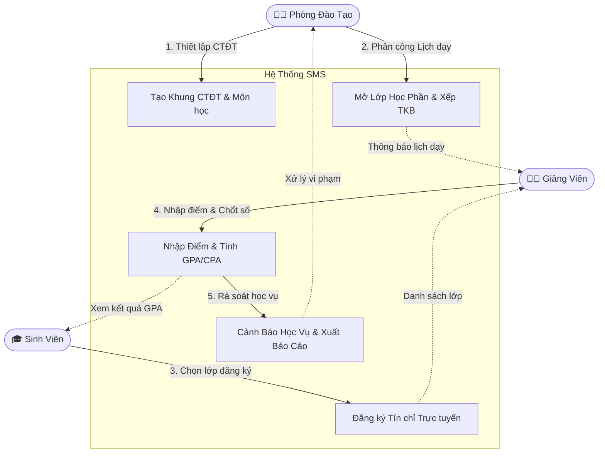

<div align="center">
  
  <h1>Hệ Thống Quản Lý Đào Tạo & Sinh Viên</h1>
  <p><strong>Student Management System (SMS / DoAnChuyenNganh)</strong></p>
  <p><em>Giải pháp quản trị đại học theo học chế tín chỉ: lập khung đào tạo, xếp thời khóa biểu, đăng ký môn học, tính GPA/CPA tự động và cảnh báo học vụ.</em></p>

  
  
  
  
  
</div>

---

## 📑 Mục lục
1. [Dự án giải quyết vấn đề gì](#1-dự-án-giải-quyết-vấn-đề-gì)
2. [Tính năng theo phân hệ](#2-tính-năng-theo-phân-hệ)
3. [Sơ đồ vận hành](#3-sơ-đồ-vận-hành)
4. [Cấu trúc thư mục](#4-cấu-trúc-thư-mục)
5. [Tìm nhanh — cần gì mở đâu](#5-tìm-nhanh--cần-gì-mở-đâu)
6. [Khởi chạy & triển khai](#6-khởi-chạy--triển-khai)
7. [Nâng cấp hạ tầng an toàn](#7-nâng-cấp-hạ-tầng-an-toàn)
8. [Tài khoản dùng thử](#8-tài-khoản-dùng-thử)
9. [Tối ưu hiệu năng](#9-tối-ưu-hiệu-năng)
10. [Kiểm thử & chất lượng](#10-kiểm-thử--chất-lượng)

---

## 1. Dự án giải quyết vấn đề gì?

Ở đại học, số lượng sinh viên, học phần và phòng học rất lớn. Vận hành thủ công dễ xung đột lịch dạy, sai tính học bổng và chậm cảnh báo học vụ. Hệ thống SMS xử lý trọn gói:

- **Phòng Đào Tạo:** xây khung CTĐT 5 khối kiến thức, mở lớp học phần, xếp TKB, quản lý sĩ số, xuất báo cáo điểm/danh sách lớp ra Excel.
- **Giảng viên:** xem lịch dạy tuần, nhập điểm trực tuyến hoặc import Excel (CC1 5% · CC2 5% · GK 30% · CK 60%), khóa bảng điểm có ân hạn 7 ngày.
- **Sinh viên:** đăng ký tín chỉ (phát hiện trùng lịch, kiểm tra tiên quyết, giới hạn 10–24 TC), tra TKB tuần, xem lộ trình CTĐT và bảng điểm GPA/CPA.

---

## 2. Tính năng theo phân hệ

**🧑‍💼 Phòng Đào Tạo (Admin)**
- Danh mục đào tạo: Khoa, Ngành, Khóa, Lớp hành chính.
- Khung CTĐT: 5 khối kiến thức, môn tiên quyết chống chu trình.
- Lớp học phần & TKB: mở lớp, gán giảng viên, xếp phòng, theo dõi tỷ lệ lấp đầy.
- Cảnh báo học vụ tự động: GPA kỳ < 1.0 hoặc CPA < 2.0 → cảnh báo mức 1/2 hoặc buộc thôi học.
- Duyệt cấp lại mật khẩu & phúc khảo điểm.

**👨‍🏫 Giảng viên**
- Thời khóa biểu giảng dạy theo tuần.
- Nhập điểm trực tuyến hoặc import Excel; tự quy đổi thang 10 → thang 4 → điểm chữ.
- Khóa bảng điểm (BR-07) với cửa sổ ân hạn 7 ngày.

**🎓 Sinh viên**
- Cổng đăng ký tín chỉ: kiểm tiên quyết, giới hạn tín chỉ, ngăn trùng lịch.
- TKB cá nhân theo ma trận thứ/tiết.
- Bảng điểm GPA/CPA (chọn điểm cao nhất cho môn học lại) & lộ trình tốt nghiệp.
- Phúc khảo điểm trực tuyến theo từng thành phần.

---

## 3. Sơ đồ vận hành



---

## 4. Cấu trúc thư mục

Ba tầng ứng dụng (`backend` / `frontend` / `database`) giữ đúng bố cục chuẩn của Maven, Vite và Docker — **không đổi vị trí** để nâng cấp hạ tầng không vỡ đường dẫn build. Phần còn lại là tài liệu, kiểm thử và báo cáo.

```
DoAnChuyenNganh/
├── backend/                      # 🧠 Spring Boot 3.5.6 · Java 23 (Maven)
│   ├── src/main/java/com/sms/    #   config · controller · dto · entity · repository · service · security · exception
│   ├── src/main/resources/       #   application.properties, static, templates
│   ├── src/test/java/com/sms/    #   JUnit 5 + Mockito
│   ├── Dockerfile · pom.xml
│
├── frontend/                     # 💻 React 19 · Vite 8 (npm)
│   ├── src/components/           #   common/ (Skeleton, ErrorBoundary…) · layout/ (Header, Sidebar)
│   ├── src/pages/                #   admin/ · lecturer/ · student/ · auth/ · shared/
│   ├── src/services/             #   api.js (axios) · dataService.js
│   ├── src/store/                #   Zustand: authStore · themeStore
│   ├── src/utils/
│   ├── Dockerfile · nginx.conf · vite.config.js · package.json
│
├── database/                     # 🗄️ MySQL 8.0
│   ├── schema.sql                #   DDL gốc — docker-compose nạp khi khởi tạo
│   ├── seed.sql                  #   dữ liệu mẫu — nạp khi khởi tạo
│   ├── migrations/               #   các bản nâng cấp CSDL
│   └── README.md                 #   Views, Indexes, SQL recipes
│
├── docs/                         # 📚 Hồ sơ nghiệp vụ & đặc tả (nguồn tài liệu chính)
│   ├── 01..08_*.md               #   kiến trúc, use case, business rules, ERD, CTĐT, triển khai
│   ├── TAI_LIEU_TONG_QUAN_DU_AN.md
│   └── README.md                 #   mục lục tài liệu
│
├── tests/                        # 🧪 Kiểm thử Node: e2e/ · performance/ · integration/ · utils/ · reports/ · results/
├── test-results/                 # 📸 Bằng chứng: screenshots/ · devtools_screenshots/ · audit/
├── reports/                      # 📊 Báo cáo chính thức: progress/ (.docx) · code_review/ (.md)
├── scripts/                      # 🛠️ Tiện ích vận hành: capture_screenshots.mjs · convert_to_jpg.ps1
│
├── docker-compose.yml            # ⚙️ Hạ tầng: MySQL + Backend + Frontend
├── docker-compose.override.yml   #   override cục bộ (chứa secret — gitignored)
├── start_dev.bat                 # ⚡ Chạy 1-click trên Windows (dò MySQL, bật BE+FE)
├── run_tests.bat                 # 🧪 Menu chạy nhanh các bộ test
├── share_internet.bat            # 🌐 Mở Cloudflare Tunnel để demo (gitignored)
├── DEPLOY_GUIDE.md               #   bản rút gọn tại gốc — bản đầy đủ: docs/08
└── README.md                     #   tài liệu này
```

> **Tooling cục bộ (gitignored, không có trong clone):** `drawio/` — sơ đồ UML nguồn + script Python sinh sơ đồ; `report/` — trình sinh báo cáo Word (`node report/build_report.js`). Là công cụ phụ trợ, không thuộc mã nguồn bàn giao.

---

## 5. Tìm nhanh — cần gì mở đâu

| Bạn muốn… | Mở… |
| :--- | :--- |
| Chạy nhanh trên Windows | `start_dev.bat` |
| Chỉnh hạ tầng / cổng / service | `docker-compose.yml` |
| Đổi bảng, index, dữ liệu mẫu | `database/schema.sql` · `database/seed.sql` · `database/migrations/` |
| Thêm/sửa API | `backend/src/main/java/com/sms/controller/` → `…/service/` |
| Thêm/sửa màn hình | `frontend/src/pages/<vai-trò>/` |
| Gọi API từ frontend | `frontend/src/services/dataService.js` |
| Tài liệu nghiệp vụ / đặc tả | `docs/` (bắt đầu từ `docs/README.md`) |
| Báo cáo & kiểm toán | `reports/` |
| Chạy test | `run_tests.bat` · `tests/README.md` |

---

## 6. Khởi chạy & triển khai

**Cách 1 — 1-click trên Windows (nhanh nhất khi dev)**
Nhấp đúp `start_dev.bat`. Script tự dò MySQL (cổng 3306 hoặc 3308 Docker), bật Backend (8080) và Frontend Vite (5173). Mở `http://localhost:5173`.

**Cách 2 — trọn gói qua Docker**
```bash
docker compose up --build -d
```
Mở `http://localhost:5173`. (Chi tiết: [`docs/08`](docs/08_deployment_and_operations_guide.md).)

**Cách 3 — demo ra Internet không cần mở cổng router**
Nhấp đúp `share_internet.bat` → chọn `1` (Cloudflare Tunnel) → nhận link HTTPS công khai.

---

## 7. Nâng cấp hạ tầng an toàn

Phiên bản được ghim ở các điểm cố định — đổi đúng chỗ, build lại là xong:

- **Java / Spring Boot:** `backend/pom.xml` (`<java.version>`, `<parent>`).
- **Node / React / Vite:** `frontend/package.json`.
- **MySQL:** tag ảnh trong `docker-compose.yml` (`image: mysql:8.0`).

> ⚠️ Backend chạy trong Docker build jar **bên trong image**. Sau khi sửa code hoặc đổi version, phải build lại image, nếu không container vẫn chạy jar cũ:
> ```bash
> docker compose up -d --build backend
> ```

---

## 8. Tài khoản dùng thử

Mật khẩu mặc định: `123456`.

| Vai trò | Đăng nhập | Quyền chính |
| :--- | :--- | :--- |
| **Admin (Phòng Đào Tạo)** | `admin` | Cấu hình CTĐT, mở lớp, xếp TKB, duyệt mật khẩu, cảnh báo học vụ |
| **Giảng viên** | `1000001` | TKB cá nhân, nhập/khóa điểm, xuất/nhập Excel |
| **Sinh viên** | `2500001` | Đăng ký tín chỉ, TKB tuần, bảng điểm GPA/CPA, phúc khảo |

---

## 9. Tối ưu hiệu năng

1. **Khử N+1 bằng Database Views:** [`v_student_transcript`](database/README.md) nạp cả bảng điểm trong 1 truy vấn; [`v_student_gpa`](database/README.md) tính GPA/CPA không quét toàn bảng.
2. **Composite indexes:** `idx_enrollments_student_status` (tra TKB & đếm tín chỉ `O(log N)`), `idx_enrollments_section_status` (đếm sĩ số không lock table), `idx_sections_semester_status` (lọc lớp khi mở cổng), `idx_schedules_section_dates` (phát hiện trùng lịch).
3. Chi tiết: [`database/README.md`](database/README.md).

---

## 10. Kiểm thử & chất lượng

- **Backend:** JUnit 5 + Mockito — `cd backend && mvn test`.
- **Frontend:** Vitest — `cd frontend && npm test`.
- **E2E hệ thống:** `tests/e2e/comprehensive_system_test.js` (bao gồm SQLi/XSS/RBAC & business rules).
- **Tải & stress:** `tests/performance/overload_stress_test.js` (HikariCP, Tomcat thread pool).
- **Báo cáo kiểm định:** [`reports/code_review/code_review_report.md`](reports/code_review/code_review_report.md).

Hướng dẫn đầy đủ: [`tests/README.md`](tests/README.md).

---
*Phát triển bởi DevMarkie — 2026*


