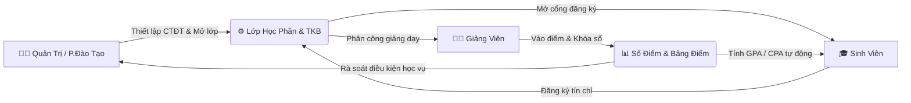

<div align="center">
  
  <h1>Hệ Thống Quản Lý Đào Tạo & Sinh Viên (SMS)</h1>
  <p><strong>Student Management System — Đại học theo học chế tín chỉ</strong></p>
  <p>Giải pháp toàn diện quản lý khung đào tạo, xếp thời khóa biểu, đăng ký tín chỉ trực tuyến, tính điểm GPA/CPA tự động và cảnh báo học vụ.</p>

  
  
  
  
  
  
</div>

---

## 📌 Tổng quan dự án

Hệ thống **SMS (Student Management System)** chuẩn hóa và tự động hóa quy trình nghiệp vụ đào tạo đại học theo học chế tín chỉ, loại bỏ thao tác thủ công, chống xung đột lịch học/phòng học và đảm bảo an toàn dữ liệu học vụ:

* **🧑‍💼 Phòng Đào Tạo (Admin):** Quản lý danh mục (Khoa, Ngành, Khóa), thiết lập Khung CTĐT 5 khối kiến thức, mở lớp học phần, xếp TKB, rà soát cảnh báo học vụ tự động và xét tốt nghiệp.
* **👨‍🏫 Giảng Viên:** Theo dõi lịch giảng dạy tuần, quản lý điểm sinh viên (nhập trực tiếp hoặc import Excel theo công thức CC1 5% · CC2 5% · GK 30% · CK 60%), khóa sổ điểm với cơ chế ân hạn 7 ngày.
* **🎓 Sinh Viên:** Cổng đăng ký tín chỉ thông minh (ràng buộc 12–24 TC, tự động chặn trùng lịch và kiểm tra tiên quyết), tra cứu TKB tuần, theo dõi GPA/CPA thời gian thực và nộp đơn phúc khảo.

---

## 🛠️ Công nghệ sử dụng

| Tầng | Công nghệ & Thư viện | Vai trò |
| :--- | :--- | :--- |
| **Backend** | Java 23, Spring Boot 3.5.6, Spring Security, JWT, JPA/Hibernate | REST API bảo mật, xử lý nghiệp vụ, kiểm tra ràng buộc logic |
| **Frontend** | React 19, Vite, Tailwind CSS, Zustand, Native Fetch Client (Zero Dep), Lucide Icons | Giao diện SPA hiện đại, tối ưu UX, hỗ trợ Dark/Light mode |
| **Database** | MySQL 8.0, Database Views (`v_student_transcript`, `v_student_gpa`) | Lưu trữ toàn vẹn quan hệ, khử truy vấn N+1, tối ưu Composite Index |
| **DevOps & QA**| Docker, Docker Compose, JUnit 5, Mockito, Vitest | Container hóa môi trường, kiểm thử tự động đa tầng |

---

## 🚀 Tính năng nổi bật theo phân hệ



### 1. Phân hệ Quản trị & Đào tạo (Admin)
- **Quản lý CTĐT chuẩn:** Cấu trúc 5 khối kiến thức; kiểm soát môn tiên quyết, song hành và tương đương; chống chu trình phụ thuộc.
- **Tổ chức lớp học phần & TKB:** Phân bổ giảng viên, phòng học, ca học; phát hiện và ngăn chặn va chạm tài nguyên thời gian thực.
- **Xử lý học vụ tự động:** Rà soát GPA/CPA kỳ để kích hoạt Cảnh báo học vụ (Mức 1, Mức 2, Buộc thôi học) theo quy chế đào tạo.
- **Bảo mật & Quản trị tài khoản:** Duyệt yêu cầu cấp lại mật khẩu, phân quyền RBAC đa cấp.

### 2. Phân hệ Giảng viên (Lecturer)
- **Quản lý lớp giảng dạy:** Danh sách sinh viên theo lớp học phần, điểm danh và xuất danh sách lớp ra Excel.
- **Sổ điểm điện tử:** Hỗ trợ nhập trực tiếp hoặc Import từ file Excel; tự động tính tổng kết và quy đổi thang điểm (Thang 10 ➔ Thang 4 ➔ Điểm chữ).
- **Quy chế khóa điểm (BR-07):** Khóa sổ điểm bảo vệ tính toàn vẹn dữ liệu, hỗ trợ mở khóa chỉnh sửa trong cửa sổ ân hạn 7 ngày.

### 3. Phân hệ Sinh viên (Student)
- **Cổng đăng ký tín chỉ:** Kiểm tra tức thời điều kiện tiên quyết, giới hạn tín chỉ (10–24 TC), ngăn chặn 100% trùng lịch học.
- **Thời khóa biểu trực quan:** Ma trận lịch học theo tuần dạng Grid, hỗ trợ lọc theo học kỳ.
- **Tra cứu kết quả học tập:** Bảng điểm chi tiết theo kỳ, tự động lấy điểm cao nhất khi học cải thiện, tiến độ tích lũy CTĐT.
- **Bảo mật cá nhân:** Đổi mật khẩu có thanh đo độ mạnh (Password Strength Meter), bắt buộc đổi mật khẩu khi cấp mới và mã hóa an toàn BCrypt.

---

## 📁 Cấu trúc dự án

```text
DoAnChuyenNganh/
├── backend/               # Máy chủ Spring Boot 3 (REST API, Spring Security, Business Logic)
│   ├── src/main/java/     #   Controllers, Services, Repositories, Entities, DTOs, Cross-cutting Rules
│   └── src/test/java/     #   288 Unit Tests tự động JUnit 5 + Mockito (100% Pass)
├── frontend/              # Giao diện người dùng React 19 + Vite SPA (Apple & Aurora Glassmorphism)
│   ├── src/components/    #   Layouts, Navigation, Modals, Shared UI Components
│   ├── src/pages/         #   Màn hình theo vai trò (Admin, Lecturer, Student, Auth, Dashboard)
│   ├── src/services/      #   Data Services, Native Fetch / Axios Client & Zustand Stores
│   └── src/tests/         #   80 Unit & Component Tests tự động Vitest (100% Pass)
├── database/              # Cơ sở dữ liệu MySQL 8.0 (InnoDB, UTF8MB4 Unicode)
│   ├── schema.sql         #   DDL Canonical khởi tạo toàn bộ bảng, Views, Composite Indexes
│   ├── seed.sql           #   Dữ liệu mẫu thực nghiệm chuẩn (28 ngành, 8 khoa, 3.000 sinh viên, TKB, điểm, hóa đơn)
│   ├── migrations/        #   27 bản vá nâng cấp cấu trúc CSDL theo từng chặng
│   └── README.md          #   Cẩm nang thiết kế CSDL, chiến lược Indexing và sổ tay Migration
├── docs/                  # Hệ thống tài liệu phân tích thiết kế, đặc tả nghiệp vụ & kiểm thử
│   ├── 01–08_*.md         #   Kiến trúc, Danh mục Use Case, Quy tắc BR, ERD, CTĐT, Triển khai
│   ├── 09–11_*.md         #   Đặc tả kịch bản kiểm thử, Luồng nghiệp vụ hệ thống, Yêu cầu NFR ISO 25010
│   └── README.md          #   Mục lục và chỉ dẫn toàn bộ bộ hồ sơ tài liệu
├── drawio/                # Hệ thống sơ đồ phân tích thiết kế chuẩn UML 2.5
│   ├── *.drawio           #   Trọn bộ sơ đồ Use Case, Sequence (18 tabs), Activity (18 tabs), BCE (18 tabs)
│   ├── scripts/           #   Công cụ Python tự động biên dịch và cập nhật sơ đồ DrawIO
│   └── README.md          #   Danh mục và hướng dẫn khai thác toàn bộ file sơ đồ
├── design-system/         # Hệ thống thiết kế giao diện Phenikaa SMS Design System
│   ├── MASTER.md          #   Quy chuẩn Design tokens, bảng màu Apple Glassmorphism, typography
│   ├── pages/             #   Cấu hình bố cục chuyên biệt cho từng màn hình (dashboard...)
│   └── prototypes/        #   Bản mẫu giao diện HTML tĩnh thực nghiệm (demo-ui-simple.html)
├── report/                # Bộ công cụ tự động sinh báo cáo Word đồ án tốt nghiệp
│   ├── build_report.js    #   Kịch bản Node.js tổng hợp nội dung và xuất file Word .docx
│   ├── BaoCao_DoAn_*.docx #   Báo cáo đồ án tốt nghiệp hoàn chỉnh theo quy cách Đại học Phenikaa
│   └── README.md          #   Hướng dẫn vận hành công cụ sinh báo cáo
├── scripts/               # Bộ công cụ & tiện ích vận hành dữ liệu đồ án
│   ├── *.py               #   Kịch bản nạp & chuẩn hóa CSDL, tạo file Excel mẫu chấm điểm/phòng thi
│   ├── *.mjs / *.ps1      #   Tự động hóa chụp màn hình hệ thống và tối ưu ảnh cho báo cáo
│   └── README.md          #   Danh mục mô tả chi tiết toàn bộ các kịch bản
├── tests/                 # Bộ kiểm thử tự động đa tầng (Automated Test Suite)
│   ├── smoke/             #   Kiểm thử khói (Sanity Gate - Fail Fast < 30s)
│   ├── e2e/               #   Kiểm thử hồi quy toàn diện 65+ Cases (Nghiệp vụ, RBAC, Học phí, Điểm...)
│   ├── integration/       #   Kiểm thử tích hợp (Điểm danh PIN, Luồng import Excel)
│   ├── performance/       #   Kiểm thử áp lực & tải đồng thời (600 SV Concurrency, Stress to Death)
│   ├── security/          #   Kiểm thử an toàn bảo mật (CSRF, Injection, Brute-force)
│   ├── reports/           #   Báo cáo kiểm toán chất lượng và kết quả đo tải thực nghiệm
│   └── README.md          #   Cẩm nang hướng dẫn thực thi toàn bộ kịch bản kiểm thử
├── docker-compose.yml     # Cấu hình container trọn gói (MySQL, Redis, 3 Backend Replicas, Nginx, Web)
├── start_dev.bat          # Script 1-Click khởi chạy môi trường phát triển cục bộ (Windows)
├── run_tests.bat          # Script 1-Click menu thực thi bộ kiểm thử tự động
├── share_internet.bat     # Script 1-Click tạo đường hầm HTTPS chia sẻ hệ thống ra Internet
└── DEPLOY_GUIDE.md        # Cẩm nang hướng dẫn triển khai máy chủ và vận hành production
```

---

## ⚡ Cài đặt & Khởi chạy nhanh

### Yêu cầu môi trường
* **Java 23 JDK** & **Node.js 20+**
* **MySQL 8.0** (hoặc sử dụng qua Docker)

---

### Cách 1: Chạy 1-Click trên Windows (Khuyên dùng khi Dev)
Khởi chạy nhanh qua script tự động:
```cmd
start_dev.bat
```
> Script tự động kiểm tra cổng MySQL, đồng thời khởi chạy Backend (Spring Boot: `http://localhost:8080`) và Frontend (Vite: `http://localhost:5173`).

---

### Cách 2: Triển khai trọn gói qua Docker Compose
Khởi chạy toàn bộ hệ thống gồm MySQL, Backend và Frontend trong container:
```bash
docker compose up --build -d
```
* **Frontend:** `http://localhost:5173`
* **Backend API:** `http://localhost:8080/api`
* **Swagger/OpenAPI:** `http://localhost:8080/swagger-ui.html`

---

## 🔑 Tài khoản trải nghiệm

Mật khẩu mặc định cho toàn bộ tài khoản thử nghiệm: **`123456`**

### 1. Quản trị viên & Giảng viên
| Phân hệ | Tên đăng nhập | Vai trò & Đơn vị | Ghi chú |
| :--- | :--- | :--- | :--- |
| **Phòng Đào Tạo** | `admin` | Quản trị hệ thống, P.Đào tạo | Toàn quyền CTĐT 9 ngành, mở lớp, TKB, xét tốt nghiệp |
| **Giảng Viên CNTT** | `gv_gv001` | PGS.TS. Trần Văn Long | Trưởng bộ môn CNPM, Khoa CNTT |
| **Giảng Viên QTKD** | `gv_gv006` | PGS.TS. Nguyễn Mạnh Cường | Khoa Kinh tế & QTKD |
| **Giảng Viên ĐTVT** | `gv_gv011` | TS. Ngô Quang Đăng | Khoa KT Điện - Điện tử & Tự động hóa |
| *(45 Giảng viên)* | `gv_gv001` .. `gv_gv045` | 5 Giảng viên / Khoa × 9 Khoa | Quản lý sổ điểm, điểm danh, chốt điểm |

### 2. Sinh viên đại diện 9 Ngành Đào tạo (Toàn bộ 4 Khóa K16 – K19)
| Ngành đào tạo | Mã tài khoản Demo | Khóa / Năm học | Tiến độ CTĐT | Tình trạng học vụ |
| :--- | :--- | :--- | :--- | :--- |
| **Công nghệ thông tin** | `sv_cntt_k16` | K16 (Năm 4 - Kỳ 7) | 120/130 TC (76.2% hoàn thành, 21 TC đang học) | Chuẩn bị làm Đồ án tốt nghiệp |
| **Quản trị kinh doanh** | `sv_qtkd_k17` | K17 (Năm 3 - Kỳ 5) | 81/133 TC (48.1% hoàn thành, 17 TC đang học) | Tích lũy chuyên ngành CSNG & CN |
| **Kỹ thuật Điện tử - Viễn thông** | `sv_dtvt_k18` | K18 (Năm 2 - Kỳ 3) | 48/132 TC (25.0% hoàn thành, 15 TC đang học) | Tích lũy cơ sở ngành & mạch số |
| **Kỹ thuật Cơ khí & Ô tô** | `sv_ck_k16` | K16 (Năm 4 - Kỳ 7) | 122/132 TC (78.8% hoàn thành, 18 TC đang học) | Đồ án chuyên ngành Cơ điện tử |
| **Ngôn ngữ Anh** | `sv_nn_k17` | K17 (Năm 3 - Kỳ 5) | 84/133 TC (50.4% hoàn thành, 17 TC đang học) | Biên phiên dịch & TA Thương mại |
| **Kế toán - Kiểm toán** | `sv_kt_k18` | K18 (Năm 2 - Kỳ 3) | 50/133 TC (24.8% hoàn thành, 17 TC đang học) | Kế toán tài chính & Thuế |
| **Luật kinh tế** | `sv_luat_k16` | K16 (Năm 4 - Kỳ 7) | 122/134 TC (73.1% hoàn thành, 24 TC đang học) | Luật cạnh tranh & Hợp đồng quốc tế |
| **Kỹ thuật Xây dựng** | `sv_xd_k17` | K17 (Năm 3 - Kỳ 5) | 85/131 TC (51.9% hoàn thành, 17 TC đang học) | Kết cấu bê tông & BIM |
| **Dược học** | `sv_yd_k19` | K19 (Năm 1 - Kỳ 1) | 17/130 TC (0% hoàn thành, 17 TC đang học) | Sinh viên tân khóa năm nhất |
| *(Toàn bộ 540 Sinh viên)* | `sv_<ngành>_<khóa>` hoặc mã SV (`23010001`..) | 36 Lớp sinh hoạt | Đầy đủ dữ liệu điểm, học phí, rèn luyện |

---

## 🧪 Kiểm thử & Đảm bảo chất lượng

Dự án áp dụng quy trình kiểm thử đa tầng đảm bảo tính ổn định và độ tin cậy cao:

```bash
# 1. Kiểm thử Backend (Unit & Integration tests với JUnit 5/Mockito)
cd backend && mvn test

# 2. Kiểm thử Frontend (Component & Unit tests với Vitest)
cd frontend && npm test

# 3. Kịch bản kiểm thử tự động E2E & Hiệu năng chịu tải
node tests/e2e/system_e2e_test.js
node tests/performance/enrollment_load_test.js
```

---

## 📚 Tài liệu chi tiết

Tất cả đặc tả kiến trúc, nghiệp vụ và hướng dẫn vận hành chi tiết được lưu trữ tại thư mục [`docs/`](docs/):
* [docs/01_system_architecture_and_diagrams.md](docs/01_system_architecture_and_diagrams.md) — Kiến trúc hệ thống & Sơ đồ luồng
* [docs/02_use_case_catalog.md](docs/02_use_case_catalog.md) — Danh mục Use Case
* [docs/04_business_rules.md](docs/04_business_rules.md) — Quy tắc nghiệp vụ (Business Rules)
* [docs/05_database_erd.md](docs/05_database_erd.md) — Thiết kế lược đồ CSDL & ERD
* [docs/08_deployment_and_operations_guide.md](docs/08_deployment_and_operations_guide.md) — Hướng dẫn triển khai & Vận hành
* [docs/09_comprehensive_test_case_specification.md](docs/09_comprehensive_test_case_specification.md) — Đặc tả kịch bản kiểm thử toàn diện
* [docs/10_system_processing_workflows.md](docs/10_system_processing_workflows.md) — Luồng xử lý nghiệp vụ hệ thống
* [docs/11_nfr_and_technical_challenges.md](docs/11_nfr_and_technical_challenges.md) — Yêu cầu phi chức năng (NFR) & Thách thức kỹ thuật

---
<div align="center">
  <sub>Đồ Án Chuyên Ngành — Trường Đại học Phenikaa · 2026</sub>
</div>
