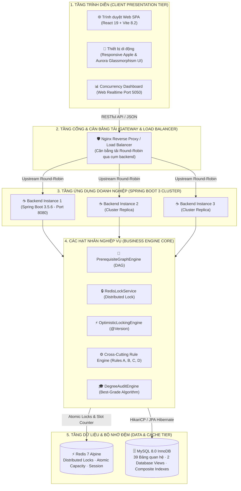
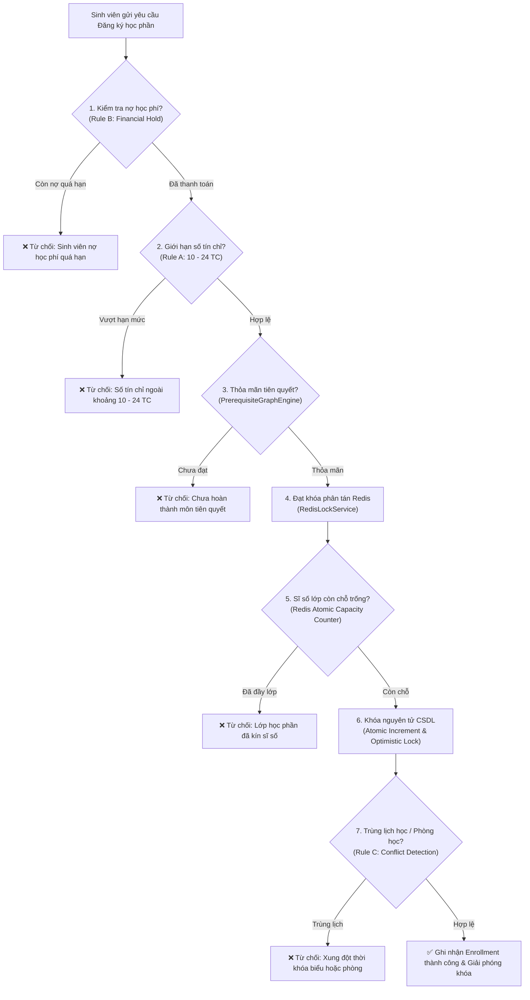
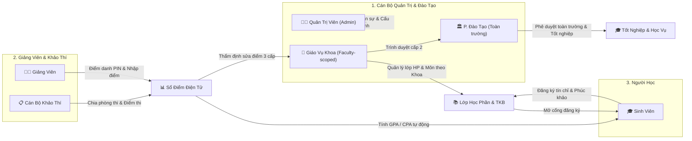

<div align="center">
  
  <h1>Hệ Thống Quản Lý Đào Tạo & Sinh Viên (SMS / UAMS)</h1>
  <p><strong>University Academic & Student Management System — Đại học theo học chế tín chỉ</strong></p>
  <p>Giải pháp toàn diện quản trị chương trình đào tạo, xếp thời khóa biểu ma trận, đăng ký tín chỉ chịu tải cao với Redis Distributed Lock, sổ điểm điện tử 4 thành phần khóa sổ 7 ngày, phân quyền Giáo vụ Khoa linh hoạt, phúc khảo điểm thi trực tuyến và tự động xét tốt nghiệp Thông tư 08.</p>

[](backend/)
[](backend/)
[](frontend/)
[](frontend/)
[](frontend/)
[-4479A1?style=flat-square&logo=mysql&logoColor=white)](database/)
[](docker-compose.yml)
[](drawio/)
[](tests/)

</div>

---

## 📑 Mục lục

1. [Tổng quan hệ thống & Điểm nhấn cốt lõi](#-tổng-quan-hệ-thống--điểm-nhấn-cốt-lõi)
2. [Kiến trúc công nghệ & Mô hình phân tầng](#-kiến-trúc-công-nghệ--mô-hình-phân-tầng)
3. [Các hạt nhân nghiệp vụ chuyên sâu (Business Engines)](#-các-hạt-nhân-nghiệp-vụ-chuyên-sâu-business-engines)
4. [Mô hình 6 Phân hệ & Ma trận phân quyền (RBAC)](#-mô-hình-6-phân-hệ--ma-trận-phân-quyền-rbac)
5. [Cấu trúc mã nguồn & Thư mục dự án](#-cấu-trúc-mã-nguồn--thư-mục-dự-án)
6. [Hệ thống 82 Sơ đồ UML Draw.io Suite](#-hệ-thống-82-sơ-đồ-uml-drawio-suite)
7. [Hướng dẫn cài đặt & Khởi chạy nhanh](#-hướng-dẫn-cài-đặt--khởi-chạy-nhanh)
8. [Tài khoản kiểm thử nghiệm thu (Credentials)](#-tài-khoản-kiểm-thử-nghiệm-thu-credentials)
9. [Bộ kiểm thử tự động & Đảm bảo chất lượng (QA Center)](#-bộ-kiểm-thử-tự-động--đảm-bảo-chất-lượng-qa-center)
10. [Bộ hồ sơ tài liệu đặc tả](#-bộ-hồ-sơ-tài-liệu-đặc-tả)

---

## 📌 Tổng quan hệ thống & Điểm nhấn cốt lõi

Hệ thống **SMS (Student Management System / UAMS)** được nghiên cứu và xây dựng nhằm chuẩn hóa và tự động hóa toàn diện quy trình quản trị đào tạo đại học theo học chế tín chỉ (tuân thủ **Thông tư 08/2021/TT-BGDĐT** của Bộ Giáo dục & Đào tạo): từ quản trị danh mục học thuật, tổ chức học kỳ, mở lớp học phần, xếp thời khóa biểu và ca thi, cổng đăng ký tín chỉ chịu tải cao, sổ điểm điện tử 4 thành phần khóa sổ 7 ngày, tiếp nhận phúc khảo trực tuyến, quản trị tài chính học phí đến xét cảnh báo học vụ và tự động công nhận tốt nghiệp.

### 🌟 7 Điểm sáng công nghệ & Nghiệp vụ nổi bật:

1. **Khung CTĐT chuẩn 5 khối kiến thức & Đồ thị tiên quyết DAG:**  
   Mô hình hóa chương trình đào tạo thành đồ thị có hướng không chu trình (Directed Acyclic Graph - DAG). Giải thuật duyệt đồ thị kiểm soát chặt chẽ điều kiện tiên quyết, học trước, song hành, tương đương và loại trừ triệt để chu trình phụ thuộc vòng kín (Circular Dependency).
2. **Đăng ký tín chỉ chịu tải cực hạn (High-Concurrency Enrollment Engine):**  
   Kết hợp 3 tầng phòng thủ: Khóa phân tán Redis (`RedisLockService`), bộ đếm nguyên tử (`Atomic Capacity Counter`) trên Redis cache và câu lệnh SQL nguyên tử / khóa bi quan (`PESSIMISTIC_WRITE`). Cam kết dữ liệu toàn vẹn tuyệt đối khi **hàng trăm sinh viên đồng thời tranh chấp ghi danh trong 1 giây**, triệt tiêu 100% hiện tượng vượt quá sĩ số (`enrolled <= max_students`).
3. **Khóa lạc quan chống xung đột dữ liệu học vụ (`@Version` Optimistic Locking):**  
   Áp dụng cơ chế `@Version` trên các thực thể cốt lõi (`CourseSection`, `Subject`, `Schedule`) kết hợp bắt lỗi `OptimisticLockException`. Ngăn chặn triệt để hiện tượng ghi đè mất mát dữ liệu (Lost Update) khi nhiều cán bộ đào tạo cùng điều chỉnh sĩ số hoặc lịch học cùng thời điểm.
4. **Phân quyền Giáo vụ Khoa chuyên trách (Faculty-Scoped RBAC):**  
   Tách bạch vai trò Cán bộ Đào tạo cấp Trường (`ACADEMIC_AFFAIRS` - toàn trường) và Giáo vụ Khoa (`ACADEMIC_STAFF` - gắn với `department_id`). Giáo vụ Khoa chỉ có quyền mở lớp, quản lý môn học, lớp sinh hoạt và duyệt sửa điểm thuộc phạm vi sinh viên/giảng viên của Khoa mình phụ trách.
5. **Sổ điểm điện tử 4 thành phần & Quy trình Đính chính điểm 3 cấp:**  
   Nhập điểm trực tiếp hoặc Import từ tệp Excel chuẩn tỷ lệ: **`CC1 5% · CC2 5% · GK 30% · CK 60%`**. Tự động tổng kết và quy đổi thang điểm (Hệ 10 ➔ Hệ 4 ➔ Điểm chữ). Sổ điểm tự động khóa bảo mật sau cửa sổ ân hạn 7 ngày. Sau 7 ngày, mọi điều chỉnh điểm bắt buộc thông qua quy trình phê duyệt 3 cấp (Giảng viên ➜ Khoa ➜ P. Đào tạo) và lưu vết bất biến trong nhật ký kiểm toán (`grade_audit_logs`).
6. **Tiếp nhận & Xử lý Phúc khảo điểm thi trực tuyến (`GradeAppealsPage`):**  
   Sinh viên chủ động nộp đơn phúc khảo trực tiếp trên cổng cá nhân; Cán bộ Khảo thí thẩm định đơn, chấm lại bài thi, cập nhật điểm đính chính và tự động đồng bộ sang bảng điểm học kỳ của sinh viên.
7. **Động cơ xét tốt nghiệp tự động (Degree Audit Engine) & Thuật toán "Best-Grade":**  
   Tự động rà soát tiến độ hoàn thành 5 khối kiến thức, tổng số tín chỉ tích lũy (130–135 TC), điểm trung bình tích lũy CPA ≥ 2.00, điểm rèn luyện và chứng chỉ chuẩn đầu ra. Thuật toán **Best-Grade** tự động nhận diện các môn học lại/học cải thiện và chỉ lấy điểm cao nhất đưa vào CPA tích lũy.

---

## 🛠️ Kiến trúc công nghệ & Mô hình phân tầng

Hệ thống được thiết kế theo mô hình **3-Tier Layered Architecture** chuẩn mực doanh nghiệp, hỗ trợ triển khai đơn máy nhẹ nhàng (< 600MB RAM) hoặc mở rộng cụm đa máy phục vụ cân bằng tải chịu tải cao:



### Bảng tổng hợp công nghệ sử dụng:

| Tầng kiến trúc | Công nghệ sử dụng | Phiên bản | Vai trò & Đặc tính kỹ thuật nổi bật |
| :--- | :--- | :--- | :--- |
| **Frontend SPA** | React, Vite, Tailwind CSS, Zustand | React 19.2, Vite 8.2, Tailwind 3.4, Zustand 5 | Giao diện Apple Glassmorphism & Aurora UI, Dark/Light Mode, Native Fetch Client (Zero External Axios Dep). |
| **Backend API** | Java LTS, Spring Boot, Spring Security | Java 23, Spring Boot 3.5.6, JWT 0.12.6 | 33 REST Controllers, 20+ Services, xác thực 2 lớp Access/Refresh Token, phân quyền RBAC 6 vai trò. |
| **High Concurrency** | Redis, Lettuce Pool, Commons Pool 2 | Redis 7-alpine, Lettuce 6.x | Bộ nhớ đệm phân tán, cơ chế khóa phân tán Redis Lock cho ghi danh môn học, chống quá tải sĩ số. |
| **Cơ sở dữ liệu** | MySQL Server, InnoDB Engine, HikariCP | MySQL 8.0, HikariCP 5.1 | 39 bảng quan hệ chuẩn 3NF, 2 Database Views tối ưu N+1, `utf8mb4_unicode_ci` hỗ trợ tiếng Việt chuẩn xác. |
| **Điều phối tải** | Nginx Reverse Proxy & HTTP Load Balancing | Nginx 1.25 Alpine | Điều hướng tải Round-Robin qua cụm 3 Backend Replicas, phục vụ tài nguyên tĩnh SPA. |
| **Bộ kiểm thử QA** | JUnit 5, Mockito, Vitest, Node.js E2E | JUnit 5, Mockito 5, Vitest 5.0 | 297 Backend tests, 89 Frontend tests, 65+ E2E tests, bài test 600 SV đồng thời, kiểm tra lỗ hổng OWASP. |

---

## ⚙️ Các hạt nhân nghiệp vụ chuyên sâu (Business Engines)

### 1. Hạt nhân Đồ thị môn học tiên quyết (Prerequisite Graph Engine - DAG)
* Xây dựng danh mục học phần thành đồ thị có hướng không chu trình (**DAG**).
* Tự động phân tích các loại ràng buộc: môn học tiên quyết (bắt buộc qua môn), môn học trước (đã từng dự thi), môn song hành (phải học cùng kỳ) và môn học thay thế/tương đương.
* Thuật toán kiểm tra chu trình phụ thuộc vòng tròn, ngăn ngừa lỗi thiết kế CTĐT.

### 2. Động cơ Đăng ký tín chỉ chịu tải cực hạn (High-Concurrency Engine)
Quy trình ghi danh học phần được kiểm soát qua đường ống 7 bước kiểm tra nghiêm ngặt:



### 3. Động cơ thực thi quy tắc nghiệp vụ liên thông (Cross-Cutting Rule Engine)
* **Quy tắc A (Credit Limits):** Khống chế số tín chỉ tối thiểu (10 TC) và tối đa (24 TC) sinh viên được phép đăng ký trong một học kỳ chính.
* **Quy tắc B (Financial Hold):** Chặn cổng đăng ký đối với sinh viên có hóa đơn nợ quá hạn chưa thanh toán từ các kỳ trước; tự động mở khóa khi sinh viên nộp đủ hoặc được cấp gia hạn.
* **Quy tắc C (Schedule Collision Detection):** Kiểm tra xung đột 3 chiều: trùng ca/thứ của sinh viên, trùng lịch dạy của giảng viên và trùng phòng học trong cùng một khoảng thời gian.
* **Quy tắc D (Grade Finalization Window):** Khóa sổ điểm học phần với cửa sổ ân hạn 7 ngày. Giảng viên có quyền tự điều chỉnh trong 7 ngày; sau 7 ngày bắt buộc phải tạo đề xuất xin sửa điểm kèm minh chứng gửi Hội đồng đào tạo phê duyệt.

### 4. Hạt nhân Kiểm toán tốt nghiệp (Degree Audit Engine)
* Tự động rà soát 5 khối kiến thức: Khối kiến thức đại cương, Cơ sở nhóm ngành, Cơ sở ngành, Chuyên ngành và Khóa luận/Học phần tốt nghiệp.
* Thuật toán **Best-Grade**: Phát hiện các lần thi cải thiện/học lại môn học và chỉ chọn điểm tổng kết cao nhất để tính vào CPA tích lũy.
* Đối soát điều kiện tốt nghiệp: Tích lũy tối thiểu 130–135 tín chỉ, CPA ≥ 2.00, chuẩn điểm rèn luyện, chứng chỉ Ngoại ngữ, Tin học và GDTC/GDQP-AN.

---

## 👥 Mô hình 6 Phân hệ & Ma trận phân quyền (RBAC)



### Chi tiết 6 phân hệ người dùng:

1. **Phân hệ Quản trị viên (Admin):**  
   Toàn quyền quản trị cơ cấu hệ thống, bảo mật RBAC, quản trị nhân sự đào tạo (`StaffsPage`), cấp lại mật khẩu hàng loạt (`Bulk Password Reset` theo định dạng DOB `ddmmyyyya@` + cờ bắt buộc đổi mật khẩu), giám sát nhật ký kiểm toán hệ thống (`Security Audit Logs`).
2. **Phân hệ Cán bộ Phòng Đào tạo (Academic Affairs - Cấp Trường):**  
   Điều phối kế hoạch đào tạo toàn trường, phê duyệt cuối cùng quy trình sửa điểm sau khóa sổ (Cấp 2), vận hành thuật toán xét tốt nghiệp tự động Thông tư 08, quản lý bàn thu ngân học phí và áp dụng chế tài nợ học phí (Rule B).
3. **Phân hệ Giáo vụ Khoa (Academic Staff - Phân quyền theo Khoa):**  
   Quản lý danh mục môn học, mở lớp học phần, xếp thời khóa biểu và quản lý lớp sinh hoạt thuộc Khoa mình phụ trách (`department_id`). Thẩm định bước 1 (Cấp 1) các đề xuất đính chính điểm của giảng viên trong Khoa trước khi trình Phòng Đào tạo.
4. **Phân hệ Cán bộ Khảo thí (Examination Officer):**  
   Tổ chức đợt thi, phân bổ phòng thi, ca thi, đánh số báo danh tự động; nhập điểm thi kết thúc học phần độc lập; tiếp nhận và giải quyết đơn phúc khảo điểm thi trực tuyến của sinh viên.
5. **Phân hệ Giảng viên (Lecturer):**  
   Theo dõi lịch giảng dạy ma trận tuần thời gian thực, điểm danh trực tiếp qua mã PIN 6 số ngẫu nhiên, nhập điểm 4 thành phần (trực tiếp hoặc Import Excel), khóa sổ điểm (cửa sổ 7 ngày) và tạo yêu cầu sửa điểm đính kèm minh chứng.
6. **Phân hệ Sinh viên (Student):**  
   Cổng đăng ký học phần thông minh (chống trùng lịch, kiểm tra tiên quyết, nợ học phí), gợi ý lịch học tự động (Smart Schedule), tra cứu bảng điểm CPA/GPA, bản đồ tiến độ CTĐT (Roadmap), điểm danh PIN và gửi đơn phúc khảo bài thi trực tuyến.

---

## 📊 Hệ thống 82 Sơ đồ UML Draw.io Suite

Toàn bộ mô hình phân tích và thiết kế hệ thống được xây dựng đồng bộ theo chuẩn **OMG UML 2.5** và phân tích **BCE (Boundary - Control - Entity)** với quy chuẩn thẩm mỹ **Academic Monochrome High-Contrast** (nền trắng tinh khiết, viền đen 1.5px, zero overlap, tối ưu in ấn và bảo vệ đồ án).

Bạn có thể sử dụng **Extension Draw.io trên VS Code / Antigravity IDE** (`hediet.vscode-drawio`) để mở, xem trực quan và chuyển đổi dễ dàng giữa các tab ở thanh dưới màn hình:

| STT | Tập sơ đồ Master (.drawio) | Chuẩn mô hình hóa | Số Tabs | Nội dung mô tả chi tiết |
|:---:|:---|:---|:---:|:---|
| **1** | [UseCase_Diagrams.drawio](drawio/UseCase_Diagrams.drawio) | UML 2.5 Use Case Diagram | **5 tabs** | 5 phân hệ ca sử dụng: Tổng quan toàn trường, Quản trị viên, Cán bộ Đào tạo, Giảng viên, Sinh viên. Phân định ranh giới hệ thống chuẩn mực, đầy đủ quan hệ `«include»` và `«extend»`. |
| **2** | [ERD_Diagrams.drawio](drawio/ERD_Diagrams.drawio) | OMG UML / Relational ERD | **8 tabs** | Lược đồ Thực thể Quan hệ CSDL 2 tầng: 1 Tab Sơ đồ Tổng quan Thực thể Cốt lõi + 7 Tabs Lược đồ Phân hệ chi tiết mô hình hóa toàn bộ **39 bảng quan hệ** CSDL MySQL 8. |
| **3** | [Activity_Diagrams.drawio](drawio/Activity_Diagrams.drawio) | UML 2.5 Activity Diagram | **23 tabs** | 23 biểu đồ hoạt động phân làn (Swimlanes): Làn Tác nhân (Actor Lane) và Làn Hệ thống (System Service & DB Lane), đầy đủ điểm rẽ nhánh quyết định và xử lý ngoại lệ. |
| **4** | [AnalysisClass_BCE_Diagrams.drawio](drawio/AnalysisClass_BCE_Diagrams.drawio) | Boundary – Control – Entity | **23 tabs** | 23 biểu đồ phân tích kiến trúc BCE: Lớp Biên (Boundary UI), Lớp Điều khiển (Controller & Service), Lớp Thực thể (JPA Entity & DTO), khớp 1-1 với cấu trúc mã nguồn. |
| **5** | [Sequence_Diagrams.drawio](drawio/Sequence_Diagrams.drawio) | UML 2.5 Sequence Diagram | **23 tabs** | 23 biểu đồ tuần tự cho 23 nghiệp vụ cốt lõi theo 6 đường sinh mệnh (Lifelines): `Tác nhân` ➜ `React SPA UI` ➜ `REST Controller` ➜ `Business Service` ➜ `JPA Repository` ➜ `CSDL MySQL`. |

> 💡 **Tự động hóa hoàn toàn:** Toàn bộ 82 sơ đồ được tự động sinh bằng bộ kịch bản Python tại [drawio/scripts/](drawio/scripts/) và được xuất sang ảnh nét cao (Scale 2x, 300 DPI) bằng headless CLI `draw.io.exe`.

---

## 📁 Cấu trúc mã nguồn & Thư mục dự án

```text
DoAnChuyenNganh/
├── backend/                       # Máy chủ dịch vụ Spring Boot 3 (REST API & Business Engines)
│   ├── src/main/java/com/sms/     #   33 Controllers, 20+ Services, 41 JPA Entities, DTOs, Security
│   ├── src/test/java/com/sms/     #   43 Test Classes, 297 Unit & Integration Tests (JUnit 5 + Mockito)
│   ├── pom.xml                    #   Cấu hình Maven (Java 23, Spring Boot 3.5.6, Redis, JWT, Apache POI)
│   └── README.md                  #   👉 Cẩm nang kiến trúc Backend, REST API & Hướng dẫn phát triển
├── frontend/                      # Cổng thông tin giao diện người dùng React 19 + Vite SPA
│   ├── src/components/            #   Layouts, Navigation, Modals, Shared Glassmorphism Components
│   ├── src/pages/                 #   Màn hình theo vai trò (Admin, Staffs, Academic, Lecturer, Student, Auth)
│   ├── src/services/              #   Native Fetch Client (Zero Dep), API routing, Zustand stores
│   ├── src/tests/                 #   18 Test Files, 89 Component & Logic Tests tự động (Vitest)
│   ├── nginx.conf                 #   Cấu hình Nginx Reverse Proxy & Static Host trong Docker
│   ├── nginx.cluster.conf         #   Cấu hình Nginx Cân bằng tải Round-Robin cho cụm 3 Backends
│   └── README.md                  #   👉 Cẩm nang phát triển Frontend, Aurora UI & Testing
├── database/                      # Cơ sở dữ liệu quan hệ MySQL 8.0 (InnoDB, utf8mb4_unicode_ci)
│   ├── schema.sql                 #   Canonical DDL: Toàn bộ 39 bảng quan hệ, 2 Views, Composite Indexes
│   ├── seed.sql                   #   Dữ liệu mẫu thực nghiệm: 3.000 SV, 80 GV, 28 ngành, 8 khoa, 5 kỳ
│   ├── migrations/                #   Kho lưu trữ migration hợp nhất (V14__faculty_scoped_rbac, etc.)
│   └── README.md                  #   👉 Cẩm nang thiết kế CSDL, 39 bảng, Database Views & Indexing
├── drawio/                        # Hệ thống sơ đồ phân tích thiết kế chuẩn OMG UML 2.5
│   ├── *.drawio                   #   5 Bộ sơ đồ Master (82 tabs): UseCase, Sequence, Activity, BCE, ERD
│   ├── scripts/                   #   Bộ công cụ Python tự động sinh và kiểm toán toàn vẹn XML sơ đồ
│   └── README.md                  #   👉 Danh mục và cẩm nang khai thác toàn bộ 82 tabs sơ đồ
├── tests/                         # Trung tâm kiểm thử tự động đa tầng (Automated Test Suite)
│   ├── smoke/                     #   Kiểm thử khói (Sanity Gate - Fail Fast < 30s)
│   ├── e2e/                       #   Kiểm thử hồi quy toàn diện 65+ Cases (RBAC, Điểm, Học phí, Lớp riêng)
│   ├── integration/               #   Kiểm thử tích hợp (Điểm danh PIN 6 số, Quy trình Import Excel)
│   ├── performance/               #   Kiểm thử áp lực & Tải đồng thời 600 SV (Redis Distributed Lock)
│   │   └── demo_100/              #   Visual Concurrency Load Test Dashboard (Port 5050)
│   ├── security/                  #   Kiểm thử bảo mật (SQL Injection, IDOR, Tampered JWT, Brute-Force)
│   ├── run_all_tests.mjs          #   Master Test Runner điều phối kiểm thử liên hoàn 10 bài test chủ lực
│   └── README.md                  #   👉 Cẩm nang hướng dẫn thực thi toàn bộ kịch bản kiểm thử QA
├── docker-compose.yml             # Khởi chạy Docker tiêu chuẩn (MySQL, Redis, 1 Backend, Nginx Frontend)
├── docker-compose.cluster.yml     # Khởi chạy mở rộng cụm (3 Backend Replicas + Nginx Load Balancer)
├── start_dev.bat                  # Script 1-Click khởi chạy môi trường phát triển cục bộ Windows
├── bat_tiet_kiem_ram.bat          # Script 1-Click khởi chạy chế độ Tiết kiệm RAM qua Docker (< 600MB)
├── bat_cluster_demo.bat           # Script 1-Click khởi chạy chế độ Cụm Cluster Demo (3 Backends)
├── run_tests.bat                  # Script 1-Click mở menu Trung tâm kiểm thử tự động toàn diện
└── share_internet.bat             # Script 1-Click tạo đường hầm HTTPS an toàn chia sẻ hệ thống ra ngoài
```

---

## ⚡ Hướng dẫn cài đặt & Khởi chạy nhanh

### Yêu cầu môi trường tiên quyết:
* **Java 23 JDK** & **Maven 3.9+** (hoặc sử dụng Maven Wrapper `mvnw` đi kèm).
* **Node.js 20+** & **npm 10+**.
* **Docker Desktop** (nếu khởi chạy qua bộ chứa container).
* **MySQL 8.0** & **Redis 7** (nếu cài đặt trực tiếp trên máy không qua Docker).

---

### Lựa chọn 1: Chạy 1-Click trên Windows (Khuyên dùng khi Phát triển)

Từ thư mục gốc dự án, chỉ cần nhấp đúp chuột vào tệp hoặc chạy trong Command Prompt:

```cmd
start_dev.bat
```

> **Cơ chế tự động:** Script tự động dò tìm cổng MySQL (3308 Docker hoặc 3306 Local), tự động khởi động dịch vụ nếu chưa bật, sau đó mở đồng thời 2 cửa sổ chạy **Spring Boot Backend** (`http://localhost:8080`) và **React Frontend Vite** (`http://localhost:5173`).

---

### Lựa chọn 2: Chạy chế độ Tiết kiệm RAM qua Docker (< 600MB RAM)

Phù hợp cho máy tính cá nhân cấu hình vừa phải, chỉ chạy 1 Backend tối ưu Garbage Collection `SerialGC`:

```cmd
bat_tiet_kiem_ram.bat
```

*(Hoặc chạy qua lệnh Docker Compose tiêu chuẩn: `docker compose up -d --remove-orphans`)*

* **Giao diện Web Frontend:** `http://localhost:5173` (hoặc `http://localhost`)
* **Backend REST API:** `http://localhost:8080/api`
* **Swagger/OpenAPI Documentation:** `http://localhost:8080/swagger-ui.html`

---

### Lựa chọn 3: Chạy chế độ Cụm Cluster Demo (3 Backends + Cân bằng tải Nginx)

Dành cho các buổi báo cáo hội đồng, kiểm thử chịu tải phân tán và chứng minh kiến trúc mở rộng:

```cmd
bat_cluster_demo.bat
```

*(Hoặc lệnh CLI: `docker compose -f docker-compose.yml -f docker-compose.cluster.yml up -d`)*

> Nginx tự động cân bằng tải Round-Robin qua 3 container Backend (`backend_1`, `backend_2`, `backend_3`), toàn bộ dữ liệu phiên và bộ đếm đồng bộ qua **Redis 7** và **MySQL 8.0**.

---

### Lựa chọn 4: Bật Dashboard Demo Tải đồng thời (Visual Concurrency Demo)

Bật bảng điều khiển đồ họa trực quan theo dõi 100 sinh viên đồng thời gửi yêu cầu đăng ký tín chỉ trong cùng 1 giây:

```bash
node tests/performance/demo_100/server.js
```

* **Địa chỉ Dashboard:** `http://localhost:5050`
* Hiển thị biểu đồ Waterfall thời gian phản hồi từng yêu cầu, tỷ lệ ghi danh thành công/thất bại và xác nhận tính toàn vẹn sĩ số lớp học phần không vượt ngưỡng.

---

### Lựa chọn 5: Chia sẻ trực tiếp qua Internet an toàn (Public HTTPS Tunnel)

Chia sẻ giao diện demo trực tiếp cho thầy cô và hội đồng chấm thi xem từ xa mà không cần mở cổng modem mạng:

```cmd
share_internet.bat
```

---

## 🔑 Tài khoản kiểm thử nghiệm thu (Credentials)

Mật khẩu mặc định cho toàn bộ các tài khoản thử nghiệm trên hệ thống: **`123456`**

### 1. Cán bộ Quản trị, Đào tạo, Khảo thí & Giảng viên:

| Phân hệ / Vai trò | Tên đăng nhập | Họ và tên | Chức năng & Phạm vi quyền hạn |
| :--- | :--- | :--- | :--- |
| **Quản trị hệ thống (Admin)** | `admin` | Nguyễn Hoàng Long | Toàn quyền quản trị tài khoản, cấu hình tham số, phân quyền, bulk reset mật khẩu. |
| **Quản trị kỹ thuật** | `admin_tech` | Lê Hoàng Nam | Quản trị hạ tầng kỹ thuật, nhật ký kiểm toán hệ thống. |
| **P. Đào Tạo (Toàn trường)** | `daotao` | Nguyễn Văn Đào | Điều phối CTĐT, xếp TKB toàn trường, xét tốt nghiệp TT08, duyệt sửa điểm Cấp 2. |
| **Giáo vụ Khoa CNTT** | `giaovu_cntt` | Lê Thị Thanh | Quản lý CTĐT, môn học, mở lớp HP và thẩm định sửa điểm Cấp 1 thuộc Khoa CNTT. |
| **Giáo vụ Khoa Cơ khí & Ô tô** | `giaovu_oto` | Phạm Thanh Tùng | Quản lý mở lớp HP, xếp TKB và sinh viên thuộc Khoa Cơ khí & Ô tô. |
| **Giáo vụ Khoa Kinh tế & QTKD** | `giaovu_kt` | Đặng Quốc Huy | Quản lý CTĐT và lớp học phần thuộc Khoa Kinh tế & QTKD. |
| **Cán bộ Khảo thí** | `khaothi` | Trần Thị Khảo | Chia phòng thi, phân số báo danh, nhập điểm thi, giải quyết đơn phúc khảo điểm. |
| **Giảng Viên CNTT** | `gv_gv001` | PGS.TS. Trần Văn Long | Trưởng BM CNPM, Khoa CNTT. Quản lý sổ điểm, điểm danh PIN, chốt điểm 7 ngày. |
| **Giảng Viên QTKD** | `gv_gv006` | PGS.TS. Nguyễn Mạnh Cường | Khoa Kinh tế & QTKD. Quản lý điểm các học phần chuyên ngành kinh tế. |
| **Giảng Viên ĐTVT** | `gv_gv011` | TS. Ngô Quang Đăng | Khoa KT Điện - Điện tử & TĐH. Quản lý lớp học phần thực hành mạch điện tử. |
| *(45 Giảng viên)* | `gv_gv001` .. `gv_gv045` | 5 Giảng viên / Khoa × 9 Khoa | Điểm danh PIN 6 số, nhập điểm 4 thành phần trực tiếp hoặc Import Excel. |

### 2. Sinh viên đại diện các Khóa & Ngành đào tạo:

| Ngành đào tạo | Tên đăng nhập | Khóa / Học kỳ | Tiến độ CTĐT | Tình trạng học vụ |
| :--- | :--- | :--- | :--- | :--- |
| **Công nghệ thông tin** | `sv_cntt_k16` | K16 (Năm 4 - Kỳ 7) | 120/130 TC (76.2% hoàn thành) | Chuẩn bị làm Đồ án tốt nghiệp; điểm CPA tích lũy cao. |
| **Quản trị kinh doanh** | `sv_qtkd_k17` | K17 (Năm 3 - Kỳ 5) | 81/133 TC (48.1% hoàn thành) | Đang tích lũy các học phần chuyên ngành CSNG & CN. |
| **Kỹ thuật Điện tử - VT** | `sv_dtvt_k18` | K18 (Năm 2 - Kỳ 3) | 48/132 TC (25.0% hoàn thành) | Đang học các môn cơ sở ngành và kỹ thuật số. |
| **Kỹ thuật Cơ khí & Ô tô** | `sv_ck_k16` | K16 (Năm 4 - Kỳ 7) | 122/132 TC (78.8% hoàn thành) | Chuẩn bị xét tốt nghiệp chuyên ngành Cơ điện tử. |
| **Ngôn ngữ Anh** | `sv_nn_k17` | K17 (Năm 3 - Kỳ 5) | 84/133 TC (50.4% hoàn thành) | Biên phiên dịch & Tiếng Anh thương mại. |
| **Kế toán - Kiểm toán** | `sv_kt_k18` | K18 (Năm 2 - Kỳ 3) | 50/133 TC (24.8% hoàn thành) | Kế toán tài chính, kế toán quản trị & Thuế. |
| **Luật kinh tế** | `sv_luat_k16` | K16 (Năm 4 - Kỳ 7) | 122/134 TC (73.1% hoàn thành) | Pháp luật hợp đồng, giải quyết tranh chấp kinh doanh. |
| **Kỹ thuật Xây dựng** | `sv_xd_k17` | K17 (Năm 3 - Kỳ 5) | 85/131 TC (51.9% hoàn thành) | Kết cấu bê tông cốt thép, mô hình thông tin BIM. |
| **Dược học** | `sv_yd_k19` | K19 (Năm 1 - Kỳ 1) | 17/130 TC (0% hoàn thành) | Sinh viên tân khóa năm nhất, học khối đại cương. |
| *(Toàn bộ 3.000 SV)* | `sv_<ngành>_<khóa>` hoặc mã SV (`23010001`..) | 36 Lớp sinh hoạt | Đầy đủ hồ sơ dữ liệu điểm, học phí, điểm danh và điểm rèn luyện. |

---

## 🧪 Bộ kiểm thử tự động & Đảm bảo chất lượng (QA Center)

Hệ thống thiết lập quy trình kiểm thử tự động toàn diện theo chuẩn doanh nghiệp. Để chạy toàn bộ các hạng mục kiểm thử trên Windows, chỉ cần chạy menu tương tác 1-Click:

```cmd
run_tests.bat
```

Hoặc thực thi kịch bản **Master Test Runner** tự động chạy liên hoàn 10 bài test chủ lực qua CLI:

```bash
node tests/run_all_tests.mjs
```

### Các kịch bản kiểm thử độc lập:

```bash
# 1. Kiểm thử Backend Spring Boot (43 test classes, 297 tests JUnit 5 & Mockito)
cd backend && .\mvnw.cmd test -Dtest=*Test

# 2. Kiểm thử Frontend React SPA (18 test files, 89 tests Vitest)
cd frontend && npm test -- --run

# 3. Smoke Test kiểm tra kết nối API & Hạ tầng (< 30 giây)
node tests/smoke/smoke_test.js

# 4. Kiểm thử luồng E2E Quản trị viên & Thu ngân học phí (Rule B)
node tests/e2e/test_admin_coordination_and_tuition.js

# 5. Kiểm thử luồng E2E Đính chính điểm 3 cấp & Cửa sổ ân hạn 7 ngày
node tests/e2e/test_grade_amendment_e2e.cjs

# 6. Kiểm thử luồng Điểm danh sinh viên bằng mã PIN 6 chữ số
node tests/integration/test_attendance_feature.js

# 7. Kiểm thử Hành trình trải nghiệm cổng sinh viên (ĐKTC, TKB, GPA)
node tests/e2e/user_experience_journey_test.js

# 8. Bộ kiểm thử hồi quy toàn diện 65 Test Cases liên hoàn
node tests/e2e/comprehensive_system_test.js

# 9. Kiểm thử an ninh bảo mật (SQL Injection, IDOR, Tampered JWT, Brute-Force)
node tests/security/basic_security_test.js
node tests/security/patched_defects_verification_test.js

# 10. Kiểm thử áp lực tranh chấp 600 sinh viên đồng thời (Redis Distributed Lock)
node tests/performance/simulate_600_enrollment.js
```

---

## 📚 Bộ hồ sơ tài liệu đặc tả

Hệ thống được tài liệu hóa chi tiết và đồng bộ thông qua 5 cẩm nang kỹ thuật chuyên sâu theo từng tầng kiến trúc trong kho lưu trữ:

| Tài liệu / Phân hệ | Đường dẫn liên kết | Mô tả nội dung kỹ thuật |
| :--- | :--- | :--- |
| **Cẩm nang Máy chủ Backend** | [backend/README.md](backend/README.md) | Kiến trúc REST API 33 Controllers, 20+ Services, 41 JPA Entities, JWT và cơ chế khóa phân tán Redis Lock. |
| **Cẩm nang Giao diện Frontend** | [frontend/README.md](frontend/README.md) | React 19 SPA, Zustand stores, Native Fetch Client (Zero Dep), Apple Vision & Aurora Glassmorphism UI. |
| **Cẩm nang Cơ sở dữ liệu** | [database/README.md](database/README.md) | 39 bảng quan hệ chuẩn 3NF, 2 Database Views, consolidated migrations và chiến lược Indexing tối ưu tải cao. |
| **Cẩm nang Sơ đồ UML Draw.io** | [drawio/README.md](drawio/README.md) | 5 Tập sơ đồ Master (82 tabs) chuẩn OMG UML 2.5: Use Case (5 tabs), Sequence (23 tabs), Activity (23 tabs), BCE (23 tabs), ERD (8 tabs). |
| **Cẩm nang Kiểm thử QA** | [tests/README.md](tests/README.md) | Khung 8 Trụ cột QA, 297 Backend tests, 89 Frontend tests, 65+ E2E flows, kiểm thử đồng thời 600 SV và Visual Dashboard. |

---

<div align="center">
  <sub>Đồ Án Chuyên Ngành Công Nghệ Thông Tin — Trường Đại học Phenikaa · 2026</sub><br/>
  <sub>Sinh viên thực hiện: <strong>Nguyễn Duy Minh</strong> (MSV: 23010359)</sub>
</div>
