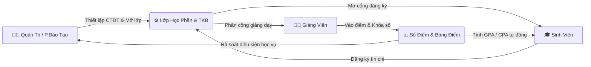

<div align="center">
  
  <h1>Hệ Thống Quản Lý Đào Tạo & Sinh Viên (SMS)</h1>
  <p><strong>Student Management System — Đại học theo học chế tín chỉ</strong></p>
  <p>Giải pháp toàn diện quản lý khung đào tạo, xếp thời khóa biểu, đăng ký tín chỉ trực tuyến, tính điểm GPA/CPA tự động và cảnh báo học vụ.</p>

  
  
  
  
  
  
</div>

---

## 📌 Tổng quan dự án

Hệ thống **SMS (Student Management System)** chuẩn hóa và tự động hóa quy trình nghiệp vụ đào tạo đại học theo học chế tín chỉ, loại bỏ thao tác thủ công, chống xung đột lịch học/phòng học và đảm bảo an toàn dữ liệu học vụ:

* **🧑‍💼 Phòng Đào Tạo (Admin):** Quản lý danh mục (Khoa, Ngành, Khóa), thiết lập Khung CTĐT 5 khối kiến thức, mở lớp học phần, xếp TKB, rà soát cảnh báo học vụ tự động và xét tốt nghiệp.
* **👨‍🏫 Giảng Viên:** Theo dõi lịch giảng dạy tuần, quản lý điểm sinh viên (nhập trực tiếp hoặc import Excel theo công thức CC1 5% · CC2 5% · GK 30% · CK 60%), khóa sổ điểm với cơ chế ân hạn 7 ngày.
* **🎓 Sinh Viên:** Cổng đăng ký tín chỉ thông minh (ràng buộc 12–24 TC, tự động chặn trùng lịch và kiểm tra tiên quyết), tra cứu TKB tuần, theo dõi GPA/CPA thời gian thực và nộp đơn phúc khảo.

---

## 🛠️ Công nghệ sử dụng

| Tầng | Công nghệ & Thư viện | Vai trò |
| :--- | :--- | :--- |
| **Backend** | Java 23, Spring Boot 3.5.6, Spring Security, JWT, JPA/Hibernate | REST API bảo mật, xử lý nghiệp vụ, kiểm tra ràng buộc logic |
| **Frontend** | React 19, Vite, Tailwind CSS, Zustand, Native Fetch Client (Zero Dep), Lucide Icons | Giao diện SPA hiện đại, tối ưu UX, hỗ trợ Dark/Light mode |
| **Database** | MySQL 8.0, Database Views (`v_student_transcript`, `v_student_gpa`) | Lưu trữ toàn vẹn quan hệ, khử truy vấn N+1, tối ưu Composite Index |
| **DevOps & QA**| Docker, Docker Compose, JUnit 5, Mockito, Vitest | Container hóa môi trường, kiểm thử tự động đa tầng |

---

## 🚀 Tính năng nổi bật theo phân hệ



### 1. Phân hệ Quản trị & Đào tạo (Admin)
- **Quản lý CTĐT chuẩn:** Cấu trúc 5 khối kiến thức; kiểm soát môn tiên quyết, song hành và tương đương; chống chu trình phụ thuộc.
- **Tổ chức lớp học phần & TKB:** Phân bổ giảng viên, phòng học, ca học; phát hiện và ngăn chặn va chạm tài nguyên thời gian thực.
- **Xử lý học vụ tự động:** Rà soát GPA/CPA kỳ để kích hoạt Cảnh báo học vụ (Mức 1, Mức 2, Buộc thôi học) theo quy chế đào tạo.
- **Bảo mật & Quản trị tài khoản:** Duyệt yêu cầu cấp lại mật khẩu, phân quyền RBAC đa cấp.

### 2. Phân hệ Giảng viên (Lecturer)
- **Quản lý lớp giảng dạy:** Danh sách sinh viên theo lớp học phần, điểm danh và xuất danh sách lớp ra Excel.
- **Sổ điểm điện tử:** Hỗ trợ nhập trực tiếp hoặc Import từ file Excel; tự động tính tổng kết và quy đổi thang điểm (Thang 10 ➔ Thang 4 ➔ Điểm chữ).
- **Quy chế khóa điểm (BR-07):** Khóa sổ điểm bảo vệ tính toàn vẹn dữ liệu, hỗ trợ mở khóa chỉnh sửa trong cửa sổ ân hạn 7 ngày.

### 3. Phân hệ Sinh viên (Student)
- **Cổng đăng ký tín chỉ:** Kiểm tra tức thời điều kiện tiên quyết, giới hạn tín chỉ (10–24 TC), ngăn chặn 100% trùng lịch học.
- **Thời khóa biểu trực quan:** Ma trận lịch học theo tuần dạng Grid, hỗ trợ lọc theo học kỳ.
- **Tra cứu kết quả học tập:** Bảng điểm chi tiết theo kỳ, tự động lấy điểm cao nhất khi học cải thiện, tiến độ tích lũy CTĐT.
- **Bảo mật cá nhân:** Đổi mật khẩu có thanh đo độ mạnh (Password Strength Meter), bắt buộc đổi mật khẩu khi cấp mới và mã hóa an toàn BCrypt.

---

## 📁 Cấu trúc dự án

```text
DoAnChuyenNganh/
├── backend/               # Mã nguồn máy chủ Spring Boot 3 (REST API, Security, Business Logic)
│   ├── src/main/java/     #   Controllers, Services, Repositories, Entities, DTOs, Security
│   └── src/test/java/     #   Bộ kiểm thử tự động JUnit 5 + Mockito
├── frontend/              # Giao diện người dùng React 19 + Vite SPA
│   ├── src/components/    #   Layouts, Modals, Reusable UI Components
│   ├── src/pages/         #   Màn hình theo vai trò (admin, lecturer, student, auth)
│   └── src/services/      #   Kết nối API Axios, Data Services & Zustand Stores
├── database/              # Cơ sở dữ liệu MySQL 8.0
│   ├── schema.sql         #   DDL khởi tạo toàn bộ bảng, khóa ngoại, ràng buộc
│   ├── seed.sql           #   Dữ liệu khởi tạo mẫu
│   └── migrations/        #   Các bản cập nhật cấu trúc DB có kiểm soát
├── docs/                  # Tài liệu phân tích thiết kế hệ thống & đặc tả nghiệp vụ
├── tests/                 # Kịch bản kiểm thử E2E, Integration & Load Test
├── docker-compose.yml     # Cấu hình khởi chạy trọn gói hệ thống qua Docker
├── start_dev.bat          # Script 1-click khởi chạy môi trường phát triển (Windows)
└── run_tests.bat          # Script kích hoạt bộ kiểm thử tự động
```

---

## ⚡ Cài đặt & Khởi chạy nhanh

### Yêu cầu môi trường
* **Java 23 JDK** & **Node.js 20+**
* **MySQL 8.0** (hoặc sử dụng qua Docker)

---

### Cách 1: Chạy 1-Click trên Windows (Khuyên dùng khi Dev)
Khởi chạy nhanh qua script tự động:
```cmd
start_dev.bat
```
> Script tự động kiểm tra cổng MySQL, đồng thời khởi chạy Backend (Spring Boot: `http://localhost:8080`) và Frontend (Vite: `http://localhost:5173`).

---

### Cách 2: Triển khai trọn gói qua Docker Compose
Khởi chạy toàn bộ hệ thống gồm MySQL, Backend và Frontend trong container:
```bash
docker compose up --build -d
```
* **Frontend:** `http://localhost:5173`
* **Backend API:** `http://localhost:8080/api`
* **Swagger/OpenAPI:** `http://localhost:8080/swagger-ui.html`

---

## 🔑 Tài khoản trải nghiệm

Mật khẩu mặc định cho toàn bộ tài khoản thử nghiệm: **`123456`**

| Phân hệ | Tên đăng nhập | Vai trò chính |
| :--- | :--- | :--- |
| **Phòng Đào Tạo** | `admin` | Toàn quyền quản trị danh mục, CTĐT, mở lớp và xét duyệt học vụ |
| **Giảng Viên** | `1000001` | Quản lý giảng dạy môn học, nhập điểm và chốt sổ điểm |
| **Sinh Viên** | `2500001` | Đăng ký tín chỉ, xem TKB tuần và tra cứu bảng điểm |

---

## 🧪 Kiểm thử & Đảm bảo chất lượng

Dự án áp dụng quy trình kiểm thử đa tầng đảm bảo tính ổn định và độ tin cậy cao:

```bash
# 1. Kiểm thử Backend (Unit & Integration tests với JUnit 5/Mockito)
cd backend && mvn test

# 2. Kiểm thử Frontend (Component & Unit tests với Vitest)
cd frontend && npm test

# 3. Kịch bản kiểm thử tự động E2E & Hiệu năng chịu tải
node tests/e2e/system_e2e_test.js
node tests/performance/enrollment_load_test.js
```

---

## 📚 Tài liệu chi tiết

Tất cả đặc tả kiến trúc, nghiệp vụ và hướng dẫn vận hành chi tiết được lưu trữ tại thư mục [`docs/`](docs/):
* [docs/01_system_architecture_and_diagrams.md](docs/01_system_architecture_and_diagrams.md) — Kiến trúc hệ thống & Sơ đồ luồng
* [docs/02_use_case_catalog.md](docs/02_use_case_catalog.md) — Danh mục Use Case
* [docs/04_business_rules.md](docs/04_business_rules.md) — Quy tắc nghiệp vụ (Business Rules)
* [docs/05_database_erd.md](docs/05_database_erd.md) — Thiết kế lược đồ CSDL & ERD
* [docs/08_deployment_and_operations_guide.md](docs/08_deployment_and_operations_guide.md) — Hướng dẫn triển khai & Vận hành

---
<div align="center">
  <sub>Đồ Án Chuyên Ngành — Trường Đại học Phenikaa · 2026</sub>
</div>
