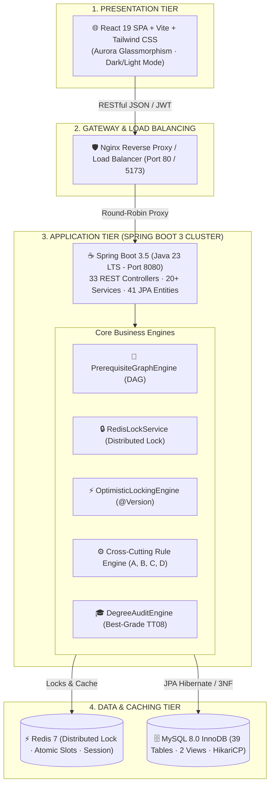
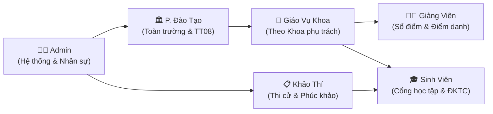

<div align="center">
  
  <h1>Hệ Thống Quản Lý Đào Tạo & Sinh Viên (SMS / UAMS)</h1>
  <p><strong>University Academic & Student Management System — Đại học theo học chế tín chỉ</strong></p>
  <p><em>Nền tảng Full-stack doanh nghiệp chuẩn hóa quy trình đào tạo theo <strong>Thông tư 08/2021/TT-BGDĐT</strong></em></p>

  <p>
    <a href="backend/"></a>
    <a href="backend/"></a>
    <a href="frontend/"></a>
    <a href="frontend/"></a>
    <a href="database/"></a>
    <a href="docker-compose.yml"></a>
    <a href="tests/"></a>
    <a href="drawio/"></a>
  </p>
</div>

---

## ⚡ Chỉ số cốt lõi (Key Metrics)

| Chỉ số | Giá trị thực tế | Ý nghĩa kỹ thuật |
| :--- | :---: | :--- |
| **Độ bao phủ kiểm thử** | **528 ca kiểm thử (PASS 100%)** | 297 JUnit 5, 105 Vitest, 65 E2E, 46 Business Logic, 15 Chrome DevTools |
| **Cơ sở dữ liệu** | **39 Bảng quan hệ & 2 Views** | Chuẩn hóa 3NF, phân chỉ mục tối ưu, hỗ trợ đa khoa, đa ngành, đa vai trò |
| **Thiết kế hệ thống** | **82 Tabs Sơ đồ OMG UML 2.5** | 5 Master files: 5 Use Case, 8 ERD, 23 Activity, 23 BCE, 23 Sequence |
| **Phân quyền truy cập** | **6 Phân hệ vai trò (RBAC)** | Admin, P. Đào tạo, Giáo vụ Khoa, Cán bộ Khảo thí, Giảng viên, Sinh viên |
| **Khả năng chịu tải** | **600+ SV đồng thời / giây** | Khóa phân tán Redis Lock + Atomic Slot Counter triệt tiêu race-condition |

---

## 🏛️ Kiến trúc công nghệ (Architecture)

Hệ thống triển khai theo mô hình **3-Tier Layered Architecture** chuẩn doanh nghiệp, hỗ trợ chạy đơn máy nhẹ (< 600MB RAM) hoặc cụm phân tán cân bằng tải (Cluster Replicas):



---

## 🌟 6 Hạt nhân nghiệp vụ đột phá

1. **Khung CTĐT & Đồ thị tiên quyết DAG (`PrerequisiteGraphEngine`):**
   * Mô hình hóa tiến độ CTĐT thành đồ thị có hướng không chu trình (**DAG**).
   * Kiểm soát nghiêm ngặt 4 loại ràng buộc: môn tiên quyết, môn học trước, môn song hành, môn tương đương và triệt tiêu phụ thuộc vòng kín (Circular Dependency).
2. **Đăng ký tín chỉ chịu tải cao (`High-Concurrency Enrollment Engine`):**
   * Bảo vệ 3 lớp: **Khóa phân tán Redis** + **Atomic Slot Counter** + **Khóa bi quan/nguyên tử DB**.
   * Đảm bảo an toàn giao dịch tuyệt đối khi hàng trăm sinh viên tranh chấp 1 lớp học phần cùng giây (`enrolled <= max_students`).
3. **Khóa lạc quan chống mất mát dữ liệu (`@Version` Optimistic Locking):**
   * Kiểm soát tính nhất quán trên `CourseSection`, `Subject`, `Schedule`. Ngăn chặn ghi đè dữ liệu (Lost Update) khi nhiều cán bộ đào tạo cùng chỉnh sửa lịch học / sĩ số.
4. **Phân quyền Giáo vụ Khoa linh hoạt (`Faculty-Scoped RBAC`):**
   * Tách bạch quyền Đào tạo toàn trường (`ACADEMIC_AFFAIRS`) và Giáo vụ Khoa (`ACADEMIC_STAFF`). Giáo vụ chỉ mở lớp, quản lý môn và duyệt điểm trong phạm vi Khoa mình quản lý.
5. **Sổ điểm điện tử 4 thành phần & Quy trình Đính chính điểm 3 cấp:**
   * Tính điểm chuẩn tỷ lệ: **CC1 (5%) · CC2 (5%) · GK (30%) · CK (60%)** ➔ Thang 10 ➔ Thang 4 ➔ Điểm chữ.
   * Khóa sổ tự động sau cửa sổ ân hạn 7 ngày. Sau 7 ngày, mọi điều chỉnh điểm phải qua xét duyệt 3 cấp (Giảng viên ➜ Giáo vụ Khoa ➜ Phòng Đào tạo) và lưu vết bất biến trong `grade_audit_logs`.
6. **Tiếp nhận phúc khảo điểm thi trực tuyến & Tự động xét tốt nghiệp TT08:**
   * Sinh viên nộp đơn phúc khảo trực tuyến ➔ Cán bộ Khảo thí chấm lại, cập nhật điểm và đồng bộ tự động sang bảng điểm.
   * Động cơ `DegreeAuditEngine` tự động rà soát 5 khối kiến thức, tích lũy 130–135 tín chỉ, chuẩn đầu ra và áp dụng thuật toán **Best-Grade** (chỉ lấy điểm thi cao nhất của các môn học lại).

---

## 👥 Ma trận phân quyền 6 Phân hệ người dùng



| Phân hệ / Vai trò | Phạm vi quản lý | Các chức năng nghiệp vụ trọng tâm |
| :--- | :--- | :--- |
| **Quản trị viên (Admin)** | Toàn hệ thống | Quản trị người dùng, phân quyền RBAC, Reset mật khẩu hàng loạt (Bulk Reset DOB), giám sát Audit Logs. |
| **Phòng Đào tạo (Academic Affairs)** | Cấp Trường | Khung CTĐT, điều phối TKB toàn trường, duyệt sửa điểm Cấp 2, thu ngân học phí (Rule B), tự động xét tốt nghiệp. |
| **Giáo vụ Khoa (Academic Staff)** | Cấp Khoa | Quản lý danh mục môn học Khoa, mở lớp học phần, thẩm định sửa điểm Cấp 1 của giảng viên trong Khoa. |
| **Cán bộ Khảo thí (Exam Officer)** | Khảo thí & Khảo thí | Lập lịch thi, chia phòng thi, đánh số báo danh, nhập điểm thi kết thúc học phần, giải quyết đơn phúc khảo trực tuyến. |
| **Giảng viên (Lecturer)** | Lớp giảng dạy | Điểm danh thời gian thực bằng mã PIN 6 số, nhập điểm 4 thành phần (Excel/Trực tiếp), tạo đề xuất sửa điểm 7 ngày. |
| **Sinh viên (Student)** | Hồ sơ cá nhân | Đăng ký tín chỉ thông minh, thời khóa biểu tuần, tra cứu điểm CPA/GPA, đồ thị tiến độ DAG, gửi đơn phúc khảo. |

---

## 🚀 Hướng dẫn khởi chạy nhanh (Quick Start)

### Yêu cầu tiên quyết:
* **Java 23 JDK** & **Maven 3.9+** (hoặc `mvnw` đi kèm)
* **Node.js 20+** & **npm 10+**
* **Docker Desktop** (khuyên dùng để chạy MySQL 8 & Redis 7)

---

### Lựa chọn 1: 1-Click Windows Dev Mode (Tiện lợi nhất)
```cmd
start_dev.bat
```
> Tự động kiểm tra MySQL/Redis, tự động khởi động Spring Boot (`:8080`) và React Vite (`:5173`).

---

### Lựa chọn 2: Chạy Docker tối ưu RAM (< 600MB RAM)
```cmd
bat_tiet_kiem_ram.bat
```
*(Hoặc lệnh CLI: `docker compose up -d`)*

---

### Lựa chọn 3: Chạy cụm Cluster Demo (3 Backends + Nginx Load Balancer)
```cmd
bat_cluster_demo.bat
```
*(Hoặc lệnh CLI: `docker compose -f docker-compose.yml -f docker-compose.cluster.yml up -d`)*

---

### 🌐 Địa chỉ truy cập dịch vụ:

| Cổng dịch vụ | Địa chỉ kết nối | Mô tả |
| :--- | :--- | :--- |
| **Frontend Web SPA** | [http://localhost:5173](http://localhost:5173) (hoặc `:80`) | Cổng thông tin giao diện người dùng |
| **Backend REST API** | [http://localhost:8080/api](http://localhost:8080/api) | Máy chủ API dịch vụ doanh nghiệp |
| **Swagger UI / OpenAPI** | [http://localhost:8080/swagger-ui.html](http://localhost:8080/swagger-ui.html) | Tài liệu trực quan 33 REST Controllers |
| **Visual Load Test Dashboard**| [http://localhost:5050](http://localhost:5050) | Giám sát đồ họa 100 SV tranh chấp tải đồng thời |

---

## 🔑 Tài khoản kiểm thử nghiệm thu (Mật khẩu chung: `123456`)

| Phân hệ / Vai trò | Tài khoản | Họ và tên | Quyền hạn tiêu biểu |
| :--- | :---: | :--- | :--- |
| **Quản trị hệ thống** | `admin` | Nguyễn Hoàng Long | Toàn quyền cấu hình, nhân sự đào tạo, bulk reset mật khẩu |
| **Phòng Đào tạo (Trường)** | `daotao` | Nguyễn Văn Đào | Xét tốt nghiệp TT08, duyệt sửa điểm Cấp 2, thu ngân học phí |
| **Giáo vụ Khoa CNTT** | `giaovu_cntt` | Lê Thị Thanh | Quản lý môn học, mở lớp HP, thẩm định sửa điểm Cấp 1 Khoa CNTT |
| **Giáo vụ Khoa Cơ khí** | `giaovu_oto` | Phạm Thanh Tùng | Mở lớp HP, xếp TKB Khoa Cơ khí & Ô tô |
| **Cán bộ Khảo thí** | `khaothi` | Trần Thị Khảo | Chia phòng thi, nhập điểm thi, giải quyết phúc khảo |
| **Giảng viên CNTT** | `gv_gv001` | PGS.TS. Trần Văn Long | Điểm danh PIN, nhập điểm 4 thành phần, chốt điểm 7 ngày |
| **Sinh viên K16 (Năm 4)** | `sv_cntt_k16` | K16 CNTT (120/130 TC) | Cổng sinh viên, ĐKTC, xem TKB, tra cứu CPA/GPA, nộp phúc khảo |
| *(3.000 Sinh viên)* | `23010001`.. | Dữ liệu thực nghiệm | Đầy đủ dữ liệu học phí, điểm thi, rèn luyện 36 lớp sinh hoạt |

---

## 🧪 Trung tâm Đảm bảo Chất lượng & Kiểm thử (QA Suite)

Hệ thống sở hữu bộ kiểm thử tự động **528 ca kiểm thử đạt tỷ lệ PASS 100%**:

```text
528 TOTAL AUTOMATED TESTS (100% PASS)
├── 297 Tests Backend Unit & Integration (JUnit 5 + Mockito - 43 test classes)
├── 105 Tests Frontend Component & Store (Vitest + Testing Library - 21 test files)
├──  65 Tests End-to-End System Integration (Puppeteer / Node.js Runner)
├──  46 Tests Core Business Engines (DAG, Rules A-D, Degree Audit, RBAC Scope)
└──  15 Tests Google Chrome DevTools & Core Web Vitals (LCP < 1.2s, CLS = 0.00, Contrast WCAG AA)
```

### Chạy kiểm thử tự động 1-Click:
```cmd
run_tests.bat
```
*(Hoặc chạy kịch bản Master Test Runner: `node tests/run_all_tests.mjs`)*

---

## 📐 Hệ thống 82 Sơ đồ Phân tích Thiết kế (Draw.io)

Toàn bộ mô hình phân tích thiết kế tuân thủ nghiêm ngặt **OMG UML 2.5** và chuẩn phân tích **BCE (Boundary - Control - Entity)**, được xây dựng theo phong cách **Academic Monochrome High-Contrast** tối ưu in ấn và bảo vệ đồ án:

| STT | Tập sơ đồ Master (.drawio) | Chuẩn mô hình hóa | Số Tabs | Phạm vi nghiệp vụ |
|:---:|:---|:---|:---:|:---|
| **1** | [UseCase_Diagrams.drawio](drawio/UseCase_Diagrams.drawio) | UML 2.5 Use Case | **5 tabs** | Tổng quan, Admin, Đào tạo, Giảng viên, Sinh viên |
| **2** | [ERD_Diagrams.drawio](drawio/ERD_Diagrams.drawio) | Relational ERD | **8 tabs** | 1 Tab Tổng quan thực thể + 7 Tabs chi tiết 39 bảng CSDL |
| **3** | [Activity_Diagrams.drawio](drawio/Activity_Diagrams.drawio) | UML 2.5 Activity | **23 tabs** | 23 Biểu đồ phân làn (Swimlanes) cho 23 ca sử dụng cốt lõi |
| **4** | [AnalysisClass_BCE_Diagrams.drawio](drawio/AnalysisClass_BCE_Diagrams.drawio) | Boundary-Control-Entity | **23 tabs** | 23 Biểu đồ phân tích BCE khớp 1-1 với cấu trúc mã nguồn |
| **5** | [Sequence_Diagrams.drawio](drawio/Sequence_Diagrams.drawio) | UML 2.5 Sequence | **23 tabs** | 23 Biểu đồ tuần tự 6 đường sinh mệnh (Lifelines) |

---

## 📁 Cấu trúc thư mục dự án

```text
DoAnChuyenNganh/
├── backend/                       # Máy chủ dịch vụ Spring Boot 3 (Java 23 LTS, REST API, Security)
├── frontend/                      # Giao diện người dùng React 19 SPA (Vite, Tailwind CSS, Zustand)
├── database/                      # CSDL MySQL 8 (schema.sql 39 bảng, seed.sql 3.000 SV, migrations)
├── drawio/                        # 5 Bộ sơ đồ Master OMG UML 2.5 (82 tabs) & script Python tự động
├── tests/                         # Trung tâm kiểm thử 528 tests (Unit, Vitest, E2E, Security, Load test)
├── scripts/                       # Công cụ hỗ trợ vận hành (Export PDF, phát sinh dữ liệu, DevTools audit)
├── docker-compose.yml             # Cấu hình Docker đơn máy chuẩn tối ưu RAM (< 600MB)
├── docker-compose.cluster.yml     # Cấu hình cụm mở rộng 3 Backend Replicas + Nginx Load Balancer
├── start_dev.bat                  # Khởi chạy 1-Click môi trường phát triển cục bộ Windows
├── bat_tiet_kiem_ram.bat          # Khởi chạy 1-Click Docker chế độ tiết kiệm RAM
├── bat_cluster_demo.bat           # Khởi chạy 1-Click Docker chế độ Cụm cân bằng tải
├── run_tests.bat                  # Menu 1-Click chạy toàn bộ bộ kiểm thử QA
└── share_internet.bat             # Tạo đường hầm HTTPS chia sẻ demo qua Internet
```

---

<div align="center">
  <sub>Đồ Án Chuyên Ngành Công Nghệ Thông Tin — Trường Đại Học Phenikaa · 2026</sub><br/>
  <sub>Sinh viên thực hiện: <strong>Nguyễn Duy Minh</strong> (MSV: <strong>23010359</strong>)</sub>
</div>
