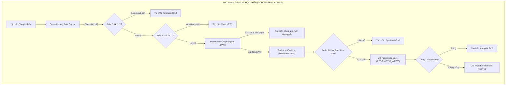

# 🧠 MÁY CHỦ DỊCH VỤ BACKEND (REST API & BUSINESS ENGINES)
## HỆ THỐNG QUẢN LÝ ĐÀO TẠO & SINH VIÊN (SMS / UAMS)
> **Spring Boot 3.5.6 · Java 23 LTS · MySQL 8.0 · Redis 7 Alpine · Spring Security · JWT**  
> **Tác giả:** Nguyễn Duy Minh (MSV: 21010696)  
> **Vị trí trong kiến trúc:** Tầng xử lý nghiệp vụ doanh nghiệp trung tâm (Core Application Tier)

---

## 📑 Mục lục
1. [Tổng quan & Vai trò](#1-tổng-quan--vai-trò)
2. [Ngăn xếp công nghệ cốt lõi](#2-ngăn-xếp-công-nghệ-cốt-lõi)
3. [Cấu trúc mã nguồn toàn diện](#3-cấu-trúc-mã-nguồn-toàn-diện)
4. [Các hạt nhân xử lý nghiệp vụ chuyên sâu](#4-các-hạt-nhân-xử-lý-nghiệp-vụ-chuyên-sâu)
5. [Danh mục 33 REST Controllers theo miền chức năng](#5-danh-mục-33-rest-controllers-theo-miền-chức-năng)
6. [Kiến trúc điều khiển đồng thời & Redis Distributed Lock](#6-kiến-trúc-điều-khiển-đồng-thời--redis-distributed-lock)
7. [Cấu hình môi trường & Biến hệ thống](#7-cấu-hình-môi-trường--biến-hệ-thống)
8. [Bộ kiểm thử tự động (285+ Tests)](#8-bộ-kiểm-thử-tự-động-285-tests)
9. [Hướng dẫn cài đặt & Khởi chạy](#9-hướng-dẫn-cài-đặt--khởi-chạy)

---

## 1. Tổng quan & Vai trò

Tầng **Backend** đảm nhiệm vai trò bộ não điều phối toàn bộ nghiệp vụ của hệ thống SMS:
* **Kiểm soát bảo mật & Phân quyền:** Xác thực qua giao thức stateless JWT kép (Access/Refresh Token) và phân quyền RBAC cho 5 nhóm người dùng (`ADMIN`, `ACADEMIC_AFFAIRS`, `LECTURER`, `STUDENT`, `EXAMINATION_OFFICER`).
* **Thực thi quy chế đào tạo tín chỉ:** Ràng buộc cây điều kiện tiên quyết DAG, kiểm soát giới hạn tín chỉ (10–24 TC), ngăn chặn 100% xung đột thời khóa biểu và phòng học.
* **Ghi danh chịu tải cao (High-Concurrency Enrollment):** Tích hợp bộ nhớ đệm phân tán Redis 7 và khóa phân tán `RedisLockService` để xử lý tranh chấp sĩ số lớp khi hàng trăm sinh viên cùng đăng ký trong 1 giây.
* **Sổ điểm điện tử & Bảo mật 4 thành phần:** Tự động tính điểm tổng kết (`CC1 5% · CC2 5% · GK 30% · CK 60%`), quy đổi hệ 10 ➔ hệ 4 ➔ điểm chữ, quản lý cửa sổ ân hạn 7 ngày và quy trình xét duyệt sửa điểm kèm nhật ký kiểm toán (Audit Log).
* **Tài chính & Dịch vụ đào tạo:** Bàn thu ngân, tính công nợ học phí, tự động kích hoạt Rule B chặn đăng ký khi nợ học phí quá hạn, lập hóa đơn lớp học phần riêng theo thang quy mô sĩ số.

---

## 2. Ngăn xếp công nghệ cốt lõi

| Phân hệ / Thư viện | Phiên bản | Vai trò & Đặc tính kỹ thuật |
| :--- | :--- | :--- |
| **Java Platform** | 23 LTS | Sử dụng các tính năng ngôn ngữ mới nhất, tối ưu hiệu năng Garbage Collection (`SerialGC` khi tiết kiệm RAM hoặc `G1GC` khi tải cao). |
| **Spring Boot** | 3.5.6 | Framework nền tảng với hệ sinh thái: Spring Web, Spring Data JPA, Spring Security, Spring Validation, Spring Mail. |
| **Bảo mật & JWT** | `jjwt 0.12.6` | Mã hóa mật khẩu BCrypt, ký và giải mã JWT token an toàn với thuật toán HMAC-SHA512. |
| **Redis & Cache** | `spring-boot-starter-data-redis` + `commons-pool2` | Quản lý bộ đếm nguyên tử (Atomic Counter), khóa phân tán Redis Distributed Lock, lưu trữ tạm sĩ số lớp học phần. |
| **CSDL & ORM** | MySQL Connector 8.0, Hibernate ORM | Ánh xạ 41 JPA Entities, hỗ trợ Native Query tối ưu, View Mapping và HikariCP Connection Pool. |
| **Xử lý Excel** | Apache POI 5.x | Đọc và ghi tệp Excel đa định dạng (`.xlsx`) phục vụ Import bảng điểm, Import danh sách phòng thi, Export danh sách lớp. |
| **Tài liệu API** | Springdoc OpenAPI 2.8.5 | Tự động sinh giao diện Swagger UI thử nghiệm API trực quan tại `/swagger-ui.html`. |
| **Kiểm thử tự động** | JUnit 5 + Mockito 5 | 285+ ca kiểm thử đơn vị và tích hợp bao phủ toàn bộ Controller, Service, Engine và Rules. |

---

## 3. Cấu trúc mã nguồn toàn diện

```text
backend/
├── src/main/java/com/sms/
│   ├── config/                     # Cấu hình CORS, OpenAPI/Swagger, Async, Rate Limiter, Redis Connection Pool
│   ├── controller/                 # 33 REST Controllers tiếp nhận request HTTP và kiểm soát phân quyền RBAC
│   ├── dto/                        # Data Transfer Objects (Request/Response payload) kèm Bean Validation (@Valid)
│   ├── entity/                     # 41 JPA Entities tương ứng chặt chẽ với cấu trúc 41 bảng CSDL
│   ├── exception/                  # GlobalExceptionHandler, BusinessException, ResourceNotFoundException...
│   ├── repository/                 # Spring Data JPA Repositories (Pessimistic Locking, Custom Native Queries)
│   ├── security/                   # JwtAuthenticationFilter, UserDetailsServiceImpl, SecurityConfig, Role Constants
│   └── service/                    # Business Logic Layer (20+ Services & Core Engines)
│       ├── rule/                   # Hạt nhân Rule Engine (Rule A: Limits, Rule B: Tuition Hold, Rule C: Conflict)
│       ├── scheduler/              # Tác vụ định kỳ ngầm (Tự động rà soát khóa sổ 7 ngày, cập nhật trạng thái đợt)
│       ├── DegreeAuditEngine.java  # Động cơ kiểm toán tốt nghiệp & tích lũy 5 khối kiến thức
│       ├── PrerequisiteGraphEngine.java # Động cơ đồ thị DAG kiểm tra môn tiên quyết & chu trình
│       ├── RedisLockService.java   # Động cơ khóa phân tán Redis phục vụ đăng ký tín chỉ tải cao
│       ├── RedisCourseSectionService.java # Đồng bộ bộ đếm sĩ số lớp trên Redis Cache
│       ├── EnrollmentService.java  # Nghiệp vụ đăng ký/hủy học phần kết hợp Redis + DB Pessimistic Lock
│       ├── GradeService.java       # Nghiệp vụ sổ điểm 4 thành phần, khóa sổ 7 ngày, Import Excel
│       ├── TuitionService.java     # Nghiệp vụ tài chính, hóa đơn học phí, bàn thu ngân
│       └── ...                     # Các services học vụ, khảo thí, rèn luyện, dịch vụ sinh viên
├── src/main/resources/
│   ├── application.properties      # Cấu hình chuẩn mặc định khi chạy Local (Port 8080, MySQL 3306, Redis 6379)
│   └── static/                     # Template và tài nguyên tĩnh
├── src/test/java/com/sms/          # 41 test classes, 285+ test cases tự động JUnit 5 + Mockito
├── Dockerfile                      # Multi-stage Docker build tối ưu kích thước image và tài nguyên RAM
└── pom.xml                         # Quản lý phụ thuộc Maven
```

---

## 4. Các hạt nhân xử lý nghiệp vụ chuyên sâu



### 1. `DegreeAuditEngine.java` (Động cơ kiểm toán tốt nghiệp)
- Tự động rà soát cây cấu trúc 5 khối kiến thức: Khối Đại cương, Cơ sở nhóm ngành, Cơ sở ngành, Chuyên ngành và Tốt nghiệp.
- **Thuật toán Best-Grade:** Khi sinh viên học cải thiện hoặc học lại một học phần, hệ thống tự động tìm và áp dụng điểm tổng kết cao nhất để tính vào GPA tích lũy, không tính trùng số tín chỉ tích lũy.
- Đối chiếu các điều kiện tiên quyết tốt nghiệp: Tổng số tín chỉ hoàn thành $\ge 130$ tín chỉ, GPA tích lũy $\ge 2.00$, hoàn thành Giáo dục thể chất, Giáo dục Quốc phòng & An ninh.

### 2. `PrerequisiteGraphEngine.java` (Động cơ đồ thị DAG môn học)
- Biểu diễn cây quan hệ môn học dưới dạng Đồ thị có hướng (Directed Graph).
- Sử dụng thuật toán DFS/Tarjan kiểm tra và phát hiện chu trình phụ thuộc vòng (Circular Dependency) ngay khi Admin thiết lập môn tiên quyết.
- Xác thực 3 cấp độ ràng buộc học phần:
  * **Tiên quyết (Prerequisite):** Sinh viên bắt buộc phải có điểm tổng kết $\ge 4.0$ (thang 10) ở môn trước mới được đăng ký.
  * **Học trước (Pre-course):** Sinh viên đã từng tham gia học môn trước (không bắt buộc phải qua môn).
  * **Song hành (Co-requisite):** Cho phép sinh viên đăng ký học đồng thời trong cùng một học kỳ.

### 3. `RedisLockService.java` & `RedisCourseSectionService.java` (Động cơ khóa phân tán)
- Bảo vệ an toàn tuyệt đối tài nguyên lớp học phần khi xảy ra bão truy cập trong đợt mở cổng đăng ký tín chỉ.
- Sử dụng lệnh nguyên tử `SET NX PX` trên Redis với thời gian timeout hợp lý (3000ms), kết hợp cơ chế giải phóng khóa an toàn qua Lua Script.
- Ngăn chặn triệt để hiện tượng overselling (vượt quá sĩ số tối đa) ngay cả khi có hàng trăm request đồng thời ghi dữ liệu qua nhiều Backend Replicas.

### 4. `RuleEngine.java` (Động cơ quy tắc nghiệp vụ liên thông)
- Tách biệt logic nghiệp vụ phức tạp ra khỏi tầng Controller:
  * **Rule A (Credit Thresholds):** Kiểm soát ngưỡng số tín chỉ tối thiểu (10 TC) và tối đa (24 TC) trong học kỳ chính.
  * **Rule B (Financial Suspension):** Liên thông dữ liệu công nợ với phân hệ Tài chính; nếu sinh viên còn nợ học phí quá hạn, hệ thống tự động gắn cờ tạm khóa đăng ký môn.
  * **Rule C (Schedule Collision):** Kiểm tra giao thoa khoảng thời gian và ca học giữa lớp dự định đăng ký với danh sách các lớp sinh viên đã đăng ký thành công.
  * **Rule D (Grade Editing Grace Period):** Quy chế khóa sổ điểm 7 ngày. Giảng viên có quyền sửa sai trực tiếp trong 7 ngày kể từ lúc ấn Chốt điểm. Sau thời gian này, điểm bị đóng băng và chỉ có thể sửa đổi qua quy trình nộp đề xuất có xác nhận của Trưởng khoa và Phòng Đào tạo.

---

## 5. Danh mục 33 REST Controllers theo miền chức năng

Hệ thống phân chia 33 Controllers theo các miền nghiệp vụ rành mạch:

| Miền nghiệp vụ | Controller | Endpoint gốc | Vai trò chính |
| :--- | :--- | :--- | :--- |
| **Xác thực & Bảo mật** | `AuthController` | `/api/auth` | Đăng nhập hệ thống, cấp phát cặp JWT Token, đổi mật khẩu cá nhân. |
| | `AdminPasswordResetController` | `/api/admin/password-resets` | Tiếp nhận và phê duyệt yêu cầu cấp lại mật khẩu từ người dùng. |
| **Cơ cấu Học thuật** | `DepartmentController` | `/api/departments` | Quản lý danh mục 8 Khoa đào tạo. |
| | `MajorController` | `/api/majors` | Quản lý danh mục 28 Ngành đào tạo. |
| | `CohortController` | `/api/cohorts` | Quản lý các khóa tuyển sinh (K16, K17, K18, K19). |
| | `ClassController` | `/api/classes` | Quản lý danh sách các Lớp sinh hoạt / Lớp hành chính. |
| | `SubjectController` | `/api/subjects` | Quản lý danh mục học phần, số tín chỉ, gán môn tiên quyết. |
| | `CurriculumController` | `/api/curriculum` | Thiết lập cây khung CTĐT 5 khối kiến thức theo từng ngành và khóa. |
| **Học kỳ & Điều phối** | `SemesterController` | `/api/semesters` | Quản lý học kỳ đào tạo, kích hoạt học kỳ hiện tại, đóng kỳ. |
| | `RegistrationWaveController` | `/api/registration-waves` | Mở và phân ca đăng ký tín chỉ theo từng khóa sinh viên. |
| | `CourseSectionController` | `/api/course-sections` | Tạo mới, mở lớp, hủy lớp và điều phối sĩ số lớp học phần. |
| | `ScheduleController` | `/api/schedules` | Xếp thời khóa biểu, phân bổ phòng học, ca học, kiểm tra va chạm. |
| **Ghi danh Tải cao** | `EnrollmentController` | `/api/enrollments` | Cổng đăng ký tín chỉ đồng thời, hủy học phần, kiểm tra sĩ số. |
| **Sổ điểm & Khảo thí** | `GradeController` | `/api/grades` | Nhập điểm 4 thành phần, chốt sổ điểm, khóa sổ 7 ngày, import Excel. |
| | `GradeAmendmentController` | `/api/grade-amendments` | Đề xuất sửa đổi điểm sau khóa sổ và quy trình phê duyệt đa cấp. |
| | `GradeAppealController` | `/api/grade-appeals` | Nộp và xử lý đơn phúc khảo điểm bài thi của sinh viên. |
| | `GradeAuditLogController` | `/api/grade-audit-logs` | Truy xuất toàn bộ lịch sử thay đổi điểm phục vụ thanh tra đào tạo. |
| | `ExamController` | `/api/exams` | Quản lý phòng thi, danh sách thi theo SBD, nhập điểm thi kết thúc. |
| **Học vụ & Tốt nghiệp** | `AcademicAffairsController` | `/api/academic-affairs` | Bàn điều phối học vụ, danh sách học lại, thống kê tốt nghiệp. |
| | `AcademicWarningController` | `/api/academic-warnings` | Quét tự động sinh viên vi phạm cảnh báo học vụ Mức 1, 2, Buộc thôi học. |
| | `GraduationController` | `/api/graduation` | Khởi chạy xét tốt nghiệp tự động qua DegreeAuditEngine, cấp bằng. |
| **Tài chính & Lớp riêng**| `TuitionController` | `/api/tuition`, `/api/admin/tuition` | Bàn thu ngân, tra cứu công nợ sinh viên, biểu mức học phí tín chỉ. |
| | `SpecialClassController` | `/api/special-classes` | Tính học phí các lớp học phần mở riêng theo thang quy mô sĩ số. |
| **Người dùng & Đời sống**| `StudentController` | `/api/students` | Quản lý hồ sơ sinh viên, sinh mã tự động, chuyển lớp, đình chỉ học. |
| | `LecturerController` | `/api/lecturers` | Quản lý hồ sơ giảng viên, học hàm học vị, phân công giảng dạy. |
| | `AttendanceController` | `/api/attendance` | Tạo phiên điểm danh lớp bằng mã PIN 6 số, sinh viên check-in realtime. |
| | `StudentConductController` | `/api/student-conduct` | Đánh giá và ghi nhận điểm rèn luyện định kỳ của sinh viên. |
| | `StudentServiceController` | `/api/student-services` | Tiếp nhận và xử lý yêu cầu một cửa (giấy xác nhận sinh viên, bảng điểm). |
| | `NotificationController` | `/api/notifications` | Phát thông báo học vụ thời gian thực đến từng nhóm người dùng. |
| **Báo cáo & Tiện ích** | `TranscriptController` | `/api/transcripts` | Trích xuất bảng điểm cá nhân, tính điểm GPA học kỳ, CPA tích lũy. |
| | `DashboardController` | `/api/dashboard` | Cung cấp số liệu thống kê tổng hợp toàn trường cho Admin. |
| | `AdminSystemController` | `/api/admin/system` | Quản trị cấu hình hệ thống, sao lưu & phục hồi CSDL. |
| | `UploadController` | `/api/upload` | Tải lên và lưu trữ các tệp đính kèm, ảnh đại diện, minh chứng. |

---

## 6. Kiến trúc điều khiển đồng thời & Redis Distributed Lock

Trong các đợt mở cổng đăng ký tín chỉ tại các trường đại học, hàng ngàn sinh viên thường truy cập đồng thời vào cùng một giây để tranh những lớp học phần có khung giờ đẹp hoặc giảng viên mong muốn.

### Cơ chế 3 tầng phòng thủ:
1. **Tầng 1 - Bộ nhớ đệm nguyên tử (Redis Atomic Counter):**
   Mỗi lớp học phần khi mở cổng đăng ký sẽ được khởi tạo số lượng đã ghi danh lên Redis (`section:{id}:enrolled`). Thao tác kiểm tra còn chỗ và tăng bộ đếm được thực hiện nguyên tử qua lệnh Redis:
   ```java
   Long currentCount = redisTemplate.opsForValue().increment("section:" + sectionId + ":enrolled");
   if (currentCount > maxStudents) {
       redisTemplate.opsForValue().decrement("section:" + sectionId + ":enrolled");
       throw new BusinessException("Lớp học phần đã hết chỗ!");
   }
   ```
2. **Tầng 2 - Khóa phân tán đa máy chủ (`RedisLockService`):**
   Đảm bảo tại một thời điểm, chỉ một tiến trình được phép xử lý ghi danh cho một lớp học phần cụ thể trên toàn bộ cụm Backend Replicas:
   ```java
   String lockKey = "lock:enrollment:" + sectionId;
   if (redisLockService.acquireLock(lockKey, 3000)) {
       try {
           // Thực thi logic kiểm tra và lưu trữ
       } finally {
           redisLockService.releaseLock(lockKey);
       }
   }
   ```
3. **Tầng 3 - Khóa bi quan CSDL (`PESSIMISTIC_WRITE`):**
   Tại tầng JPA Repository, câu lệnh khóa được kích hoạt để đảm bảo tính toàn vẹn tuyệt đối của giao dịch ACID trong MySQL:
   ```java
   @Lock(LockModeType.PESSIMISTIC_WRITE)
   @Query("SELECT cs FROM CourseSection cs WHERE cs.id = :id")
   Optional<CourseSection> findByIdForUpdate(@Param("id") Long id);
   ```

---

## 7. Cấu hình môi trường & Biến hệ thống

Mã nguồn hỗ trợ nạp cấu hình linh hoạt qua biến môi trường (Environment Variables) hoặc tệp `application.properties`:

| Tên biến môi trường | Giá trị mặc định | Mô tả |
| :--- | :--- | :--- |
| `PORT` | `8080` | Cổng HTTP lắng nghe của dịch vụ Backend. |
| `SPRING_DATASOURCE_URL` | `jdbc:mysql://localhost:3306/student_management?...` | Chuỗi kết nối JDBC đến MySQL Server. |
| `SPRING_DATASOURCE_USERNAME` | `root` (Local) / `sms_app` (Docker) | Tên người dùng CSDL MySQL. |
| `SPRING_DATASOURCE_PASSWORD` | `123456` (Local) / `sms_dev_pw` (Docker) | Mật khẩu kết nối CSDL MySQL. |
| `SPRING_DATA_REDIS_HOST` | `localhost` (Local) / `redis` (Docker) | Địa chỉ máy chủ Redis 7. |
| `SPRING_DATA_REDIS_PORT` | `6379` | Cổng dịch vụ Redis. |
| `JWT_SECRET` | *(Khóa 64 ký tự Base64)* | Khóa bí mật dùng để ký và xác thực mã JWT. |
| `CORS_ALLOWED_ORIGINS` | `http://localhost:5173,http://localhost:80` | Danh sách tên miền được phép gọi API (CORS). |
| `JAVA_TOOL_OPTIONS` | `-Xmx384m -XX:+UseSerialGC` | Giới hạn dung lượng RAM JVM cấp phát (tiết kiệm tài nguyên máy dev). |

---

## 8. Bộ kiểm thử tự động (285+ Tests)

Bộ kiểm thử được viết bằng **JUnit 5** kết hợp với **Mockito**, tập trung kiểm định tính toàn vẹn của logic nghiệp vụ:
* Kiểm thử xác thực & phân quyền JWT: kiểm tra token hết hạn, sai chữ ký, truy cập trái quyền hạn 403.
* Kiểm thử giải thuật đồ thị tiên quyết (Prerequisite Graph Engine): kiểm tra phát hiện chu trình, chặn môn chưa đạt.
* Kiểm thử bộ kiểm toán tốt nghiệp (Degree Audit Engine): kiểm tra tích lũy tín chỉ 5 khối, cơ chế Best-Grade.
* Kiểm thử điều khiển đồng thời (Concurrency & Locking): mô phỏng ghi danh song song đa luồng.
* Kiểm thử quy chế khóa sổ điểm 7 ngày và tính toán quy đổi điểm GPA.

### Lệnh chạy kiểm thử Backend:
```bash
cd backend
mvn test
```
*(Để xuất báo cáo chi tiết: kết quả lưu tại `backend/target/surefire-reports/`)*

---

## 9. Hướng dẫn cài đặt & Khởi chạy

### Yêu cầu môi trường
* **JDK 23** đã cài đặt (`java -version`).
* **Maven 3.9+** (hoặc sử dụng `mvnw`).
* **MySQL 8.0** đang lắng nghe tại cổng `3306` (hoặc cổng `3308` qua Docker).
* **Redis 7** đang lắng nghe tại cổng `6379`.

### Khởi chạy môi trường phát triển (Dev Mode):
```bash
cd backend
mvn clean spring-boot:run
```
* **API Base URL:** `http://localhost:8080/api`
* **Swagger Documentation:** `http://localhost:8080/swagger-ui.html`
* **OpenAPI Raw JSON:** `http://localhost:8080/v3/api-docs`

---
<div align="center">
  <sub>Hệ Thống Quản Lý Đào Tạo & Sinh Viên (SMS) · Đại học Phenikaa · 2026</sub>
</div>
