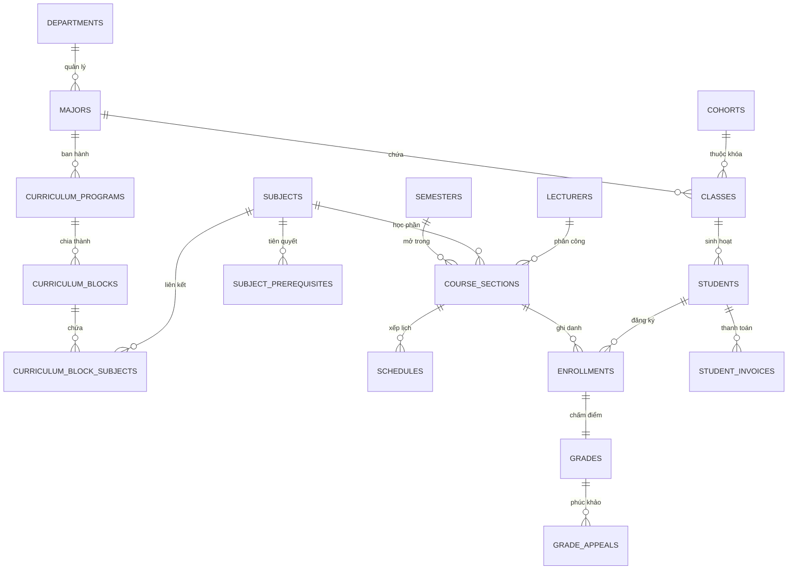

# 🗄️ CẨM NANG THIẾT KẾ & TỐI ƯU HÓA CƠ SỞ DỮ LIỆU
## DATABASE ARCHITECTURE, INDEXING STRATEGY & MIGRATION HANDBOOK
> **Dự án:** Hệ Thống Quản Lý Đào Tạo & Sinh Viên (SMS / UAMS)  
> **Hệ quản trị CSDL:** MySQL 8.0 (InnoDB Engine, Character set: `utf8mb4`, Collation: `utf8mb4_unicode_ci`)  
> **Quy mô dữ liệu thực nghiệm:** 41 Bảng quan hệ · 2 Database Views · 27 Bản migration · 3.000 Sinh viên · 80 Giảng viên · 5 Học kỳ  
> **Tác giả:** Nguyễn Duy Minh (MSV: 21010696)

---

## 📑 Mục lục
1. [Tổng quan Kiến trúc CSDL](#1-tổng-quan-kiến-trúc-csdl)
2. [Cấu trúc Thư mục `database/`](#2-cấu-trúc-thư-mục-database)
3. [Danh mục Toàn bộ 41 Bảng Quan hệ theo 7 Phân nhóm](#3-danh-mục-toàn-bộ-41-bảng-quan-hệ-theo-7-phân-nhóm)
4. [Hệ thống Database Views phục vụ Truy xuất dữ liệu siêu tốc](#4-hệ-thống-database-views-phục-vụ-truy-xuất-dữ-liệu-siêu-tốc)
5. [Chiến lược Indexing & Tối ưu hóa truy vấn tải cao](#5-chiến-lược-indexing--tối-ưu-hóa-truy-vấn-tải-cao)
6. [Sổ tay Migration & Lịch sử nâng cấp CSDL (27 bản vá)](#6-sổ-tay-migration--lịch-sử-nâng-cấp-csdl-27-bản-vá)
7. [Mẫu truy vấn Tối ưu thực tế (Best-Practice SQL Recipes)](#7-mẫu-truy-vấn-tối-ưu-thực-tế-best-practice-sql-recipes)

---

## 1. Tổng quan Kiến trúc CSDL

Cơ sở dữ liệu của hệ thống SMS được thiết kế theo chuẩn hóa dữ liệu bậc 3 (**3rd Normal Form - 3NF**), kết hợp với các kỹ thuật tối ưu hóa phi chuẩn hóa có kiểm soát (**Controlled Denormalization**) qua **Database Views** nhằm cân bằng hoàn hảo giữa tính toàn vẹn quan hệ và tốc độ truy vấn thời gian thực:



* **Chuẩn hóa quan hệ chặt chẽ:** Đảm bảo toàn vẹn dữ liệu qua hệ thống khóa ngoại (`FOREIGN KEY`) với các chính sách `ON DELETE RESTRICT` cho các danh mục cốt lõi và `ON DELETE CASCADE` cho các thực thể phụ thuộc dữ liệu phiên.
* **Hỗ trợ Unicode toàn diện:** Chuẩn ký tự `utf8mb4` kết hợp đối chiếu `utf8mb4_unicode_ci` bảo đảm hiển thị chính xác 100% tiếng Việt có dấu, ký tự toán học và biểu tượng hiện đại.
* **Tối ưu hóa bộ nhớ đệm InnoDB:** Cấu hình kích thước vùng nhớ đệm `innodb_buffer_pool_size=128M` trên container đơn (hoặc mở rộng 1GB+ trên production) đảm bảo toàn bộ chỉ mục B-Tree nằm thường trực trong RAM.

---

## 2. Cấu trúc Thư mục `database/`

```text
database/
├── schema.sql                 # Canonical DDL: Định nghĩa toàn vẹn 41 bảng, 2 views, composite indexes
├── seed.sql                   # Bộ dữ liệu thực nghiệm mẫu hoàn chỉnh (3.000 SV, 80 GV, 28 ngành, 5 học kỳ)
├── migrations/                # Kho lưu trữ 27 bản vá nâng cấp CSDL từ phiên bản sơ khởi đến bản hiện tại
└── README.md                  # Cẩm nang tài liệu kỹ thuật này
```

---

## 3. Danh mục Toàn bộ 41 Bảng Quan hệ theo 7 Phân nhóm

Hệ thống quản lý tổng cộng **41 bảng quan hệ** được tổ chức khoa học theo 7 miền nghiệp vụ:

### Phân nhóm 1: Hệ thống, Người dùng & Phân quyền (6 Bảng)
| STT | Tên bảng | Chức năng chính | Khóa ngoại & Ràng buộc quan trọng |
|:---:|:---|:---|:---|
| 1 | `roles` | Danh mục vai trò người dùng trong hệ thống | ENUM: `ADMIN`, `ACADEMIC_AFFAIRS`, `LECTURER`, `STUDENT`, `EXAMINATION_OFFICER`. |
| 2 | `users` | Tài khoản xác thực, mật khẩu mã hóa BCrypt | `role_id ➜ roles.id`, Unique `username`, `email`, cờ `must_change_password`. |
| 3 | `password_reset_requests` | Yêu cầu cấp lại mật khẩu từ người dùng | `user_id ➜ users.id`, trạng thái `PENDING`, `APPROVED`, `REJECTED`. |
| 4 | `system_configs` | Cấu hình tham số hệ thống động theo cặp key-value | Unique `config_key` (hạn nộp điểm, số TC tối đa, học phí/TC). |
| 5 | `audit_logs` | Nhật ký ghi nhận các hành vi nhạy cảm của người dùng | `user_id ➜ users.id`, lưu vết IP, Action, Timestamp, User-Agent. |
| 6 | `backup_histories` | Lịch sử sao lưu và khôi phục CSDL | Lưu đường dẫn file backup `.sql`, dung lượng, trạng thái sao lưu. |

### Phân nhóm 2: Cơ cấu Học thuật & Khung CTĐT (9 Bảng)
| STT | Tên bảng | Chức năng chính | Khóa ngoại & Ràng buộc quan trọng |
|:---:|:---|:---|:---|
| 7 | `departments` | Danh mục 8 Khoa đào tạo trong trường | Unique `department_code`, `department_name`. |
| 8 | `majors` | Danh mục 28 Ngành đào tạo chuyên sâu | `department_id ➜ departments.id`, Unique `major_code`. |
| 9 | `cohorts` | Danh mục các khóa sinh viên (K16, K17, K18, K19) | Unique `cohort_code`, `start_year`, `end_year`. |
| 10 | `classes` | Lớp sinh hoạt / Lớp hành chính | `major_id ➜ majors.id`, `cohort_id ➜ cohorts.id`, Unique `class_code`. |
| 11 | `curriculum_programs` | Khung CTĐT cho từng ngành đào tạo theo khóa | `major_id`, `cohort_id`, tổng tín chỉ yêu cầu (130–135 TC). |
| 12 | `curriculum_blocks` | 5 khối kiến thức trong khung CTĐT | `program_id ➜ curriculum_programs.id` (Đại cương, Cơ sở nhóm ngành, Chuyên ngành...). |
| 13 | `subjects` | Danh mục các môn học trong trường | `department_id ➜ departments.id`, Unique `subject_code`, số tín chỉ. |
| 14 | `subject_prerequisites` | Quan hệ môn tiên quyết, học trước, song hành | `subject_id`, `prerequisite_id ➜ subjects.id`, `prerequisite_type`. |
| 15 | `curriculum_block_subjects` | Ánh xạ môn học thuộc khối kiến thức | `block_id ➜ curriculum_blocks.id`, `subject_id ➜ subjects.id`, cờ `is_compulsory`. |

### Phân nhóm 3: Hồ sơ Người học & Rèn luyện (6 Bảng)
| STT | Tên bảng | Chức năng chính | Khóa ngoại & Ràng buộc quan trọng |
|:---:|:---|:---|:---|
| 16 | `students` | Hồ sơ sinh viên, thông tin nhân thân, trạng thái học vụ | `user_id ➜ users.id`, `class_id ➜ classes.id`, Unique `student_code`. |
| 17 | `lecturers` | Hồ sơ giảng viên, học hàm, học vị | `user_id ➜ users.id`, `department_id ➜ departments.id`, Unique `lecturer_code`. |
| 18 | `student_achievements_disciplines` | Quyết định khen thưởng, kỷ luật sinh viên | `student_id ➜ students.id`, phân loại `REWARD` / `DISCIPLINE`. |
| 19 | `student_training_points` | Điểm rèn luyện tổng kết từng học kỳ | `student_id ➜ students.id`, `semester_id ➜ semesters.id`, thang điểm 100. |
| 20 | `conduct_scores` | Chi tiết các tiêu chí chấm điểm rèn luyện | `student_id`, `semester_id`, điểm ý thức học tập, đạo đức lối sống. |
| 21 | `student_service_requests` | Dịch vụ sinh viên một cửa (xin giấy xác nhận, bảng điểm) | `student_id ➜ students.id`, trạng thái `PENDING`, `APPROVED`, `DELIVERED`. |

### Phân nhóm 4: Học kỳ, Đợt đăng ký & Lớp học phần (5 Bảng)
| STT | Tên bảng | Chức năng chính | Khóa ngoại & Ràng buộc quan trọng |
|:---:|:---|:---|:---|
| 22 | `semesters` | Danh mục các học kỳ đào tạo chính và học kỳ phụ | Unique `semester_code`, ngày bắt đầu/kết thúc, trạng thái kỳ. |
| 23 | `registration_waves` | Các đợt mở cổng đăng ký tín chỉ phân theo khóa | `semester_id ➜ semesters.id`, khung giờ bắt đầu và kết thúc cổng đăng ký. |
| 24 | `course_sections` | Lớp học phần được mở trong học kỳ | `subject_id`, `semester_id`, `lecturer_id`, `max_students`, `enrolled_students`. |
| 25 | `class_opening_requests` | Đơn xin mở thêm lớp học phần từ sinh viên | `student_id`, `subject_id`, `semester_id`, trạng thái phê duyệt. |
| 26 | `schedules` | Thời khóa biểu chi tiết của lớp học phần | `section_id ➜ course_sections.id`, phòng học, thứ, ca học, tuần học. |

### Phân nhóm 5: Đăng ký Tín chỉ, Điểm danh & Thông báo (4 Bảng)
| STT | Tên bảng | Chức năng chính | Khóa ngoại & Ràng buộc quan trọng |
|:---:|:---|:---|:---|
| 27 | `enrollments` | Kết quả ghi danh học phần của sinh viên | `student_id`, `section_id`, trạng thái `ENROLLED`, `DROPPED`, `CANCELLED`. |
| 28 | `attendance_sessions` | Phiên điểm danh lớp học trực tiếp | `section_id ➜ course_sections.id`, mã PIN ngẫu nhiên 6 chữ số, thời hạn phiên. |
| 29 | `attendance_records` | Bản ghi điểm danh của từng sinh viên | `session_id`, `student_id`, trạng thái `PRESENT`, `LATE`, `ABSENT`. |
| 30 | `notifications` | Thông báo học vụ thời gian thực đến người dùng | `user_id ➜ users.id`, tiêu đề, nội dung, loại thông báo, trạng thái đã đọc. |

### Phân nhóm 6: Sổ điểm, Khảo thí & Phúc khảo (7 Bảng)
| STT | Tên bảng | Chức năng chính | Khóa ngoại & Ràng buộc quan trọng |
|:---:|:---|:---|:---|
| 31 | `grades` | Bảng điểm 4 thành phần của sinh viên | `enrollment_id ➜ enrollments.id`, CC1 (5%), CC2 (5%), GK (30%), CK (60%). |
| 32 | `grade_appeals` | Đơn khiếu nại, phúc khảo bài thi | `grade_id ➜ grades.id`, lý do, điểm cũ, điểm mới sau chấm lại. |
| 33 | `exam_sessions` | Đợt thi kết thúc học phần | `semester_id ➜ semesters.id`, loại kỳ thi (Chính thức, Thi phụ, Thi lại). |
| 34 | `exam_rooms` | Danh sách phòng thi và ca thi cụ thể | `session_id ➜ exam_sessions.id`, `subject_id`, phòng thi, thời gian thi. |
| 35 | `exam_rosters` | Danh sách thí sinh trong phòng thi kèm Số báo danh | `room_id ➜ exam_rooms.id`, `student_id`, số báo danh, chữ ký thí sinh. |
| 36 | `grade_change_tickets` | Đề xuất sửa đổi điểm sau khi đã khóa sổ 7 ngày | `grade_id`, người đề xuất, minh chứng đính kèm, trạng thái phê duyệt. |
| 37 | `grade_audit_logs` | Nhật ký kiểm toán mọi biến động điểm số | `grade_id`, người chỉnh sửa, giá trị điểm cũ, giá trị điểm mới, thời điểm sửa. |

### Phân nhóm 7: Tài chính, Học phí & Học vụ ngoại lệ (4 Bảng)
| STT | Tên bảng | Chức năng chính | Khóa ngoại & Ràng buộc quan trọng |
|:---:|:---|:---|:---|
| 38 | `fee_scale_rules` | Biểu mức học phí tín chỉ theo ngành và quy mô lớp | Mức học phí chuẩn mỗi tín chỉ, hệ số lớp riêng dưới 15 sinh viên. |
| 39 | `student_invoices` | Hóa đơn học phí học kỳ của sinh viên | `student_id`, `semester_id`, tổng tiền phải nộp, miễn giảm, đã thanh toán. |
| 40 | `academic_exceptions` | Các trường hợp học vụ ngoại lệ được đặc xá | `student_id`, `semester_id`, lý do bảo lưu, gia hạn thời gian nộp học phí. |
| 41 | `graduation_records` | Quyết định công nhận tốt nghiệp và xếp loại bằng | `student_id`, số quyết định, điểm CPA tốt nghiệp, xếp loại xuất sắc/giỏi/khá. |

---

## 4. Hệ thống Database Views phục vụ Truy xuất dữ liệu siêu tốc

Hệ thống xây dựng 2 Database Views chủ chốt giúp tăng tốc độ hiển thị bảng điểm và tiến độ học tập, loại bỏ hoàn toàn các truy vấn lồng nhau (N+1 Queries):

### 1. View bảng điểm chi tiết: `v_student_transcript`
Tập hợp toàn bộ thông tin môn học, lớp học phần, 4 đầu điểm thành phần, điểm tổng kết hệ 10, hệ 4, điểm chữ và trạng thái khóa điểm:
```sql
CREATE OR REPLACE VIEW v_student_transcript AS
SELECT
    s.id              AS student_id,
    s.student_code,
    s.full_name       AS student_name,
    cl.name           AS class_name,
    sem.id            AS semester_id,
    sem.semester_name,
    sem.academic_year,
    sub.id            AS subject_id,
    sub.subject_code,
    sub.subject_name,
    sub.credits,
    g.cc1_score,
    g.cc2_score,
    g.midterm_score,
    g.final_score,
    g.total_score,
    g.letter_grade,
    g.gpa_point,
    g.is_finalized,
    (g.total_score >= 4.0) AS is_passed,
    e.status          AS enrollment_status
FROM students s
    JOIN classes cl ON s.class_id = cl.id
    JOIN enrollments e ON e.student_id = s.id
    JOIN course_sections cs ON e.section_id = cs.id
    JOIN subjects sub ON cs.subject_id = sub.id
    JOIN semesters sem ON cs.semester_id = sem.id
    LEFT JOIN grades g ON g.enrollment_id = e.id
WHERE e.status != 'CANCELLED';
```

### 2. View kiểm toán GPA & Tốt nghiệp: `v_student_gpa`
Tự động tính điểm trung bình tích lũy CPA theo thuật toán **"Best-Grade"**: nếu sinh viên học lại để cải thiện điểm, hệ thống chỉ giữ điểm cao nhất để tính vào GPA tích lũy:
```sql
CREATE OR REPLACE VIEW v_student_gpa AS
WITH best_grades AS (
    SELECT
        e.student_id,
        cs.subject_id,
        sub.credits,
        MAX(g.gpa_point) AS best_gpa_point
    FROM enrollments e
        JOIN grades g ON g.enrollment_id = e.id AND g.is_finalized = TRUE
        JOIN course_sections cs ON e.section_id = cs.id
        JOIN subjects sub ON cs.subject_id = sub.id
    WHERE e.status != 'CANCELLED'
      AND g.gpa_point IS NOT NULL
    GROUP BY e.student_id, cs.subject_id, sub.credits
)
SELECT
    s.id                                                                               AS student_id,
    s.student_code,
    s.full_name,
    COUNT(CASE WHEN bg.best_gpa_point >= 1.0 THEN 1 END)                              AS completed_courses,
    COALESCE(SUM(CASE WHEN bg.best_gpa_point >= 1.0 THEN bg.credits ELSE 0 END), 0)    AS total_credits,
    ROUND(
        COALESCE(
            SUM(bg.best_gpa_point * bg.credits) / NULLIF(SUM(bg.credits), 0),
            0.00
        ),
        2
    )                                                                                  AS cumulative_gpa
FROM students s
    LEFT JOIN best_grades bg ON bg.student_id = s.id
GROUP BY s.id, s.student_code, s.full_name;
```

---

## 5. Chiến lược Indexing & Tối ưu hóa truy vấn tải cao

Để đảm bảo hệ thống phản hồi dưới 100ms trong đợt mở cổng đăng ký tín chỉ và khi xuất báo cáo hàng ngàn sinh viên, các Composite Index sau đã được thiết lập:

| Tên Index | Bảng áp dụng | Các cột trong Index | Mục đích tối ưu hóa |
| :--- | :--- | :--- | :--- |
| `idx_enrollments_student_section` | `enrollments` | `(student_id, section_id, status)` | Tra cứu tức thời trạng thái sinh viên đã ghi danh môn học này hay chưa ($O(1)$). |
| `idx_schedules_section_dates` | `schedules` | `(section_id, day_of_week, start_period, end_period)` | Phát hiện va chạm lịch học (Collision Detection) giữa 2 lớp học phần trong tích tắc. |
| `idx_sections_semester_status` | `course_sections` | `(semester_id, status, enrolled_students)` | Tối ưu truy vấn tìm kiếm các lớp học phần còn chỗ mở trong kỳ. |
| `idx_curriculum_program_major` | `curriculum_programs`| `(major_id, cohort_id)` | Truy xuất toàn bộ cây chương trình đào tạo của sinh viên trong 1 câu lệnh. |
| `idx_block_subjects_block_sub` | `curriculum_block_subjects` | `(block_id, subject_id)` | Phân loại môn học bắt buộc/tự chọn khi rà soát chuẩn tốt nghiệp. |
| `idx_prerequisites_check` | `subject_prerequisites` | `(subject_id, prerequisite_id)` | Kiểm tra sinh viên có đủ điều kiện tiên quyết trước khi bấm đăng ký. |
| `idx_grades_enrollment_final` | `grades` | `(enrollment_id, is_finalized)` | Kiểm tra học phần đã chốt điểm hay còn nằm trong thời gian ân hạn 7 ngày. |
| `idx_invoices_student_semester` | `student_invoices` | `(student_id, semester_id, status)` | Kiểm tra công nợ học phí phục vụ thực thi Rule B (Financial Hold). |

---

## 6. Sổ tay Migration & Lịch sử nâng cấp CSDL (27 bản vá)

Toàn bộ tiến trình phát triển và hoàn thiện dữ liệu hệ thống được ghi nhận qua 27 tệp migration chuẩn mực tại thư mục `database/migrations/`:

```text
database/migrations/
├── 01. migration_academic_structure.sql              # Tái cấu trúc mô hình Khoa -> Ngành -> Khóa -> CTĐT 5 khối
├── 02. populate_curriculum_subjects.sql              # Nạp dữ liệu môn học vào các khối kiến thức cho 28 ngành
├── 03. migrate_curriculum_block_names_vi.sql         # Chuẩn hóa tên các khối kiến thức bằng tiếng Việt có dấu
├── 04. validate_academic_catalog.sql                 # Kiểm định tính toàn vẹn giữa danh mục môn học và khung CTĐT
├── 05. migrate_fix_section_capacity.sql              # Đồng bộ giới hạn sĩ số tối đa/tối thiểu của lớp học phần
├── 06. migrate_split_overcapacity_sections.sql       # Phân tách các lớp học phần quá tải thành các lớp con
├── 07. migrate_luong1_registration_shifts_and_majors.sql # Thiết lập phân ca đăng ký tín chỉ và mở rộng ngành
├── 08. migrate_luong1_registration_waves.sql         # Tạo các đợt mở cổng đăng ký tín chỉ theo từng khóa SV
├── 09. migrate_split_cc.sql                          # Tách điểm chuyên cần thành CC1 (5%) và CC2 (5%) độc lập
├── 10. migrate_grade_edit_window.sql                 # Bổ sung trường finalized_at kích hoạt ân hạn sửa điểm 7 ngày
├── 11. migrate_grade_appeals.sql                     # Tạo bảng grade_appeals phục vụ quy trình khiếu nại điểm thi
├── 12. migrate_luong1_grade_amendment_and_audit.sql  # Thêm cơ chế đề xuất sửa điểm sau khóa sổ kèm audit log
├── 13. migrate_luong2_grade_submission_and_appeals.sql # Hoàn thiện luồng nộp điểm và thẩm định phúc khảo
├── 14. migrate_examination_officer_role_and_audit.sql# Thêm vai trò Cán bộ khảo thí (EXAMINATION_OFFICER)
├── 15. migrate_exam_management_and_scoring.sql       # Quản lý phòng thi, ca thi, số báo danh và nhập điểm thi
├── 16. migrate_past_semesters_and_exams.sql          # Nạp dữ liệu lịch sử các kỳ thi và học kỳ trước để demo
├── 17. migrate_academic_affairs_role.sql             # Thêm vai trò Chuyên viên Phòng Đào tạo (ACADEMIC_AFFAIRS)
├── 18. migrate_academic_summary_and_warning.sql      # Xử lý tự động cảnh báo học vụ (Mức 1, Mức 2, Thôi học)
├── 19. migrate_phase1_student_profile_conduct.sql    # Quản lý hồ sơ cá nhân và bảng điểm rèn luyện định kỳ
├── 20. migrate_special_class_billing.sql             # Hóa đơn học phí student_invoices và biểu giá lớp riêng
├── 21. migrate_admin_coordination_and_tuition.sql    # Bàn thu ngân, gia hạn nộp học phí và điều phối đào tạo
├── 22. migrate_student_balance_and_business_rules.sql# Quản lý số dư tài khoản sinh viên và ví học phí
├── 23. migrate_luong3_rule_b_financial_hold.sql      # Kích hoạt Rule B: Chặn đăng ký khi còn nợ học phí quá hạn
├── 24. migrate_luong3_rule_engine.sql                # Tích hợp bộ quy tắc nghiệp vụ liên thông Cross-cutting
├── 25. migrate_notifications_upgrade.sql             # Nâng cấp hệ thống thông báo realtime cho người dùng
├── 26. migrate_v3_actors_and_modules.sql             # Đồng bộ toàn bộ các vai trò và phân hệ phiên bản V3
└── 27. fix_vietnamese_encoding.sql                   # Khắc phục triệt để lỗi mã hóa tiếng Việt Unicode
```

---

## 7. Mẫu truy vấn Tối ưu thực tế (Best-Practice SQL Recipes)

### 1. Kiểm tra va chạm trùng lịch học thời gian thực (Schedule Collision)
```sql
SELECT 
    s_existing.section_id AS conflicting_section_id,
    sub.subject_name AS conflicting_subject,
    s_existing.day_of_week,
    s_existing.start_period,
    s_existing.end_period
FROM schedules s_existing
JOIN enrollments e ON s_existing.section_id = e.section_id AND e.status = 'ENROLLED'
JOIN course_sections cs ON s_existing.section_id = cs.id
JOIN subjects sub ON cs.subject_id = sub.id
JOIN schedules s_target ON s_target.section_id = :target_section_id
WHERE e.student_id = :student_id
  AND s_existing.day_of_week = s_target.day_of_week
  AND s_existing.start_period <= s_target.end_period
  AND s_existing.end_period >= s_target.start_period;
```

### 2. Kiểm tra điều kiện tiên quyết trước khi đăng ký (Prerequisite DAG Verification)
```sql
SELECT 
    sp.prerequisite_id,
    sub.subject_code,
    sub.subject_name
FROM subject_prerequisites sp
JOIN subjects sub ON sp.prerequisite_id = sub.id
WHERE sp.subject_id = :target_subject_id
  AND sp.prerequisite_type = 'PREREQUISITE'
  AND sp.prerequisite_id NOT IN (
      SELECT DISTINCT t.subject_id 
      FROM v_student_transcript t
      WHERE t.student_id = :student_id 
        AND t.is_passed = TRUE
  );
```

### 3. Tự động phát hiện sinh viên vi phạm Cảnh báo học vụ Mức 1 (GPA < 1.00)
```sql
SELECT 
    t.student_id,
    t.student_code,
    t.student_name,
    t.class_name,
    ROUND(SUM(t.gpa_point * t.credits) / SUM(t.credits), 2) AS semester_gpa,
    SUM(t.credits) AS registered_credits
FROM v_student_transcript t
WHERE t.semester_id = :current_semester_id
  AND t.is_finalized = TRUE
GROUP BY t.student_id, t.student_code, t.student_name, t.class_name
HAVING semester_gpa < 1.00;
```

---
<div align="center">
  <sub>Hệ Thống Quản Lý Đào Tạo & Sinh Viên (SMS) · Đại học Phenikaa · 2026</sub>
</div>
