# TÀI LIỆU TỔNG HỢP TOÀN BỘ CÁC LUỒNG XỬ LÝ HỆ THỐNG (SYSTEM PROCESSING WORKFLOWS)
## HỆ THỐNG QUẢN LÝ ĐÀO TẠO & SINH VIÊN THEO HỌC CHẾ TÍN CHỈ (SMS / UAMS)
> **Tài liệu tham chiếu chuẩn học thuật & kiến trúc vận hành thực chiến**  
> *Đề tài: Hệ thống Quản lý Đào tạo & Đăng ký môn học theo tín chỉ (SMS Portal)*  
> *Phiên bản: 1.0 — Chuẩn phát hành Release Gate*

---

## 📑 MỤC LỤC TỔNG QUAN

1. [Phần 1: Kiến trúc Luồng Xử Lý Tổng Thể (Overall Processing Architecture)](#phần-1-kiến-trúc-luồng-xử-lý-tổng-thể)
   - 1.1 Mô hình Phân tầng Xử lý (3-Tier Layered Architecture)
   - 1.2 Luồng Xác thực & Bảo vệ Đa lớp (Security & Interceptor Pipeline)
   - 1.3 Cơ chế Điều khiển Đồng thời & Tính toàn vẹn Dữ liệu (Pessimistic Locking & Atomic DB Update)
   - 1.4 Luồng Quản lý Bộ đệm (Caching Pipeline with @Cacheable / @CacheEvict)
   - 1.5 Luồng Xử lý Ngoại lệ Tập trung (Unified Global Exception Handling)
2. [Phần 2: Chu Trình Vận Hành Trọn Vòng Đời Năm Học (End-to-End Academic Lifecycle)](#phần-2-chu-trình-vận-hành-trọn-vòng-đời-năm-học)
   - Chặng 1: Thiết lập Danh mục & Cơ cấu Đào tạo (Khoa, Lớp, Môn học, CTĐT)
   - Chặng 2: Tiếp nhận Sinh viên & Kích hoạt Tài khoản Tự động
   - Chặng 3: Lập kế hoạch Học kỳ, Mở Lớp học phần & Xếp Thời khóa biểu
   - Chặng 4: Đăng ký Tín chỉ & Trợ lý Ghép TKB Thông minh
   - Chặng 5: Quá trình Giảng dạy, Nhập điểm & Chốt Sổ điểm 7 Ngày
   - Chặng 6: Tổng kết Học kỳ, Tính GPA/CPA & Cảnh báo Học vụ
3. [Phần 3: Chi Tiết 16 Luồng Xử Lý Nghiệp Vụ Chuẩn Hóa (16 Core Business Workflows)](#phần-3-chi-tiết-16-luồng-xử-lý-nghiệp-vụ-chuẩn-hóa)
   - [WF-01: Đăng nhập & Xác thực Hệ thống](#wf-01-đăng-nhập--xác-thực-hệ-thống)
   - [WF-02: Đổi Mật khẩu & Quản lý An toàn Phiên](#wf-02-đổi-mật-khẩu--quản-lý-an-toàn-phiên)
   - [WF-03: Thêm mới Sinh viên & Cấp phát Tài khoản Tự động](#wf-03-thêm-mới-sinh-viên--cấp-phát-tài-khoản-tự-động)
   - [WF-04: Cập nhật Hồ sơ & Khóa Tài khoản Sinh viên](#wf-04-cập-nhật-hồ-sơ--khóa-tài-khoản-sinh-viên)
   - [WF-05: Quản lý Cơ cấu Đào tạo (Khoa & Lớp Sinh hoạt)](#wf-05-quản-lý-cơ-cấu-đào-tạo-khoa--lớp-sinh-hoạt)
   - [WF-06: Quản lý Giảng viên & Cấp phát Tài khoản](#wf-06-quản-lý-giảng-viên--cấp-phát-tài-khoản)
   - [WF-07: Quản lý Môn học, Khung Chương trình & Tín chỉ](#wf-07-quản-lý-môn-học-khung-chương-trình--tín-chỉ)
   - [WF-08: Cấu hình Học kỳ & Thiết lập Đợt Đăng ký](#wf-08-cấu-hình-học-kỳ--thiết-lập-đợt-đăng-ký)
   - [WF-09: Mở & Điều phối Lớp Học phần](#wf-09-mở--điều-phối-lớp-học-phần)
   - [WF-10: Xếp Thời khóa biểu & Kiểm tra Xung đột Lịch](#wf-10-xếp-thời-khóa-biểu--kiểm-tra-xung-đột-lịch)
   - [WF-11: Sinh viên Đăng ký Lớp Học phần (Luồng Trọng tâm)](#wf-11-sinh-viên-đăng-ký-lớp-học-phần-luồng-trọng-tâm)
   - [WF-12: Hủy Đăng ký Học phần & Hoàn trả Sĩ số](#wf-12-hủy-đăng-ký-học-phần--hoàn-trả-sĩ-số)
   - [WF-13: Giảng viên Nhập điểm Thành phần & Tính Tổng kết](#wf-13-giảng-viên-nhập-điểm-thành-phần--tính-tổng-kết)
   - [WF-14: Chốt Sổ Điểm Học phần & Cửa sổ Sửa điểm 7 Ngày](#wf-14-chốt-sổ-điểm-học-phần--cửa-sổ-sửa-điểm-7-ngày)
   - [WF-15: Tra cứu Bảng điểm, Lịch sử Học tập & Tính GPA/CPA](#wf-15-tra-cứu-bảng-điểm-lịch-sử-học-tập--tính-gpacpa)
   - [WF-16: Báo cáo Thống kê Toàn trường, Cảnh báo Học vụ & Dashboard](#wf-16-báo-cáo-thống-kê-toàn-trường-cảnh-báo-học-vụ--dashboard)
4. [Phần 4: Các Luồng Kỹ Thuật Hạ Tầng, Bảo Mật & Kiểm Soát Đồng Thời](#phần-4-các-luồng-kỹ-thuật-hạ-tầng-bảo-mật--kiểm-soát-đồng-thời)
   - 4.1 Luồng Quên Mật Khẩu 2 Bước An Toàn (Chống Enumeration)
   - 4.2 Luồng Khóa Tài Khoản Tạm Thời (Brute-force Protection)
   - 4.3 Luồng Giải Quyết Tranh Chấp Sĩ Số & Chống Quá Tải (Concurrency Pipeline)
   - 4.4 Luồng Gợi Ý Thời Khóa Biểu Thông Minh (Smart Schedule Backtracking)
5. [Phần 5: Ma Trận Đối Chiếu & Bảng Tra Cứu Luồng Xử Lý (Summary Matrix)](#phần-5-ma-trận-đối-chiếu--bảng-tra-cứu-luồng-xử-lý)

---

# PHẦN 1: KIẾN TRÚC LUỒNG XỬ LÝ TỔNG THỂ

### 1.1 Mô hình Phân tầng Xử lý (3-Tier Layered Architecture)

Mọi yêu cầu gửi từ trình duyệt (Client React SPA) đến hệ thống cơ sở dữ liệu MySQL đều tuân theo mô hình phân tầng chặt chẽ:

```
[ Client: React SPA ]
        │  HTTPS / JSON + Authorization: Bearer <JWT>
        ▼
[ Security Filter Chain: JwtAuthFilter & SecurityContextHolder ]
        │  Xác thực token HS512, giải mã UserPrincipal, nạp Role Authority
        ▼
[ Controller Layer (REST Endpoints) ]
        │  Validate DTO (@Valid), kiểm tra phân quyền (@PreAuthorize)
        ▼
[ Service Layer (Core Business Rules & Orchestration) ]
        │  Thực thi quy tắc nghiệp vụ, kiểm tra ràng buộc, tính điểm, khóa dòng
        ▼
[ Repository Layer (Spring Data JPA) ]
        │  Thực thi truy vấn JPQL/SQL, Pessimistic Lock (PESSIMISTIC_WRITE)
        ▼
[ Database Layer: MySQL 8.0 ]
        │  Thực thi Transaction, Ràng buộc khóa ngoại, Cập nhật nguyên tử sĩ số (Atomic DB Update)
        ▼
[ Response & Cache Pipeline ]
        └─► Trả về ApiResponse<T>, Evict/Update Cache (@CacheEvict, @Cacheable)
```

---

### 1.2 Luồng Xác thực & Bảo vệ Đa lớp (Security & Interceptor Pipeline)

1. **Client Interceptor**: File `frontend/src/services/api.js` tự động đọc token từ Zustand Store (`authStore.js`). Nếu token tồn tại, nó gắn header `Authorization: Bearer <token>`. Nếu token hết hạn (đệm 60s), client tự động xóa token và điều hướng về trang đăng nhập.
2. **Backend Security Filter Chain**:
   - `JwtAuthFilter` (kế thừa `OncePerRequestFilter`) đánh chặn mọi request.
   - Trích xuất token từ header, giải mã bằng khóa bí mật **HS512** (`JWT_SECRET`).
   - Đọc các claim: `sub` (username), `userId`, `role`, `email`, `exp`.
   - Khởi tạo đối tượng `UserPrincipal` và nạp vào `SecurityContextHolder.getContext().setAuthentication(auth)`.
3. **Role-Based Access Control (RBAC)**:
   - Tầng URL: `SecurityConfig.java` thiết lập quy tắc cho các endpoint `/api/admin/**`, `/api/grades/**`, v.v.
   - Tầng Method: Bật `@EnableMethodSecurity`, sử dụng `@PreAuthorize("hasRole('ADMIN')")` hoặc `@PreAuthorize("hasAnyRole('LECTURER', 'ADMIN')")` trên từng phương thức service/controller.
4. **Response Interceptor & Auto-Logout**: Khi backend trả mã `401 Unauthorized` hoặc `403 Forbidden`, client tự động xử lý refresh hoặc đăng xuất an toàn, xóa toàn bộ session bộ nhớ và `localStorage`.

---

### 1.3 Cơ chế Điều khiển Đồng thời & Tính toàn vẹn Dữ liệu (Pessimistic Locking & Atomic DB Update)

Để triệt tiêu lỗi tranh chấp tài nguyên (Race Condition) khi hàng nghìn sinh viên cùng lúc đăng ký một lớp học phần có giới hạn sĩ số:
- **Khóa bi quan (Pessimistic Write Lock)**: Tại phương thức `findByIdForEnrollment` trong `CourseSectionRepository.java`:
  ```java
  @Lock(LockModeType.PESSIMISTIC_WRITE)
  @Query("SELECT cs FROM CourseSection cs WHERE cs.id = :id")
  Optional<CourseSection> findByIdForEnrollment(@Param("id") Long id);
  ```
  Lệnh này dịch ra câu lệnh SQL `SELECT ... FOR UPDATE`, yêu cầu MySQL cấp độc quyền khóa hàng (Row-level Exclusive Lock) trên bản ghi `course_sections`. Mọi transaction đăng ký khác muốn đọc hoặc ghi bản ghi này đều phải xếp hàng chờ trong hàng đợi HikariCP.
- **Cập nhật sĩ số nguyên tử (Atomic Database Update - Không dùng DB Triggers)**:
  - Dự án loại bỏ hoàn toàn Database Triggers nhằm tránh nguy cơ Deadlock ngầm và xung đột lệch bộ nhớ đệm (1st-level cache) của Hibernate ORM.
  - Sĩ số được cập nhật trực tiếp tại tầng CSDL bằng truy vấn cập nhật có điều kiện nguyên tử trong `CourseSectionRepository.java`:
    ```java
    @Modifying(clearAutomatically = true, flushAutomatically = true)
    @Query("UPDATE CourseSection cs SET cs.currentStudents = cs.currentStudents + 1 WHERE cs.id = :id AND cs.currentStudents < cs.maxStudents")
    int incrementCurrentStudentsAtomic(@Param("id") Long id);
    ```
  - Khi hủy học phần, hệ thống gọi `decrementCurrentStudentsAtomic` để giảm sĩ số có kiểm tra biên `currentStudents > 0`.
  - Mọi thao tác ghi danh và cập nhật sĩ số được bọc trong `@Transactional`, cam kết 100% tính nguyên tử (Atomicity), đảm bảo không bao giờ xảy ra lỗi vượt sĩ số (Zero Over-selling) hay dữ liệu mồ côi.

---

### 1.4 Luồng Quản lý Bộ đệm (Caching Pipeline with @Cacheable / @CacheEvict)

Các danh mục dữ liệu mang tính chất tĩnh (Master Data) như Danh mục Môn học (`subjects`) và Danh mục Học kỳ (`semesters`) được lưu đệm trong Spring Cache để đạt hiệu năng đọc cao:
- **Đọc dữ liệu**: Sử dụng `@Cacheable(value = "subjects", key = "'all'")`. Lần truy vấn đầu tiên đọc từ MySQL, các lần tiếp theo phục vụ tức thì từ bộ nhớ ram (< 1ms).
- **Ghi/Sửa/Xóa dữ liệu**: Sử dụng `@CacheEvict(value = "subjects", allEntries = true)`. Khi Quản trị viên thêm, sửa hoặc xóa môn học, cache cũ bị hủy ngay lập tức, đảm bảo tính nhất quán dữ liệu cho các request sau đó.

---

### 1.5 Luồng Xử lý Ngoại lệ Tập trung (Unified Global Exception Handling)

Tất cả các exception phát sinh trong quá trình thực thi nghiệp vụ đều được đánh chặn bởi `@RestControllerAdvice GlobalExceptionHandler`:
- `ResourceNotFoundException` $\rightarrow$ Trả mã HTTP `404 Not Found` kèm thông điệp mô tả tài nguyên thiếu.
- `BadRequestException` $\rightarrow$ Trả mã HTTP `400 Bad Request` kèm chi tiết lỗi vi phạm quy tắc nghiệp vụ (BR).
- `AccessDeniedException` $\rightarrow$ Trả mã HTTP `403 Forbidden`.
- `MethodArgumentNotValidException` $\rightarrow$ Đóng gói danh sách vi phạm Bean Validation thành map `{field: message}` trả về HTTP `400`.
- Toàn bộ response tuân thủ khuôn mẫu thống nhất `ApiResponse<T>`:
  ```json
  {
    "success": false,
    "message": "Trùng lịch học! Học phần này trùng thời gian với lớp IT101...",
    "data": null
  }
  ```

---

# PHẦN 2: CHU TRÌNH VẬN HÀNH TRỌN VÒNG ĐỜI NĂM HỌC

Một chu trình vận hành đại học thực tế được triển khai liền mạch qua 6 chặng chính:

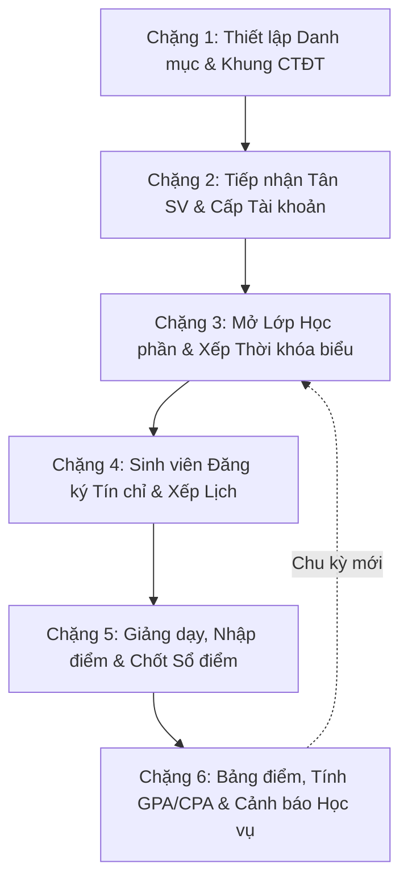

---

### Chặng 1: Thiết lập Danh mục & Cơ cấu Đào tạo
- **Chủ thể:** Quản trị viên / Phòng Đào tạo (Admin).
- **Hành động:** 
  1. Khởi tạo danh mục Khoa (`departments`), Ngành học (`majors`), và Khóa tuyển sinh (`cohorts`).
  2. Sử dụng tính năng **"Khởi tạo Lớp theo Khóa"** (`/admin/classes`) để tự động sinh hàng loạt các Lớp sinh hoạt cho toàn trường chỉ bằng 1 click (ví dụ: `CNTT01-K17`, `KTPM01-K17`, `QTKD01-K17`...).
  3. Xây dựng Khung chương trình đào tạo mẫu (Curriculum) theo chuẩn 5 khối kiến thức (Đại cương, Cơ sở ngành, Chuyên ngành, Bổ trợ, Thực tập/Tốt nghiệp) với số tín chỉ từ 135 – 140 tín chỉ.
  4. Cấu hình danh mục Môn học và khai báo quan hệ Môn học tiên quyết (`subject_prerequisites`).

---

### Chặng 2: Tiếp nhận Sinh viên & Kích hoạt Tài khoản Tự động
- **Chủ thể:** Quản trị viên $\rightarrow$ Tân sinh viên.
- **Hành động:**
  1. Admin mở module Sinh viên (`/admin/students`), chọn **"Nhập Excel"**.
  2. Tải file danh sách sinh viên mới lên. Hệ thống tự động kiểm tra cú pháp, hiển thị màn hình **Xem trước đối soát trực quan** (bôi xanh dòng hợp lệ, bôi đỏ dòng vi phạm mã lớp hoặc trùng mã sinh viên).
  3. Admin bấm **"Xác nhận nhập"**: Hệ thống khởi tạo hồ sơ `students` và tự động sinh bản ghi `users` với:
     - `username`: Mã sinh viên (ví dụ `24010001`).
     - `password`: Băm BCrypt mật khẩu mặc định `123456`.
     - `role`: `ROLE_STUDENT`.
     - `mustChangePassword`: `true`.
  4. Sinh viên đăng nhập lần đầu: Hệ thống phát hiện cờ `mustChangePassword = true`, chặn truy cập Dashboard và ép chuyển hướng sang màn hình `/change-password`. Sau khi đổi mật khẩu mới thành công, tài khoản chính thức được kích hoạt.

---

### Chặng 3: Lập kế hoạch Học kỳ, Mở Lớp học phần & Xếp Thời khóa biểu
- **Chủ thể:** Quản trị viên / Phòng Đào tạo.
- **Hành động:**
  1. Khởi tạo Học kỳ mới (ví dụ `Học kỳ 1 Năm học 2025-2026`), thiết lập khung thời gian bắt đầu, kết thúc và khoảng thời gian mở cổng đăng ký (`registrationStart` $\rightarrow$ `registrationEnd`).
  2. Bấm nút **"Đặt làm học kỳ hiện tại"** (`/api/semesters/{id}/set-current`): Hệ thống hạ cờ `isCurrent` của học kỳ cũ và bật cho học kỳ mới.
  3. Mở các Lớp học phần (`course_sections`) gắn với Môn học, cấu hình sĩ số tối đa `maxStudents` (mặc định 40), phân công Giảng viên phụ trách, trạng thái khởi tạo `OPEN`.
  4. Xếp Thời khóa biểu (`/admin/schedules`): Phân bổ Thứ, Ca/Tiết học (1–12), Phòng học (Building/Room). Hệ thống chạy thuật toán kiểm tra xung đột:
     - Xung đột phòng: Cùng phòng, cùng thứ, có khoảng tiết học giao nhau.
     - Xung đột giảng viên: Cùng giảng viên, cùng thời điểm đã có lớp khác.

---

### Chặng 4: Đăng ký Tín chỉ & Trợ lý Ghép TKB Thông minh
- **Chủ thể:** Sinh viên.
- **Hành động:**
  1. Sinh viên truy cập Cổng đăng ký môn học (`/student/enroll`) trong thời gian mở cổng.
  2. **Cách 1 - Đăng ký thông minh**: Sinh viên mở **"Trợ lý gợi ý TKB thông minh"**, chọn các môn muốn học trong kỳ. Thuật toán Backtracking Heuristic tự động duyệt các lớp còn chỗ và sinh ra top 3 phương án TKB tối ưu hoàn toàn không trùng lịch để sinh viên chọn đăng ký 1-click.
  3. **Cách 2 - Đăng ký thủ công**: Sinh viên chọn từng lớp học phần và bấm "Đăng ký".
  4. Hệ thống thực thi quy trình thẩm định 6 lớp nghiêm ngặt (xem chi tiết tại WF-11) kèm khóa bi quan `PESSIMISTIC_WRITE`. Nếu thỏa mãn, bản ghi `enrollments` được lưu và sĩ số tự động tăng.
  5. Sinh viên có thể tự hủy học phần trong thời gian mở cổng, miễn là lớp học phần đó chưa phát sinh bất kỳ điểm số nào.

---

### Chặng 5: Quá trình Giảng dạy, Nhập điểm & Chốt Sổ điểm 7 Ngày
- **Chủ thể:** Giảng viên phụ trách.
- **Hành động:**
  1. Giảng viên tra cứu lịch giảng dạy cá nhân dạng lưới tuần (`/lecturer/schedule`).
  2. Mở danh sách lớp phụ trách (`/lecturer/sections`) và truy cập Sổ điểm (`/lecturer/grades`).
  3. Nhập 4 cột điểm thành phần:
     - Chuyên cần 1 (CC1): Trọng số 5%
     - Chuyên cần 2 (CC2): Trọng số 5%
     - Giữa kỳ (GK): Trọng số 30%
     - Cuối kỳ (CK): Trọng số 60%
  4. Hệ thống tự động tính điểm Tổng kết hệ 10, quy đổi sang Thang điểm 4 và Điểm chữ (A, B+, B, C+, C, D+, D, F).
  5. **Quy tắc điểm liệt**: Nếu điểm cuối kỳ $< 3.0$, hệ thống tự động ép kết quả môn học về điểm `F` (0.0) bất kể tổng điểm thành phần cao đến đâu.
  6. **Chốt sổ điểm**: Sau khi nhập đủ 100% sinh viên, Giảng viên bấm **"Chốt & Công bố điểm"**. Điểm được công bố ngay lập tức cho sinh viên xem.
  7. **Cửa sổ ân hạn 7 ngày**: Giảng viên có quyền sửa đổi điểm trong vòng 7 ngày kể từ thời điểm chốt (`finalizedAt`). Hết 7 ngày, hệ thống khóa cứng vĩnh viễn. Mọi yêu cầu sửa điểm sau đó phải do Quản trị viên thực hiện (có ghi log audit).

---

### Chặng 6: Tổng kết Học kỳ, Tính GPA/CPA & Cảnh báo Học vụ
- **Chủ thể:** Toàn trường (Sinh viên, Giảng viên, Admin).
- **Hành động:**
  1. **Bảng điểm cá nhân**: Sinh viên vào xem kết quả học tập (`/student/transcript`). Hệ thống chỉ kết xuất các môn đã được chốt điểm (`isFinalized = true`), tính GPA học kỳ và CPA tích lũy toàn khóa theo thuật toán chọn điểm cao nhất của các lần học lại.
  2. **Phúc khảo điểm**: Sinh viên có thể gửi đơn đề nghị phúc khảo điểm trực tiếp trên portal (`/student/grade-appeals`).
  3. **Rà soát Cảnh báo học vụ tự động**: Admin mở module `/admin/warnings`. Hệ thống tự động quét toàn bộ cơ sở dữ liệu và phân loại sinh viên yếu kém:
     - *Cảnh báo Mức 1*: GPA học kỳ $< 1.0$ hoặc CPA $< 1.2$ (năm 1) / $< 1.4$ (năm 2).
     - *Cảnh báo Mức 2*: Bị cảnh báo mức 1 trong 2 học kỳ liên tiếp.
     - *Buộc thôi học*: Bị cảnh báo mức 2 không tiến bộ, hoặc vượt quá số lần cảnh báo cho phép.
  4. Xuất báo cáo, danh sách cảnh báo học vụ ra file CSV/Excel để gửi về các Khoa quản lý.

---

# PHẦN 3: CHI TIẾT 16 LUỒNG XỬ LÝ NGHIỆP VỤ CHUẨN HÓA

---

### WF-01: ĐĂNG NHẬP & XÁC THỰC HỆ THỐNG
- **Tác nhân:** Người dùng (Sinh viên, Giảng viên, Quản trị viên).
- **Mục tiêu:** Xác thực danh tính, cấp thẻ phiên JWT HS512, đọc trạng thái bảo mật tài khoản và điều hướng giao diện phù hợp với vai trò.
- **Tiền điều kiện:** Người dùng có tài khoản trên hệ thống và tài khoản đang ở trạng thái Hoạt động (`is_active = true`).
- **Endpoint API:** `POST /api/auth/login`
- **Sơ đồ xử lý (Activity Flow):**

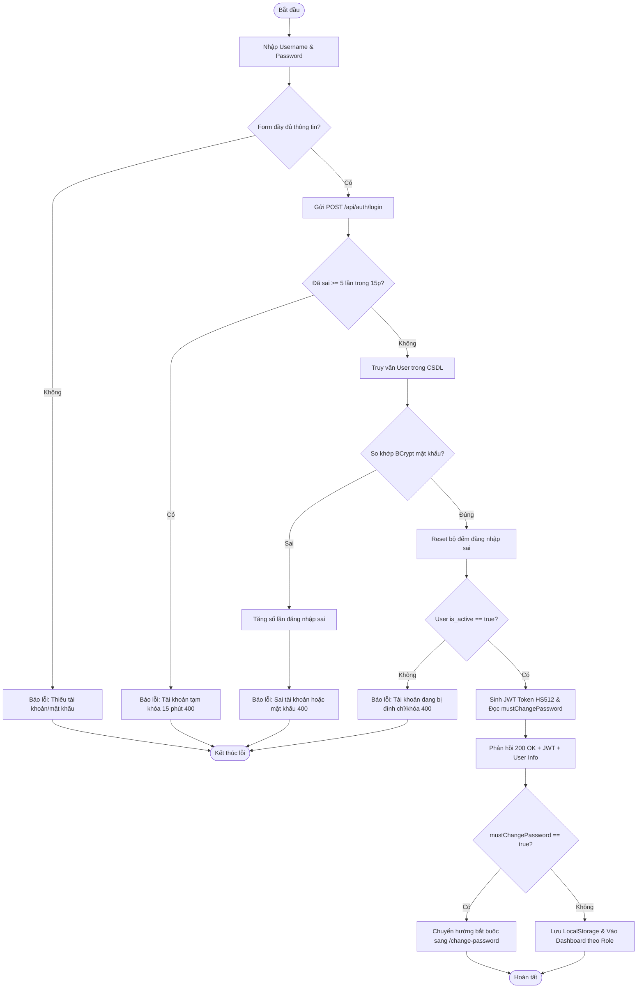

- **Quy tắc & Cơ chế xử lý:**
  - Khóa tài khoản chống Brute-force: `LoginAttemptService` lưu in-memory số lần thất bại theo username. 5 lần sai liên tiếp $\rightarrow$ khóa 15 phút.
  - Cờ `mustChangePassword`: Được kích hoạt khi Quản trị viên tạo mới tài khoản hoặc cấp lại mật khẩu. Sinh viên buộc phải đổi mật khẩu trước khi sử dụng các dịch vụ khác.

---

### WF-02: ĐỔI MẬT KHẨU & QUẢN LÝ AN TOÀN PHIÊN
- **Tác nhân:** Người dùng đã đăng nhập (Sinh viên, Giảng viên, Admin).
- **Mục tiêu:** Cập nhật mật khẩu cá nhân, mã hóa an toàn bằng BCrypt và hủy bỏ cờ bắt buộc đổi mật khẩu.
- **Tiền điều kiện:** Đã đăng nhập và sở hữu JWT Token hợp lệ.
- **Endpoint API:** `PUT /api/auth/change-password`
- **Sơ đồ xử lý:**

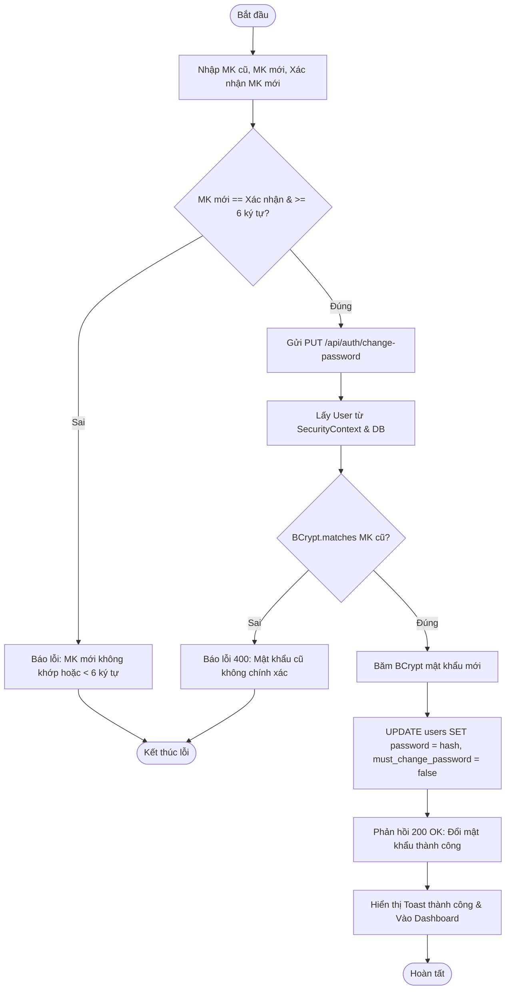

---

### WF-03: THÊM MỚI SINH VIÊN & CẤP PHÁT TÀI KHOẢN TỰ ĐỘNG
- **Tác nhân:** Quản trị viên / Phòng Đào tạo (Admin).
- **Mục tiêu:** Tiếp nhận sinh viên mới, lưu trữ hồ sơ nhân thân và tự động cấp tài khoản người dùng gắn vai trò `ROLE_STUDENT`.
- **Hỗ trợ 2 phương thức:** Nhập form đơn lẻ hoặc Nhập hàng loạt qua file Excel có đối soát trực quan.
- **Endpoint API:** `POST /api/students` (Đơn lẻ) / `POST /api/students/import-excel` (Hàng loạt).
- **Sơ đồ xử lý:**

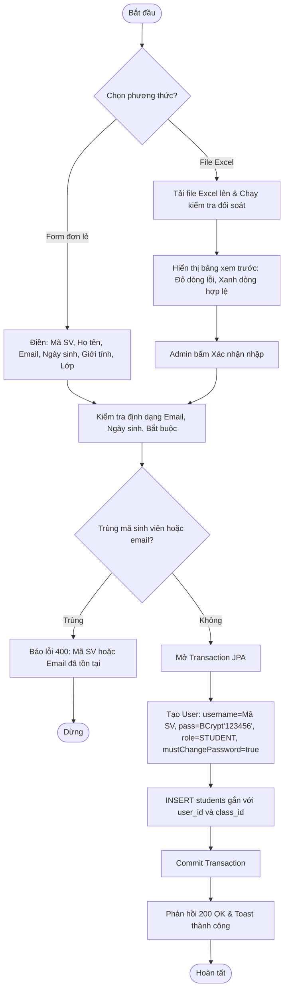

---

### WF-04: CẬP NHẬT HỒ SƠ & KHÓA TÀI KHOẢN SINH VIÊN
- **Tác nhân:** Quản trị viên (Admin).
- **Mục tiêu:** Thay đổi thông tin cá nhân của sinh viên hoặc cập nhật trạng thái học tập (Đang học $\rightarrow$ Đình chỉ, Thôi học, Tốt nghiệp) kèm tự động vô hiệu hóa tài khoản đăng nhập.
- **Endpoint API:** `PUT /api/students/{id}` hoặc `PATCH /api/students/{id}/status`
- **Sơ đồ xử lý:**

```mermaid
flowchart TD
    Start([Bắt đầu]) --> SelectStu[Admin chọn sinh viên trên danh sách]
    SelectStu --> ChangeStatus[Chọn trạng thái mới: SUSPENDED hoặc DROPPED]
    ChangeStatus --> Submit[Gửi PATCH /api/students/{id}/status]
    Submit --> CheckExists{Sinh viên có tồn tại?}
    CheckExists -- Không --> Err404[Báo lỗi 404: Không tìm thấy sinh viên] --> EndErr([Dừng])
    CheckExists -- Có --> ApplyLifecycle[Áp dụng quy tắc vòng đời BR-Lifecycle]
    ApplyLifecycle --> UpdateStudent[UPDATE students SET status = 'SUSPENDED']
    UpdateStudent --> SyncUser[UPDATE users SET is_active = false WHERE id = student.user_id]
    SyncUser --> Commit[Commit Transaction & Cập nhật UI]
    Commit --> Resp[Phản hồi 200 OK: Đã cập nhật và khóa tài khoản] --> EndOk([Hoàn tất])
```

---

### WF-05: QUẢN LÝ CƠ CẤU ĐÀO TẠO (KHOA & LỚP SINH HOẠT)
- **Tác nhân:** Quản trị viên (Admin).
- **Mục tiêu:** Xây dựng cơ cấu tổ chức đào tạo theo mô hình phân cấp Khoa $\rightarrow$ Ngành $\rightarrow$ Lớp sinh hoạt.
- **Tính năng nổi bật:** Khởi tạo lớp học tự động theo Khóa tuyển sinh (Bulk Class Generation).
- **Endpoint API:** `POST /api/departments`, `POST /api/classes`, `POST /api/classes/generate-by-cohort`
- **Sơ đồ xử lý:**

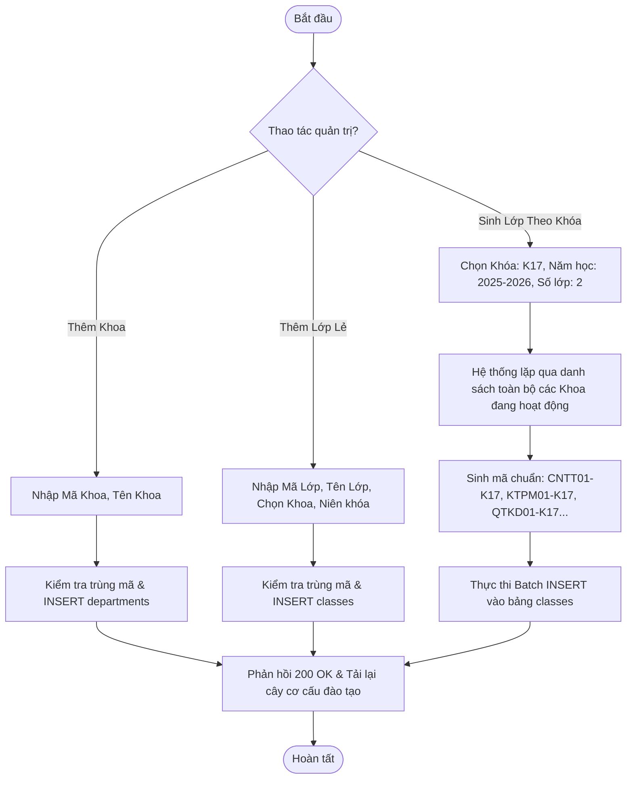

---

### WF-06: QUẢN LÝ GIẢNG VIÊN & CẤP PHÁT TÀI KHOẢN
- **Tác nhân:** Quản trị viên (Admin).
- **Mục tiêu:** Lưu trữ hồ sơ giảng viên, học vị, chuyên môn, thuộc Khoa chủ quản và tự động sinh tài khoản giảng viên mang vai trò `ROLE_LECTURER`.
- **Endpoint API:** `POST /api/lecturers`
- **Sơ đồ xử lý:** Tương tự như luồng thêm mới sinh viên, username mặc định là Mã giảng viên (ví dụ `1000001`), mật khẩu khởi tạo là `123456`, cờ `mustChangePassword = true`. Bản ghi `lecturers` gắn kết quan hệ 1-1 với `users` và N-1 với `departments`.

---

### WF-07: QUẢN LÝ MÔN HỌC, KHUNG CHƯƠNG TRÌNH & TÍN CHỈ
- **Tác nhân:** Quản trị viên / Phòng Đào tạo (Admin).
- **Mục tiêu:** Thiết lập danh mục môn học toàn trường, cấu hình số tín chỉ (1–6), khối lượng tiết lý thuyết / thực hành, và khai báo quan hệ môn học tiên quyết.
- **Endpoint API:** `POST /api/subjects`, `PUT /api/subjects/{id}`
- **Sơ đồ xử lý:**

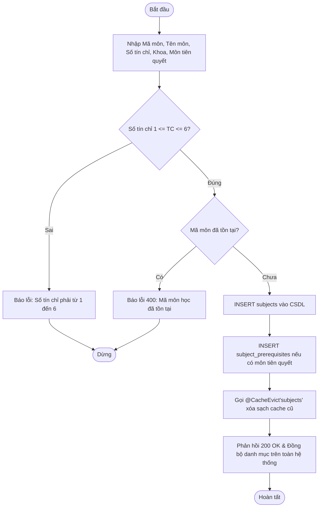

---

### WF-08: CẤU HÌNH HỌC KỲ & THIẾT LẬP ĐỢT ĐĂNG KÝ
- **Tác nhân:** Quản trị viên / Phòng Đào tạo (Admin).
- **Mục tiêu:** Khởi tạo học kỳ, thiết lập khung thời gian mở/đóng cổng đăng ký tín chỉ và chuyển giao học kỳ hiện tại (Set Current Semester).
- **Endpoint API:** `POST /api/semesters`, `PUT /api/semesters/{id}/set-current`
- **Sơ đồ xử lý:**

```mermaid
flowchart TD
    Start([Bắt đầu]) --> SelectSem[Chọn học kỳ cần kích hoạt]
    SelectSem --> SubmitSet[Gửi PUT /api/semesters/{id}/set-current]
    SubmitSet --> Tx[Mở Transaction JPA]
    Tx --> ClearOld[clearCurrentSemester: UPDATE semesters SET is_current = false]
    ClearOld --> SetNew[UPDATE semesters SET is_current = true WHERE id = :id]
    SetNew --> EvictCache[Gọi @CacheEvict'semesters' làm mới bộ nhớ đệm]
    EvictCache --> Commit[Commit Transaction]
    Commit --> Resp[Phản hồi 200 OK: Đã thiết lập Học kỳ Hiện tại thành công] --> EndOk([Hoàn tất])
```

---

### WF-09: MỞ & ĐIỀU PHỐI LỚP HỌC PHẦN
- **Tác nhân:** Quản trị viên / Phòng Đào tạo (Admin).
- **Mục tiêu:** Mở các lớp học phần cụ thể cho từng môn học trong học kỳ hiện tại, cấu hình giới hạn sức chứa sinh viên và phân công giảng viên giảng dạy.
- **Endpoint API:** `POST /api/course-sections`
- **Sơ đồ xử lý:**
  1. Admin chọn Học kỳ đang hoạt động, chọn Môn học từ danh mục.
  2. Nhập Mã lớp học phần (ví dụ `IT101.01`), Sĩ số tối đa `maxStudents` (thường là 40 hoặc 60 sinh viên).
  3. Chọn Giảng viên phụ trách thuộc Khoa tương ứng.
  4. Hệ thống kiểm tra trùng mã lớp học phần qua `existsBySectionCode`.
  5. Khi hợp lệ, INSERT bản ghi `course_sections` với `status = 'OPEN'`, `enrolled_count = 0`. Lớp học phần sẵn sàng để xếp lịch và mở cho sinh viên đăng ký.

---

### WF-10: XẾP THỜI KHÓA BIỂU & KIỂM TRA XUNG ĐỘT LỊCH
- **Tác nhân:** Quản trị viên / Phòng Đào tạo (Admin).
- **Mục tiêu:** Gán thời gian (Thứ, Tiết bắt đầu – Tiết kết thúc), Địa điểm (Tòa nhà, Phòng học) cho lớp học phần, tự động phát hiện và ngăn chặn mọi xung đột trùng phòng hoặc trùng lịch giảng viên.
- **Endpoint API:** `POST /api/schedules`
- **Sơ đồ xử lý:**

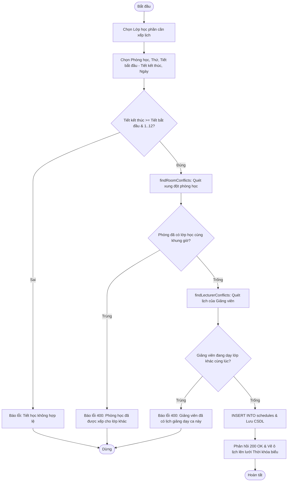

---

### WF-11: SINH VIÊN ĐĂNG KÝ LỚP HỌC PHẦN (LUỒNG TRỌNG TÂM)
- **Tác nhân:** Sinh viên.
- **Mục tiêu:** Đăng ký lớp học phần mong muốn trong học kỳ hiện tại dưới sự kiểm soát của khóa bi quan chống quá tải và 6 lớp ràng buộc nghiệp vụ.
- **Tiền điều kiện:** Cổng đăng ký học kỳ đang mở (`isRegistrationOpen = true`), tài khoản sinh viên hoạt động.
- **Endpoint API:** `POST /api/enrollments`
- **Sơ đồ xử lý toàn diện:**

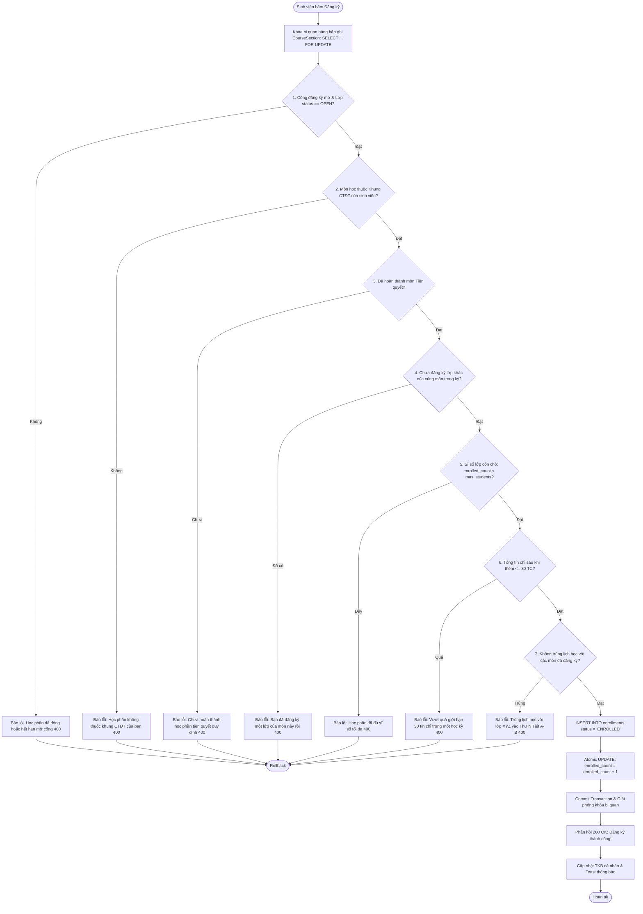

- **Ràng buộc kiểm tra giao nhau lịch học:** Hai lớp bị coi là trùng lịch khi và chỉ khi:
  $$\text{dayOfWeek}_1 = \text{dayOfWeek}_2 \quad \text{VÀ} \quad (\text{startPeriod}_1 \le \text{endPeriod}_2 \ \land \ \text{endPeriod}_1 \ge \text{startPeriod}_2) \quad \text{VÀ} \quad (\text{Khoảng ngày học giao nhau})$$

---

### WF-12: HỦY ĐĂNG KÝ HỌC PHẦN & HOÀN TRẢ SĨ SỐ
- **Tác nhân:** Sinh viên.
- **Mục tiêu:** Rút khỏi lớp học phần đã đăng ký, hoàn trả lại chỗ trống cho các sinh viên khác.
- **Tiền điều kiện:** Bản ghi đang ở trạng thái `ENROLLED`, trong thời gian mở cổng đăng ký, và **chưa có bất kỳ điểm số nào** trong sổ điểm.
- **Endpoint API:** `DELETE /api/enrollments/{id}`
- **Sơ đồ xử lý:**

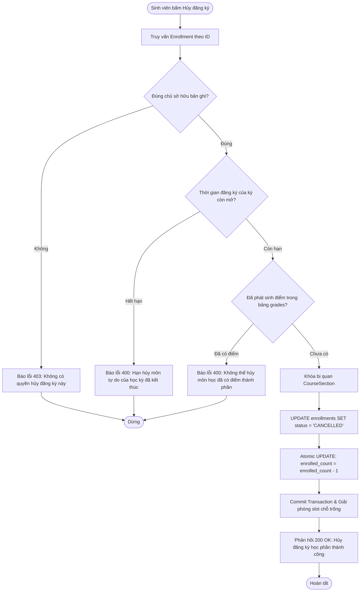

---

### WF-13: GIẢNG VIÊN NHẬP ĐIỂM THÀNH PHẦN, ĐIỂM THI & KHÓA SỔ ĐIỂM (LUỒNG 2)
- **Tác nhân:** Giảng viên phụ trách lớp học phần.
- **Mục tiêu:**
  - *Bước 1 (Nhập điểm quá trình):* Nhập điểm CC1 (5%), CC2 (5%), GK (30%) ở chế độ Bản nháp (`DRAFT`). Sinh viên được quyền xem điểm quá trình trên Bảng điểm cá nhân để đối chiếu trước khi thi.
  - *Bước 2 (Nhập điểm thi & Khóa sổ):* Giảng viên nhập điểm thi Cuối kỳ (CK 60%), hệ thống kiểm tra 100% sinh viên đã có điểm hoặc trạng thái đặc biệt (V/I/M). Giảng viên bấm "Gửi duyệt & Khóa sổ", bảng điểm chuyển sang `SUBMITTED`, khóa cứng (Read-only) và chờ Phòng Đào tạo duyệt.
- **Endpoint API:**
  - `PUT /api/grades/batch` (với `finalize = false` để lưu nháp).
  - `POST /api/grades/section/{id}/submit-official` (Khóa bảng điểm & nộp duyệt).
- **Sơ đồ xử lý:**

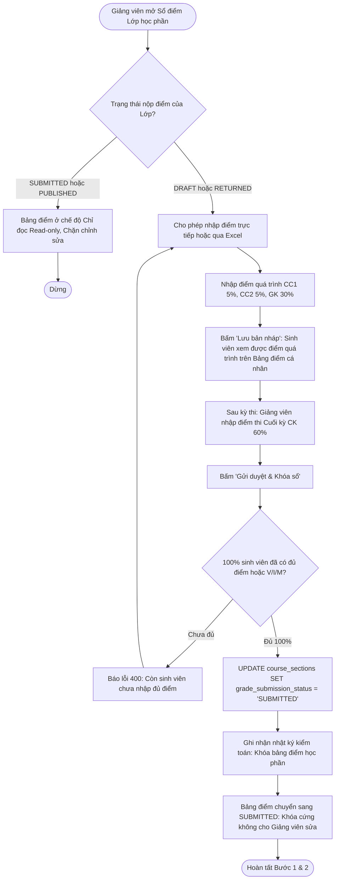

---

### WF-14: PHÒNG ĐÀO TẠO THẨM ĐỊNH, TRẢ VỀ & PHÁT HÀNH ĐIỂM CHÍNH THỨC (LUỒNG 2)
- **Tác nhân:** Phòng Đào tạo (Academic Affairs / Admin).
- **Mục tiêu:** Kiểm tra, rà soát tính hợp lệ của bảng điểm do Giảng viên nộp; trả về kèm lý do nếu có sai sót, hoặc phát hành điểm chính thức toàn trường và kích hoạt cửa sổ phúc khảo 7 ngày.
- **Endpoint API:**
  - `POST /api/grades/section/{id}/return` (Trả về kèm lý do).
  - `POST /api/grades/section/{id}/publish` (Phát hành điểm chính thức).
- **Sơ đồ xử lý:**

```mermaid
flowchart TD
    Start([Phòng Đào tạo mở Bảng điều khiển Quản lý Điểm]) --> FilterSub[Lọc danh sách các lớp học phần ở trạng thái SUBMITTED]
    FilterSub --> ReviewSheet[Kiểm tra rà soát bảng điểm lớp học phần]
    ReviewSheet --> CheckValid{Bảng điểm có hợp lệ?}
    CheckValid -- Phát hiện sai sót --> ClickReturn[Bấm 'Trả về' và nhập lý do điều chỉnh]
    ClickReturn --> UpdateReturn[UPDATE course_sections SET grade_submission_status = 'RETURNED', grade_return_reason = ?]
    UpdateReturn --> UnlockLec[Mở khóa cho Giảng viên: Hiển thị banner lý do trả về để giảng viên sửa và nộp lại] --> EndReturn([Hoàn tất trả về])
    CheckValid -- Hợp lệ --> ClickPublish[Bấm 'Phát hành điểm']
    ClickPublish --> SetPublish[UPDATE grades SET is_finalized = true, finalized_at = NOW()]
    SetPublish --> SetSecPublish[UPDATE course_sections SET grade_submission_status = 'PUBLISHED', published_at = NOW()]
    SetSecPublish --> NotifyStudents[Phát hành điểm tới Sinh viên: Mở xem CK, Tổng kết, GPA/CPA và gửi SSE thông báo]
    NotifyStudents --> Start7Days[Kích hoạt đếm ngược 7 ngày: Cho phép sinh viên nộp đơn phúc khảo điểm thi CK] --> EndOk([Hoàn tất công bố])
```

---

### WF-17: QUY TRÌNH XỬ LÝ PHÚC KHẢO ĐIỂM THI KẾT THÚC HỌC PHẦN (LUỒNG 2)
- **Tác nhân:** Sinh viên, Phòng Đào tạo, Cán bộ chấm thi thứ 2 (Independent Examiner), Trưởng Bộ môn (Department Head).
- **Mục tiêu:** Tiếp nhận và xử lý đơn phúc khảo điểm thi cuối kỳ minh bạch, đúng quy chế đào tạo tín chỉ qua quy trình 4 giai đoạn độc lập.
- **Endpoint API:**
  - `POST /api/grade-appeals` (Sinh viên nộp đơn).
  - `PUT /api/grade-appeals/{id}/assign` (P. Đào tạo phân công CB 2).
  - `PUT /api/grade-appeals/{id}/submit-grading` (CB 2 nộp kết quả chấm lại).
  - `PUT /api/grade-appeals/{id}/head-sign` (Trưởng BM ký duyệt điện tử).
  - `PUT /api/grade-appeals/{id}/apply-final` (P. Đào tạo cập nhật sổ điểm).
- **Sơ đồ xử lý:**

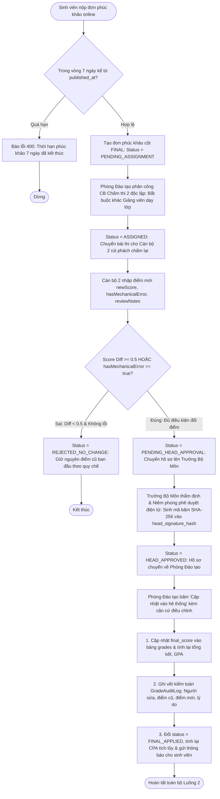

---

### WF-15: TRA CỨU BẢNG ĐIỂM, LỊCH SỬ HỌC TẬP & TÍNH GPA/CPA
- **Tác nhân:** Sinh viên.
- **Mục tiêu:** Theo dõi kết quả học tập, điểm chi tiết từng môn, tiến độ tích lũy tín chỉ và biểu đồ biến thiên điểm GPA/CPA.
- **Endpoint API:** `GET /api/transcript/me`
- **Sơ đồ xử lý:**

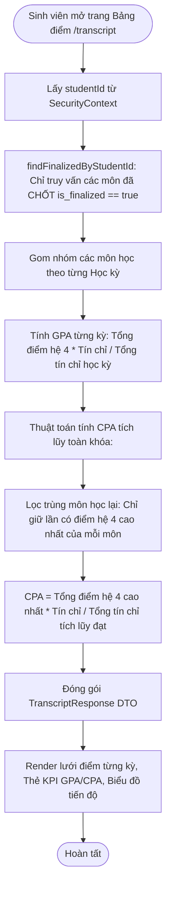

---

### WF-16: BÁO CÁO THỐNG KÊ TOÀN TRƯỜNG, CẢNH BÁO HỌC VỤ & DASHBOARD
- **Tác nhân:** Quản trị viên (Admin).
- **Mục tiêu:** Giám sát toàn cảnh hoạt động đào tạo của nhà trường, cơ cấu sinh viên theo Khoa, phân bố trạng thái học tập và lọc danh sách cảnh báo học vụ.
- **Endpoint API:** `GET /api/dashboard`, `GET /api/admin/academic-warnings`
- **Sơ đồ xử lý:**
  1. Admin mở Bảng điều khiển Quản trị (`/admin/dashboard`).
  2. `DashboardService` thực thi các câu lệnh đếm tổng hợp:
     - `countByDepartment()`: Gom nhóm số lượng sinh viên theo từng Khoa $\rightarrow$ Vẽ Biểu đồ Cột.
     - `countByStatus()`: Đếm sinh viên theo các trạng thái (`ACTIVE`, `GRADUATED`, `SUSPENDED`, `DROPPED`) $\rightarrow$ Vẽ Biểu đồ Tròn.
     - Đếm tổng số Khoa, Lớp, Môn học, Giảng viên, Lớp học phần mở trong kỳ $\rightarrow$ Thẻ KPI.
  3. Module Cảnh báo học vụ quét tự động dữ liệu bảng điểm toàn trường, lọc ra các sinh viên có:
     - Điểm GPA học kỳ $< 1.0$ (Cảnh báo mức 1).
     - CPA $< 1.2$ đối với năm nhất hoặc $< 1.4$ đối với năm hai.
  4. Hệ thống kết xuất danh sách chi tiết có kèm mã SV, họ tên, lớp, điểm CPA và số lần cảnh báo để Admin xuất file Excel/CSV gửi thông báo xử lý học vụ.

---

# PHẦN 4: CÁC LUỒNG KỸ THUẬT HẠ TẦNG, BẢO MẬT & KIỂM SOÁT ĐỒNG THỜI

### 4.1 Luồng Quên Mật Khẩu 2 Bước An Toàn (Chống Enumeration)
- **Vấn đề an ninh:** Nếu người dùng nhập một username không tồn tại mà hệ thống báo ngay *"Tài khoản không tồn tại"*, hacker có thể lợi dụng để quét và dò tìm toàn bộ danh sách tài khoản trong trường.
- **Giải pháp triển khai trong SMS:**
  1. **Bước 1 (Gửi yêu cầu):** Sinh viên/Giảng viên gửi yêu cầu cấp lại mật khẩu tại `/api/auth/forgot-password`. Cho dù tài khoản có tồn tại hay không, hệ thống **luôn luôn trả về cùng một thông điệp**: *"Yêu cầu cấp lại mật khẩu của bạn đã được ghi nhận và gửi tới Phòng Đào tạo xét duyệt"*.
  2. **Bước 2 (Admin xét duyệt):** Quản trị viên truy cập màn hình Duyệt cấp lại mật khẩu (`/admin/password-resets`).
     - Khi Admin bấm **"Duyệt"**: Hệ thống dùng bộ sinh ngẫu nhiên an toàn `SecureRandom` sinh mật khẩu mới 8 ký tự (đã loại bỏ các ký tự dễ gây nhầm lẫn như `0`, `O`, `1`, `I`, `l`).
     - Mật khẩu mới được băm BCrypt, lưu vào CSDL, đồng thời bật cờ `mustChangePassword = true`.
     - Hệ thống gửi email thông báo mật khẩu mới **về đúng địa chỉ email chính thức lưu trong hồ sơ sinh viên/giảng viên** (tuyệt đối không gửi vào email do người lạ nhập vào từ form công khai). Email hiển thị trên giao diện Admin được làm mờ (Masking: `ngu***@sv.sms.edu.vn`) để bảo mật thông tin cá nhân.

---

### 4.2 Luồng Khóa Tài Khoản Tạm Thời (Brute-force Protection)
- Triển khai trong service `LoginAttemptService.java`:
  - Sử dụng bộ đệm in-memory lưu số lần thất bại theo `username`.
  - Mỗi lần đăng nhập sai mật khẩu: Tăng bộ đếm lên 1.
  - Khi bộ đếm đạt ngưỡng 5 lần: Ghi nhận mốc thời gian khóa 15 phút. Trong thời gian này, mọi nỗ lực đăng nhập đúng hay sai đều bị chặn với thông báo lỗi HTTP 400.
  - Khi người dùng đăng nhập thành công với mật khẩu chính xác: Bộ đếm tự động được xóa về 0.

---

### 4.3 Luồng Giải Quyết Tranh Chấp Sĩ Số & Chống Quá Tải (Concurrency Pipeline)
- **Kịch bản thực tế:** Giả sử một lớp học phần chỉ còn đúng 1 suất trống duy nhất, nhưng lúc 08:00:00 sáng có 100 sinh viên cùng nhấn nút "Đăng ký".
- **Cơ chế bảo vệ của SMS:**
  1. Yêu cầu đầu tiên chạm tới backend được cấp khóa `PESSIMISTIC_WRITE` trên hàng bản ghi của lớp học phần trong MySQL.
  2. 99 yêu cầu còn lại bị chặn ở trạng thái chờ (Wait Queue) trong kết nối JDBC của HikariCP.
  3. Giao dịch đầu tiên kiểm tra `enrolled_count < max_students` $\rightarrow$ Thỏa mãn $\rightarrow$ Thực hiện `INSERT` bản ghi đăng ký $\rightarrow$ Trigger MySQL chạy, tăng `enrolled_count` lên bằng `max_students` $\rightarrow$ Giao dịch kết thúc và nhả khóa.
  4. Giao dịch thứ hai lấy được khóa, đọc lại bản ghi thì thấy `enrolled_count == max_students` $\rightarrow$ Lập tức ném ngoại lệ `BadRequestException("Học phần đã đầy")` và rollback.
  5. Tương tự, 98 giao dịch tiếp theo đều bị chặn an toàn. **Không bao giờ xảy ra tình trạng vượt sĩ số (Over-enrollment).**

---

### 4.4 Luồng Gợi Ý Thời Khóa Biểu Thông Minh (Smart Schedule Backtracking)
- Được xây dựng trên thuật toán **Tìm kiếm Quay lui (Backtracking Search) kết hợp Heuristic kiểm tra giao nhau thời gian (Interval Overlap)**:
  1. Sinh viên tích chọn danh sách $K$ môn học cần đăng ký trong kỳ.
  2. Thuật toán trích xuất toàn bộ các lớp học phần đang mở và còn chỗ trống của $K$ môn học này.
  3. Tiến hành duyệt tổ hợp các lớp học phần: Tại mỗi bước đệ quy, thuật toán kiểm tra xung đột thời gian giữa lớp đang xét với các lớp đã chọn trước đó trong tổ hợp.
  4. Nếu phát hiện trùng giờ, nhánh tìm kiếm bị cắt tỉa ngay lập tức (Pruning), giúp thuật toán đạt tốc độ phản hồi cực nhanh ($< 5\text{ms}$).
  5. Trả về cho sinh viên tối đa 3 phương án thời khóa biểu hợp lệ, đẹp nhất và không bị trống quá nhiều tiết giữa các ca học.

---

# PHẦN 5: MA TRẬN ĐỐI CHIẾU & BẢNG TRA CỨU LUỒNG XỬ LÝ

Bảng tổng hợp tra cứu nhanh toàn bộ 16 luồng nghiệp vụ cốt lõi của Hệ thống SMS:

| Mã Luồng | Tên Luồng Xử Lý | Tác Nhân Chính | Điểm Cuối API (Endpoint) | Service / Component Phụ Trách | Cơ Chế Bảo Mật & Ràng Buộc CSDL |
| :---: | :---| :---: | :---| :---| :---|
| **WF-01** | Đăng nhập & Cấp thẻ JWT | All Users | `POST /api/auth/login` | `AuthService`, `LoginAttemptService` | BCrypt, JWT HS512, Khóa 15p sau 5 lần sai |
| **WF-02** | Đổi mật khẩu cá nhân | Logged Users | `PUT /api/auth/change-password` | `AuthService`, `UserRepository` | Kiểm tra mật khẩu cũ, MustChangePassword=false |
| **WF-03** | Thêm mới & Cấp user SV | Admin | `POST /api/students` | `StudentService`, `UserRepository` | Transaction kép (User + Student), Check Unique |
| **WF-04** | Khóa hồ sơ & Đình chỉ | Admin | `PATCH /api/students/{id}/status` | `StudentService`, `UserRepository` | BR-Lifecycle: Đổi status kéo theo `is_active=false` |
| **WF-05** | Quản lý Khoa & Lớp SH | Admin | `POST /api/classes` | `ClassService`, `DepartmentService` | Tự động sinh lớp theo Khóa (Bulk Generation) |
| **WF-06** | Thêm & Cấp user Giảng viên| Admin | `POST /api/lecturers` | `LecturerService`, `UserRepository` | Transaction kép, gán role `ROLE_LECTURER` |
| **WF-07** | Quản lý Môn & Tiên quyết | Admin | `POST /api/subjects` | `SubjectService`, `PrerequisiteRepo` | 1 <= Tín chỉ <= 6, `@CacheEvict('subjects')` |
| **WF-08** | Kích hoạt Học kỳ Hiện tại | Admin | `PUT /api/semesters/{id}/set-current` | `SemesterService`, `SemesterRepository`| Reset toàn bộ `is_current=false`, set kỳ mới |
| **WF-09** | Mở Lớp Học phần | Admin | `POST /api/course-sections` | `CourseSectionService` | Kiểm tra trùng mã học phần, gán Giảng viên |
| **WF-10** | Xếp TKB & Chống trùng lịch| Admin | `POST /api/schedules` | `ScheduleService`, `ScheduleRepository` | Quét xung đột kép: Trùng phòng & Trùng giảng viên |
| **WF-11** | Đăng ký Học phần (Core) | Sinh viên | `POST /api/enrollments` | `EnrollmentService`, `CourseSectionRepo`| Khóa bi quan `PESSIMISTIC_WRITE`, Triggers DB, 6 BRs |
| **WF-12** | Hủy Đăng ký & Trả slot | Sinh viên | `DELETE /api/enrollments/{id}` | `EnrollmentService`, `GradeRepository` | Chặn hủy khi đã có điểm, Trigger giảm sĩ số |
| **WF-13** | Nhập điểm & Khóa sổ (L2) | Giảng viên | `POST /grades/section/{id}/submit-official` | `GradeService`, `CourseSectionRepo` | Nhập nháp quá trình, khóa cứng khi nộp duyệt |
| **WF-14** | Thẩm định & Công bố (L2) | P. Đào tạo | `POST /grades/section/{id}/publish` | `GradeService`, `NotificationService` | Trả về (RETURNED) hoặc phát hành (PUBLISHED), kích hoạt 7 ngày |
| **WF-17** | Phúc khảo 4 bước (L2) | All Roles | `/api/grade-appeals/*` | `GradeAppealService`, `GradeService` | Chấm độc lập, ngưỡng 0.5 / lỗi cơ học, ký SHA-256, Audit Log |
| **WF-15** | Bảng điểm & Tính GPA/CPA | Sinh viên | `GET /api/transcript/me` | `TranscriptService`, `GradeRepository` | Chỉ lấy điểm đã finalized, Khử trùng môn học lại |
| **WF-16** | Báo cáo Thống kê & Warning| Admin | `GET /api/dashboard`, `/admin/warnings`| `DashboardService`, `TranscriptService`| Gom nhóm Khoa, Trạng thái, Cảnh báo học lực 3 mức |

---

> 🎯 **Kết luận:** Tài liệu này đóng vai trò là "kim chỉ nam" phản ánh toàn bộ kiến trúc xử lý nghiệp vụ của Hệ thống Quản lý Sinh viên (SMS), đồng bộ 100% giữa thiết kế phân tích hệ thống (UML Activity Diagrams / Sequence Diagrams / BCE Class Diagrams) với mã nguồn Java Spring Boot và cơ sở dữ liệu MySQL 8.0.
