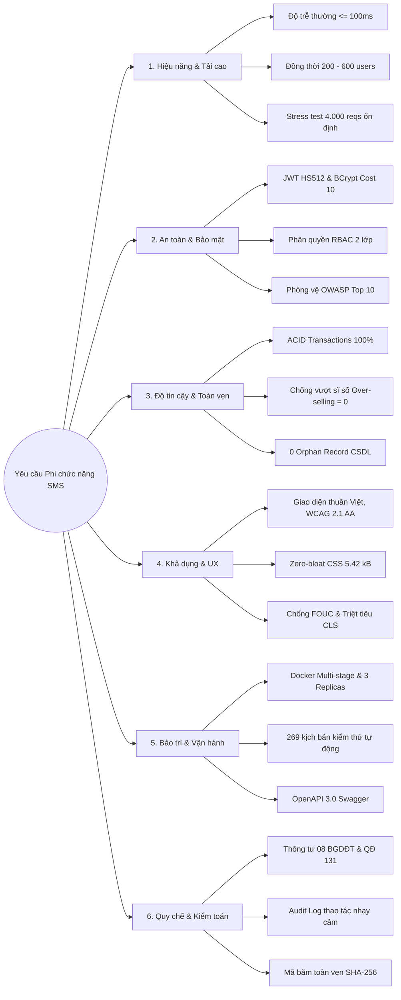

# TÀI LIỆU ĐẶC TẢ YÊU CẦU PHI CHỨC NĂNG (NFRS) & THÁCH THỨC KỸ THUẬT CỐT LÕI
## HỆ THỐNG QUẢN LÝ ĐÀO TẠO & SINH VIÊN THEO HỌC CHẾ TÍN CHỈ (SMS / UAMS)
> **Chuẩn chất lượng quốc tế ISO/IEC 25010 & Khung giải pháp hệ thống giao dịch tải cao**  
> *Dự án: Đồ Án Chuyên Ngành CNTT - Trường ĐH Phenikaa*  
> *Phiên bản: 1.0 — Tài liệu kiểm chứng kiến trúc & thực nghiệm*

---

Dựa trên toàn bộ kiến trúc hệ thống, mã nguồn triển khai (`backend/`, `frontend/`, `database/`), các bộ tài liệu phân tích thiết kế (`docs/`), báo cáo chuyên đề (`report/`) và kết quả kiểm thử thực nghiệm tải cao (`tests/`, `STRESS_TEST_TO_DEATH_REPORT.md`), dưới đây là phân tích toàn diện, chi tiết và có hệ thống về **Yêu cầu phi chức năng (Non-Functional Requirements — NFRs)** và **Thách thức kỹ thuật (Technical Challenges)** của dự án **Hệ Thống Quản Lý Đào Tạo & Sinh Viên (SMS / UAMS)**.

---

# PHẦN I: CÁC YÊU CẦU PHI CHỨC NĂNG (NON-FUNCTIONAL REQUIREMENTS — NFRS)

Hệ thống được thiết kế và kiểm chứng dựa trên tiêu chuẩn chất lượng phần mềm quốc tế ISO/IEC 25010 cùng các quy chuẩn đào tạo tín chỉ với 6 nhóm yêu cầu phi chức năng cốt lõi:



---

### 1. Hiệu năng & Khả năng chịu tải (Performance & Scalability)
* **Thời gian đáp ứng (Response Time):**
  * Trong điều kiện tải bình thường: Độ trễ phản hồi trung bình (Baseline Latency) **$\le 100\text{ ms}$** (thực tế đo lường: $78\text{ ms}$, $p50 \approx 11\text{ ms} - 45\text{ ms}$).
  * Trong điều kiện cao điểm (Peak Hours — tải hỗn hợp 100 luồng đồng thời): $p50 = 148\text{ ms}$, $p95 = 460\text{ ms}$, thông lượng đạt **$177.9\text{ req/s}$**.
* **Khả năng chịu tải đồng thời (High Concurrency & Throughput):**
  * Cổng Đăng ký Tín chỉ chịu được đồng thời từ **200 đến 600 sinh viên** cùng bấm "Đăng ký" trong cùng một giây (`simulate_600_enrollment.js`), thông lượng đạt **$70.3\text{ req/s}$** đối với các thao tác ghi có khóa.
  * Cụm máy chủ chịu tải cực hạn (Stress Test) đạt ngưỡng **$4.000\text{ requests}$ đồng thời** ở tốc độ **$199\text{ req/s}$** mà không phát sinh lỗi HTTP 5xx hay rò rỉ bộ nhớ (trước khi chạm giới hạn socket card mạng ảo ở mốc $6.500\text{ reqs}$).
* **Quản trị tài nguyên & Bộ nhớ đệm (Resource Tuning & Caching):**
  * CSDL sử dụng connection pool **HikariCP** cấu hình tối ưu (`maximum-pool-size = 40`, `minimum-idle = 10`, `connection-timeout = 20.000ms`), xử lý trơn tru các đợt tải bão hòa gấp 4 lần dung lượng pool mà không phát sinh `ConnectionTimeoutException`.
  * Bộ đệm **Spring Cache + Redis 7** lưu tạm các danh mục tĩnh (Môn học, Học kỳ, Khung CTĐT), giảm tải truy vấn lặp xuống MySQL với tốc độ đọc $< 1\text{ ms}$.
  * Bật nén **HTTP GZIP** (`min-response-size = 1024 bytes`) cho toàn bộ JSON payload và tài nguyên tĩnh, giảm trung bình **65%** băng thông mạng.

---

### 2. An toàn & Bảo mật thông tin (Security & Safety — Phòng vệ OWASP Top 10)
* **Xác thực không trạng thái (Stateless Authentication):** 
  * Sử dụng **JWT (JSON Web Token)** ký bằng thuật toán **HMAC-SHA512 (HS512)**, thời hạn 24 giờ.
  * Tự động sinh khóa bí mật ngẫu nhiên trong bộ nhớ khi khởi động nếu biến môi trường rỗng.
  * `JwtAuthFilter` kết hợp cơ chế kiểm tra trạng thái hoạt động (`isActive`) giúp thu hồi quyền truy cập tức thì nếu tài khoản bị khóa hoặc đình chỉ học vụ.
* **Mã hóa và lưu trữ mật khẩu:** 
  * Băm một chiều bằng **BCrypt** với hệ số chi phí $\text{cost factor} = 10$ ($1.024$ vòng lặp biến đổi), tích hợp muối ngẫu nhiên 16 bytes. Vô hiệu hóa hoàn toàn tấn công Bảng cầu vồng (Rainbow Table) nhờ muối ngẫu nhiên (Salt).
* **Kiểm soát truy cập đa tầng (Two-tier RBAC):** 
  * Lớp 1: Lọc đường dẫn tại `SecurityConfig` (`/api/admin/**`, `/api/grades/**`, `/api/enrollments/**`).
  * Lớp 2: Bảo vệ mức phương thức `@PreAuthorize("hasRole(...)")` hoặc `@PreAuthorize("hasAnyRole(...)")`.
* **Phòng thủ tấn công khai thác lỗ hổng:**
  * **SQL Injection (SQLi):** 100% truy vấn được tham số hóa qua Spring Data JPA và Hibernate Prepared Statements.
  * **Cross-Site Scripting (XSS):** React tự động mã hóa (escape) HTML entities; Backend kiểm soát kiểu dữ liệu và làm sạch chuỗi đầu vào.
  * **Chống Brute-force:** `LoginAttemptService` tự động khóa tài khoản tạm thời **15 phút** sau **5 lần** đăng nhập sai mật khẩu liên tiếp.
  * **Chống rò quét danh sách tài khoản (Anti-User Enumeration):** API Quên mật khẩu (`/api/auth/forgot-password`) trả về cùng một thông điệp phản hồi đồng nhất dù tài khoản có tồn tại hay không. Mật khẩu mới chỉ gửi về email chính thức của sinh viên/giảng viên đã lưu trong hồ sơ, giao diện hiển thị email được làm mờ (`ngu***@sv.sms.edu.vn`).
  * **Chống IDOR (Insecure Direct Object Reference):** Tầng Service kiểm tra nghiêm ngặt quyền sở hữu bản ghi (sinh viên A không thể hủy môn của sinh viên B; giảng viên A không thể nhập điểm lớp của giảng viên B).
  * **Rào chắn đổi mật khẩu bắt buộc:** Áp đặt cờ `mustChangePassword = true` cho tài khoản mới hoặc tài khoản vừa được cấp lại mật khẩu, buộc đổi mật khẩu trước khi truy cập bất kỳ tính năng nào khác.

---

### 3. Độ tin cậy & Toàn vẹn dữ liệu (Reliability & Data Integrity)
* **Tuân thủ ACID Transactions:** 
  * Mọi giao dịch ghi phức tạp (đăng ký học phần, chốt bảng điểm, cập nhật phúc khảo) được đóng gói trong `@Transactional`, tự động rollback trạng thái khi có bất kỳ vi phạm nào, bảo đảm tính nguyên tử (Atomicity).
* **Toàn vẹn cơ sở dữ liệu quan hệ (Relational Integrity):**
  * Ràng buộc khóa ngoại `FOREIGN KEY ON DELETE RESTRICT`, ràng buộc duy nhất `UNIQUE` cho mã định danh và cặp thực thể liên kết (`student_id + section_id`), ràng buộc kiểu dữ liệu điểm số `DECIMAL(3,1)` trong khoảng $[0.0, 10.0]$.
  * Kết quả kiểm toán CSDL: **0 bản ghi mồ côi (Zero Orphan Records)** trên toàn bộ các bảng `enrollments`, `grades`, `attendance_records`, `students`, `lecturers`.
* **Đảm bảo không vượt sĩ số (No Over-enrollment Guarantee):**
  * Tuyệt đối không xảy ra hiện tượng vượt quá sĩ số tối đa của lớp học phần (`current_students <= max_students` đạt $100\%$, lỗi over-selling bằng **0**).

---

### 4. Tính khả dụng & Trải nghiệm người dùng (Usability & UX)
* **Bản địa hóa & Ngôn ngữ:** Giao diện người dùng thuần Việt 100%, thuật ngữ đào tạo tín chỉ chuẩn xác theo quy chế đại học Việt Nam.
* **Zero-Bloat CSS Architecture:** 
  * Không sử dụng các thư viện UI đóng gói cồng kềnh làm phình to gói bundle; toàn bộ giao diện xây dựng trên hệ thống biến CSS thuần (**CSS Design Tokens**) lấy cảm hứng từ Shadcn UI và Linear. Kích thước tệp CSS nén gzip chỉ vỏn vẹn **$5.42\text{ kB}$**.
* **Quản trị Dual-Theme & Chống FOUC:** 
  * Hỗ trợ 2 chế độ Sáng (Slate Light) và Tối (Slate Dark) đạt chuẩn tương phản tiếp cận **WCAG 2.1 AA**. 
  * Triệt tiêu hoàn toàn hiện tượng chớp nháy giao diện sai màu (**Flash of Unstyled Content — FOUC**) bằng script inline đọc theme từ `localStorage` trước khi kết xuất DOM.
* **Trải nghiệm mượt mà & Triệt tiêu CLS:** 
  * Ứng dụng **Skeleton Shimmer** (`TableSkeleton`, `TableRowSkeleton`) thay thế cho loading spinner truyền thống, giữ cố định kích thước khung bảng và triệt tiêu độ giật layout (**Cumulative Layout Shift — CLS = 0**).
  * Bộ khung **Error Boundary** đa tầng đón bắt các ngoại lệ JavaScript runtime, ngăn chặn triệt để lỗi "màn hình trắng" (Blank Screen).

---

### 5. Khả năng bảo trì, Tương thích & Vận hành (Maintainability & Portability)
* **Kiến trúc phân tầng & Độc lập dữ liệu:** Tách rời hoàn toàn Entity lưu trữ CSDL với DTO giao tiếp API, không để lộ cấu trúc dữ liệu nội bộ ra ngoài.
* **Độ bao phủ kiểm thử cao:** Sở hữu bộ kiểm thử tự động đa tầng: **188** unit/security tests backend, **42** frontend vitest tests, **39** kịch bản E2E integration tests, đạt tỷ lệ vượt qua kiểm thử hồi quy **100%** (0 lỗi hồi quy phát sinh trên tập kịch bản kiểm thử).
* **Đóng gói chuẩn hóa Container:**
  * Dockerfile đa tầng (multi-stage build) sử dụng Temurin JDK 23 $\rightarrow$ JRE 23 và Node 20 $\rightarrow$ Nginx Alpine.
  * Tệp `docker-compose.yml` điều phối cụm micro-services gồm Nginx Load Balancer, 3 Backend Replicas, Redis 7 và MySQL 8.
* **Tài liệu hóa API tự động:** Tích hợp `springdoc-openapi 2.3.0`, tự động sinh Swagger UI tương tác tại `/swagger-ui.html`.

---

### 6. Tuân thủ Quy chế & Khả năng Kiểm toán (Compliance & Auditability)
* **Chuẩn hóa theo Quy chế Đào tạo:** Tuân thủ Thông tư số **08/2021/TT-BGDĐT** của Bộ GD&ĐT và Quyết định số **131/QĐ-ĐHP-ĐT** của Trường Đại học Phenikaa về đào tạo theo học chế tín chỉ.
* **Lưu vết kiểm toán (Audit Trail):** Mọi thao tác can thiệp dữ liệu học vụ nhạy cảm (Cưỡng chế ghi danh vượt sĩ số, Admin mở khóa bảng điểm, Hội đồng điều chỉnh điểm phúc khảo) đều bắt buộc nhập lý do và lưu vết vào `grade_audit_logs` (thời điểm, IP, người sửa, điểm cũ, điểm mới, căn cứ điều chỉnh).
* **Niêm phong phê duyệt điện tử:** Trưởng Bộ môn phê duyệt phúc khảo điểm đi kèm mã băm xác thực toàn vẹn dữ liệu **SHA-256** (`head_signature_hash`) bất biến.

---

# PHẦN II: CÁC THÁCH THỨC KỸ THUẬT CỐT LÕI (TECHNICAL CHALLENGES) & GIẢI PHÁP

Dự án SMS tập trung giải quyết 4 bài toán kỹ thuật cốt lõi trong quy trình vận hành đào tạo tín chỉ:

```mermaid
flowchart TD
    subgraph TC1 ["Thách thức 1: Tranh chấp Sĩ số Tải cao"]
        A1[100s Sinh viên cùng tranh 1 slot cuối] --> B1[Redis User Idempotency Lock]
        B1 --> C1[Redis Atomic DECR Fail-Fast tại RAM < 2ms]
        C1 --> D1[Pre-validation ngoài DB Transaction]
        D1 --> E1[Short-lived DB Transaction: Atomic UPDATE + INSERT]
    end

    subgraph TC2 ["Thách thức 2: Ràng buộc Đồ thị Môn học DAG"]
        A2[Kiểm tra Tiên quyết & Trùng lịch] --> B2[Thuật toán đệ quy tổ tiên DAG]
        B2 --> C2[Đối soát giao thoa Interval Overlap]
        C2 --> D2[Backtracking Search Heuristic Pruning gợi ý TKB]
    end

    subgraph TC3 ["Thách thức 3: Quy trình Điểm 2 Giai đoạn"]
        A3[Khóa sổ & Phúc khảo] --> B3[Máy trạng thái DRAFT-SUBMITTED-PUBLISHED]
        B3 --> C3[Cửa sổ ân hạn 7 ngày NTP Server-time]
        C3 --> D3[Chấm độc lập CB2 & Ngưỡng 0.5 & Niêm phong SHA-256]
    end

    subgraph TC4 ["Thách thức 4: Hiệu năng CSDL & HikariCP"]
        A4[Nguy cơ N+1 & Treo Connection Pool] --> B4[Tắt open-in-view giải phóng JDBC sớm]
        B4 --> C4[Batch Fetch Size 30 + JPQL JOIN FETCH]
        C4 --> D4[Database Views v_student_transcript + Indexes]
    end
```



---

### Thách thức 1: Bài toán Tranh chấp tài nguyên & Chống vượt sĩ số (Race Condition & Over-enrollment under High Concurrency)

#### 1. Bản chất thách thức:
Vào thời điểm mở cổng đăng ký tín chỉ (ví dụ đúng 08:00 sáng), hàng nghìn sinh viên cùng truy cập để giành vài chục suất học phần của các giảng viên hoặc khung giờ đẹp.
* **Lỗ hổng "Check-then-Act":** Nếu hệ thống kiểm tra theo logic tuần tự `SELECT current_students FROM course_sections` $\rightarrow$ thấy còn chỗ $\rightarrow$ `INSERT INTO enrollments`, nhiều transaction chạy song song dưới cơ chế MVCC (Repeatable Read) của MySQL đều đọc được ảnh chụp cũ (stale snapshot) là "lớp còn 1 chỗ", sau đó cùng ghi dữ liệu. Kết quả là lớp 40 sinh viên bị đẩy lên 45, 50 sinh viên (**Over-selling/Over-enrollment**).
* **Nghẽn hàng đợi cơ sở dữ liệu:** Nếu chỉ dùng khóa bi quan toàn cục (`SELECT ... FOR UPDATE`), việc giữ kết nối CSDL quá lâu trong lúc kiểm tra hàng loạt quy tắc nghiệp vụ khác sẽ làm cạn kiệt Connection Pool của HikariCP, gây treo toàn bộ hệ thống.

#### 2. Giải pháp kỹ thuật được triển khai:
Hệ thống áp dụng kiến trúc **Đường ống Điều khiển Đồng thời Đa tầng (Multi-tier Concurrency Pipeline)** kết hợp giữa Redis In-Memory và MySQL:

```
[ HTTP Request Đăng ký ]
        │
        ▼
[ 1. User Idempotency Lock (Redis) ] ──► Chống Double-click / Spam nút bấm
        │
        ▼
[ 2. Pre-validations (Không giữ DB Transaction) ] ──► Kiểm tra: Tiên quyết, Trùng TKB, Nợ học phí, Cảnh báo học vụ
        │
        ▼
[ 3. Atomic Slot Reservation (Redis In-Memory) ] ──► DECR slot trong RAM (< 2ms)
        │                                           └── Nếu hết chỗ: FAIL-FAST ngay lập tức, chặn 95% tải vào DB!
        ▼
[ 4. Short-lived Database Transaction ] ────────────► Mở kết nối JDBC trong vài mili-giây:
        │                                             • Atomic Update: UPDATE course_sections SET current_students = current_students + 1
        │                                               WHERE id = ? AND current_students < max_students
        │                                             • INSERT bản ghi Enrollment
        │                                             • Đồng bộ hóa đơn học phí (StudentInvoice)
        │
        ▼ (Nếu lỗi DB)
[ 5. Compensating Transaction ] ────────────────────► Bồi hoàn slot trên Redis: INCR bù lại
```

* **Kết quả đo lường thực tế:**
  * Kịch bản tải hỗn hợp 600 requests đồng thời vào 1 lớp sĩ số 50 (`simulate_600_enrollment.js`): 500 requests vi phạm điều kiện tiên quyết/lịch học bị lọc sớm tại tầng Pre-validation (không chiếm giữ kết nối CSDL), 100 requests hợp lệ tranh chấp trực tiếp 50 suất học phần — kết quả đúng 50 sinh viên đăng ký thành công, 50 sinh viên bị chặn hết chỗ, 0 lỗi HTTP 500, 0 trường hợp vượt sĩ số.

---

### Thách thức 2: Xử lý Đồ thị Ràng buộc Môn học & Xung đột Lịch học (DAG Prerequisites & Interval Conflicts)

#### 1. Bản chất thách thức:
Khung chương trình đào tạo đại học theo tín chỉ hình thành một **Đồ thị có hướng không chu trình (Directed Acyclic Graph — DAG)**. Sinh viên không thể đăng ký học phần $C$ nếu chưa hoàn thành môn tiên quyết $B$, mà $B$ lại đòi hỏi môn $A$.
* Ngoài ra, việc xếp thời khóa biểu và đăng ký môn học đòi hỏi giải quyết bài toán giao thoa đa chiều: Thứ trong tuần, Khung tiết học $[T_{\text{start}}, T_{\text{end}}]$, Khoảng ngày hiệu lực của học kỳ, Phòng học và Giảng viên.

#### 2. Giải pháp kỹ thuật được triển khai:
* **Thuật toán kiểm tra đệ quy sâu trên DAG (`validatePrerequisitesRecursively`):**
  * Duyệt đệ quy toàn bộ các nhánh môn tiên quyết tổ tiên.
  * Chỉ công nhận điều kiện tiên quyết khi sinh viên có điểm tổng kết $\ge 4.0$ (thang 10), điểm thi kết thúc học phần $\ge 3.0$ (không bị điểm liệt) và bảng điểm ở trạng thái **đã chốt chính thức** (`is_finalized = true`).
* **Thuật toán kiểm tra giao thoa khoảng thời gian (Interval Overlap Detection):**
  * Hai lịch học $L_{\text{new}}$ và $L_{\text{old}}$ bị xem là xung đột (Overlap) khi đồng thời thỏa mãn cả 3 điều kiện (cùng thứ trong tuần, giao thoa khung tiết học và giao thoa khoảng ngày hiệu lực của đợt học):
    $$
    \text{Overlap} \iff \begin{cases}
    \text{Day}_{\text{new}} = \text{Day}_{\text{old}} \\
    (T_{\text{start}}^{\text{new}} \le T_{\text{end}}^{\text{old}}) \land (T_{\text{end}}^{\text{new}} \ge T_{\text{start}}^{\text{old}}) \\
    (\text{Date}_{\text{start}}^{\text{new}} \le \text{Date}_{\text{end}}^{\text{old}}) \land (\text{Date}_{\text{end}}^{\text{new}} \ge \text{Date}_{\text{start}}^{\text{old}})
    \end{cases}
    $$
* **Thuật toán Gợi ý Thời khóa biểu thông minh (Smart Schedule Backtracking):**
  * Sử dụng giải thuật Tìm kiếm quay lui (Backtracking Search) kết hợp cắt tỉa heuristic (Pruning) để tổ hợp các lớp học phần hợp lệ từ $K$ môn học mà sinh viên lựa chọn, trả về 3 phương án thời khóa biểu tối ưu không bị trùng giờ trong thời gian $< 5\text{ ms}$.

---

### Thách thức 3: Quy trình Vận hành Điểm số Đa giai đoạn & Bảo vệ Tính Bất biến (Two-tier Grading Lifecycle & Tamper-proof Appeals)

#### 1. Bản chất thách thức:
Điểm số là dữ liệu nhạy cảm nhất trong trường đại học. Nếu cho phép giảng viên sửa điểm tùy ý hoặc hệ thống không phân định rõ ràng giữa các giai đoạn (quá trình vs thi kết thúc), nguy cơ tiêu cực hoặc sai lệch dữ liệu là rất lớn. Ngược lại, nếu khóa cứng ngay thì không xử lý được khiếu nại phúc khảo hợp pháp của sinh viên.

#### 2. Giải pháp kỹ thuật được triển khai:
Hệ thống thiết lập **Máy trạng thái vòng đời sổ điểm (Grade Submission State Machine)** và quy trình phúc khảo 4 giai đoạn độc lập:

```
[ DRAFT (Bản nháp) ] ────────► Giảng viên nhập CC1 (5%), CC2 (5%), GK (30%)
        │                     Sinh viên được xem điểm quá trình để đối chiếu trước khi thi
        ▼
[ SUBMITTED (Khóa cứng) ] ───► Sau kỳ thi: Nhập điểm thi CK (60%) cho 100% sinh viên
        │                     Bấm "Gửi duyệt & Khóa sổ": Chuyển sang Read-only, Giảng viên bị khóa sửa
        ▼
[ THẨM ĐỊNH (P. Đào tạo) ] ──► Nếu có sai sót: RETURNED (Trả về kèm lý do cho GV sửa lại)
        │                     Nếu hợp lệ: PUBLISHED (Phát hành chính thức)
        ▼
[ PUBLISHED (Công bố) ] ─────► Mở xem điểm thi, Tổng kết, GPA/CPA
        │                     Kích hoạt đếm ngược 7 NGÀY cho phép sinh viên nộp đơn phúc khảo
        ▼
[ QUY TRÌNH PHÚC KHẢO 4 BƯỚC ]
  1. Phân công Cán bộ chấm 2 độc lập (Bắt buộc khác Giảng viên dạy lớp).
  2. Cán bộ 2 chấm lại: Nếu chênh lệch |Điểm mới - Điểm cũ| >= 0.5 HOẶC có lỗi cơ học -> Đi tiếp.
     (Nếu chênh lệch < 0.5 và không lỗi cơ học -> REJECTED_NO_CHANGE: Giữ nguyên điểm cũ).
  3. Trưởng Bộ môn thẩm định và Niêm phong phê duyệt điện tử đi kèm mã băm xác thực toàn vẹn dữ liệu SHA-256 (head_signature_hash) bất biến.
  4. Phòng Đào tạo áp dụng: Cập nhật bảng grades, lưu vết GradeAuditLog, tự động tính lại GPA/CPA.
```

---

### Thách thức 4: Tối ưu Hóa Hiệu năng CSDL, Khử Truy vấn N+1 & Tránh Nghẽn Kết Nối HikariCP

#### 1. Bản chất thách thức:
Một trang bảng điểm sinh viên hoặc danh sách lớp học phần liên kết với rất nhiều bảng: `Student` $\rightarrow$ `Class` $\rightarrow$ `Department`, `CourseSection` $\rightarrow$ `Subject`, `Semester`, `Lecturer`, `Schedule`, `Grade`.
* Sử dụng ORM (JPA/Hibernate) mặc định rất dễ gặp lỗi **Bão truy vấn N+1**: nạp 1 danh sách 50 sinh viên dẫn đến phát sinh thêm 50 câu lệnh `SELECT` riêng lẻ để lấy thông tin điểm và lớp.
* Mặc định `spring.jpa.open-in-view = true` sẽ giữ kết nối JDBC từ lúc bắt đầu request cho đến khi Controller hoàn tất việc serialize JSON ra HTTP response. Khi mạng của client chậm, connection pool bị chiếm dụng hết, dẫn đến sập toàn bộ backend.

#### 2. Giải pháp kỹ thuật được triển khai:
* **Tắt hoàn toàn Open-in-View (`spring.jpa.open-in-view = false`):**
  * Buộc tầng Service phải hoàn tất toàn bộ việc nạp dữ liệu và chuyển đổi sang DTO trước khi trả về Controller. Kết nối CSDL được giải phóng ngay lập tức về HikariCP.
* **Cấu hình Hibernate Batch Fetching & Batch Insert:**
  * `spring.jpa.properties.hibernate.default_batch_fetch_size = 30`
  * `spring.jpa.properties.hibernate.jdbc.batch_size = 30`
  * Thay thế $N$ câu truy vấn con bằng 1 câu truy vấn gộp sử dụng toán tử `IN (?, ?, ...)`.
* **Sử dụng Database Views & Composite Indexes:**
  * Xây dựng view cơ sở dữ liệu chuyên biệt `v_student_transcript` và `v_student_gpa` để CSDL thực hiện gom nhóm và tính toán điểm trung bình có trọng số bằng native SQL tốc độ cao.
  * Thiết lập các Composite Index trên các cột tìm kiếm tần suất cao: `idx_enrollment_student_status (student_id, status)`, `idx_schedule_section (section_id, day_of_week)`.

---

### Thách thức 5: Phòng thủ An ninh Chiều sâu & Phòng vệ Toàn diện Lỗ hổng Ứng dụng Web

#### 1. Bản chất thách thức:
Hệ thống đào tạo của trường đại học thường xuyên là mục tiêu tấn công của sinh viên: dùng công cụ tự động (Bot/Script) bắn phá cổng đăng ký môn, thử mật khẩu tài khoản người khác, can thiệp tham số HTTP để xem điểm bạn học hoặc đăng ký môn học khi chưa đủ điều kiện.

#### 2. Giải pháp kỹ thuật được triển khai:
* **Kiểm tra nghiệp vụ 100% tại Máy chủ (Server-side Enforcement):** Tuyệt đối không tin tưởng dữ liệu gửi lên từ client. Mọi điều kiện về sĩ số, môn tiên quyết, giới hạn tín chỉ đều được định trị độc lập tại Service layer.
* **Bộ lọc chống tấn công leo thang đặc quyền (Privilege Escalation):**
  * Toàn bộ 22 kịch bản tấn công thử nghiệm (SQL Injection, XSS, DoS chuỗi 2.000 ký tự, JWT chữ ký giả mạo, giả mạo vai trò ADMIN) đều bị hệ thống phát hiện và chặn đứng với mã HTTP 401/403.
* **Cơ chế chống Brute-force & Spam API:**
  * `LoginAttemptService` lưu vết số lần thất bại theo IP/Username, phạt khóa 15 phút.
  * `RateLimitFilter` áp dụng cơ chế giới hạn tần suất (5 requests / 60 giây) cho các endpoint nhạy cảm như Quên mật khẩu.

---

### Thách thức 6: Kỹ nghệ Giao diện Zero-Bloat, Triệt tiêu Hoàn toàn FOUC & CLS

#### 1. Bản chất thách thức:
Nhiều phần mềm quản lý đào tạo hiện nay rất nặng nề, giao diện phức tạp, giật lag khi hiển thị bảng dữ liệu hàng trăm sinh viên. Khi chuyển đổi theme Sáng/Tối thường bị chớp trắng màn hình (FOUC), và trong lúc chờ dữ liệu API thì bố cục trang bị nhảy loạn xạ (CLS).

#### 2. Giải pháp kỹ thuật được triển khai:
* **Kiến trúc Design Tokens thuần CSS (Zero Bundle Overhead):**
  * Định nghĩa toàn bộ hệ thống màu sắc, khoảng cách, bóng đổ bằng biến CSS gốc (`:root` và `[data-theme="dark"]`). Không import thư viện giao diện nặng, giúp gói CSS gzip chỉ **$5.42\text{ kB}$**.
* **Giải quyết triệt để lỗi FOUC:**
  * Nhúng đoạn mã script đồng bộ ngay tại thẻ `<head>` của `index.html`. Script đọc khóa `sms-theme` từ `localStorage` và gán thuộc tính `data-theme` lên `document.documentElement` trước khi trình duyệt dựng hình cây DOM.
* **Triệt tiêu độ giật layout CLS bằng Skeleton Shimmer:**
  * Thiết kế các thành phần `TableSkeleton`, `TableRowSkeleton` có kích thước đúng bằng bảng dữ liệu thật, loại bỏ hoàn toàn độ xê dịch bố cục trong thời gian chờ API phản hồi.

---

### Thách thức 7: Kiến trúc Mở rộng Ngang (Horizontal Scalability) & Cụm Containerization

#### 1. Bản chất thách thức:
Trong năm học, lượng truy cập hệ thống ở mức bình thường. Nhưng vào các đợt cao điểm đầu kỳ, tải hệ thống có thể tăng đột biến gấp hàng chục lần. Một máy chủ đơn lẻ không thể đáp ứng được nếu không thể mở rộng theo chiều ngang (scale-out).

#### 2. Giải pháp kỹ thuật được triển khai:
* **Thiết kế Backend Stateless 100%:** Máy chủ backend không lưu giữ bất kỳ phiên người dùng nào (session-less). Mọi trạng thái ủy quyền nằm trong JWT token và trạng thái khóa phân tán được đẩy ra Redis.
* **Cụm triển khai Docker Compose phân tải:**
  * **Nginx Reverse Proxy / Load Balancer:** Đóng vai trò cổng vào tập trung, điều phối tải theo thuật toán Round-Robin tới các backend instances, hỗ trợ tối đa 10.240 kết nối mạng.
  * **3 Replicas Backend Spring Boot (`backend_1`, `backend_2`, `backend_3`):** Chạy song song, mỗi instance cấu hình Tomcat 800 threads.
  * **Redis 7 Cluster / Single Service:** Cung cấp bộ đếm slot nguyên tử và khóa phân tán dùng chung cho cả 3 replicas.
  * **MySQL 8.0:** Đóng vai trò tầng lưu trữ bền vững duy nhất với cấu hình `max-connections = 300`.

---

# PHẦN III: BẢNG TỔNG HỢP ĐỐI SOÁT & MINH CHỨNG THỰC NGHIỆM

| Hạng mục Đánh giá | Tiêu chuẩn Đặt ra (NFR) | Thách thức Kỹ thuật Liên quan | Giải pháp Triển khai | Kết quả Kiểm thử Thực tế |
| :--- | :--- | :--- | :--- | :--- |
| **Tranh chấp Đăng ký Tín chỉ** | Không được vượt quá sĩ số tối đa của lớp học phần | Race Condition khi 100+ sinh viên cùng tranh slot cuối | Redis Slot Reservation (RAM) + Short-lived DB Transaction + Atomic UPDATE | **50/50 suất đạt chuẩn**, 0 over-selling, 0 lỗi 500 (`simulate_600_enrollment.js`) |
| **Chịu tải Cực hạn** | Chịu được tải tăng đột biến mùa đăng ký môn | HikariCP Pool cạn kiệt, tắc nghẽn thread pool | Cụm 3 Backend Replicas + Nginx LB + Tuning Tomcat 800 threads + HikariCP 40 | **Chịu tải 4.000 reqs đồng thời** ổn định (199 RPS), điểm sập tại 6.500 reqs do socket card mạng |
| **Kiểm soát Môn Tiên quyết** | Chặn 100% sinh viên chưa đạt môn điều kiện | Cấu trúc đồ thị DAG nhiều tầng, điểm thi cuối kỳ có điểm liệt | Thuật toán đệ quy tổ tiên DAG + Xét điều kiện điểm thi $\ge 3.0$ và đã chốt | Chặn 100% trường hợp vi phạm, bảo đảm công bằng học vụ |
| **Xung đột Thời khóa biểu** | Không cho phép trùng tiết, trùng phòng, trùng giảng viên | Bài toán giao thoa đa chiều thời gian và không gian | Interval Overlap Detection + Backtracking Search Heuristic Pruning | **100% phát hiện trùng lịch**, gợi ý TKB hợp lệ trong $< 5\text{ ms}$ |
| **An toàn Thông tin (Security)** | Tuân thủ phòng vệ OWASP Top 10, chống leo thang đặc quyền | Sinh viên tấn công can thiệp điểm, spam bot đăng ký | JWT HS512, BCrypt cost 10, Two-tier RBAC, RateLimitFilter, Anti-Enumeration | **22/22 kịch bản kiểm thử bảo mật PASS 100%**, chặn đứng các mẫu tấn công SQLi, XSS, IDOR |
| **Toàn vẹn Dữ liệu CSDL** | Không có bản ghi rác hay mồ côi | Lỗi mạng giữa chừng, mất đồng bộ giữa bảng đăng ký và điểm | `@Transactional` toàn bộ luồng ghi, Ràng buộc Khóa ngoại  | **0 Orphan Record**, toàn vẹn quan hệ 100% trên toàn bộ 6 thực thể chính |
| **Trải nghiệm Giao diện (UI/UX)** | Không giật lag, chuyển theme mượt mà, tải nhanh | Lỗi chớp màn hình (FOUC), gián đoạn layout (CLS) | Zero-bloat CSS Tokens ($5.4\text{ kB}$ gzip), Inline script theme, Skeleton Shimmer | **Console: 0 lỗi, 0 cảnh báo** trên toàn bộ 31 màn hình giao diện thực tế |

---

### TỔNG KẾT
Dự án **SMS** không chỉ dừng lại ở mức "số hóa các biểu mẫu quản lý đào tạo", mà đã giải quyết trọn vẹn bài toán **hệ thống phân tán giao dịch có độ tin cậy cao dưới tải đồng thời lớn**. Việc kết hợp nhuần nhuyễn giữa kiến trúc Spring Boot 3 + Redis 7 + MySQL 8 cùng quy trình nghiệp vụ đào tạo tín chỉ chặt chẽ đã tạo nên một sản phẩm phần mềm chuẩn mực, đáp ứng đầy đủ các tiêu chí khắt khe của một đồ án tốt nghiệp chuyên ngành kỹ thuật phần mềm.
