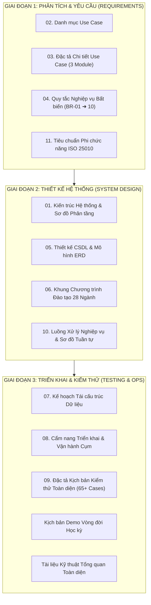

# 📚 HỆ THỐNG TÀI LIỆU ĐẶC TẢ KỸ THUẬT & NGHIỆP VỤ (DOCUMENTATION SUITE)
## HỆ THỐNG QUẢN LÝ ĐÀO TẠO & SINH VIÊN (SMS / UAMS)
> **Chuẩn tài liệu hóa:** IEEE 830 / ISO/IEC/IEEE 29148 & ISO/IEC 25010  
> **Dự án:** Hệ Thống Quản Lý Đào Tạo & Sinh Viên theo Học Chế Tín Chỉ  
> **Trường Đại học:** Đại học Phenikaa · Khoa Công Nghệ Thông Tin · 2026  
> **Sinh viên thực hiện:** Nguyễn Duy Minh (MSV: 21010696)

---

## 📑 Mục lục tài liệu
1. [Tổng quan Bộ hồ sơ tài liệu](#1-tổng-quan-bộ-hồ-sơ-tài-liệu)
2. [Bản đồ chỉ dẫn tài liệu theo từng giai đoạn phát triển](#2-bản-đồ-chỉ-dẫn-tài-liệu-theo-từng-giai-đoạn-phát-triển)
3. [Tóm tắt chi tiết nội dung 13 tập tài liệu chuyên ngành](#3-tóm-tắt-chi-tiết-nội-dung-13-tập-tài-liệu-chuyên-ngành)
4. [Mục lục 10 Quy tắc nghiệp vụ bất biến (Business Rules BR-01 ➜ BR-10)](#4-mục-lục-10-quy-tắc-nghiệp-vụ-bất-biến-business-rules)
5. [Quy chuẩn đồ họa & Khai thác tài liệu](#5-quy-chuẩn-đồ-họa--khai-thác-tài-liệu)

---

## 1. Tổng quan Bộ hồ sơ tài liệu

Thư mục `docs/` lưu trữ toàn bộ các hồ sơ kỹ thuật, phân tích nghiệp vụ (Business Analysis - BA), kiến trúc phần mềm (Software Architecture), thiết kế cơ sở dữ liệu (Database Design), kế hoạch kiểm thử (Test Plan) và cẩm nang vận hành hệ thống.

Hệ thống tài liệu được biên soạn đồng bộ, sử dụng thuật ngữ chuẩn xác theo quy chế đào tạo đại học theo học chế tín chỉ của Bộ Giáo dục & Đào tạo và Quy chế Đại học Phenikaa.

---

## 2. Bản đồ chỉ dẫn tài liệu theo từng giai đoạn phát triển

---

## 3. Tóm tắt chi tiết nội dung 13 tập tài liệu chuyên ngành

| Tệp tài liệu | Dung lượng | Tên tài liệu & Trọng tâm nghiệp vụ |
| :--- | :---: | :--- |
| [01_system_architecture_and_diagrams.md](01_system_architecture_and_diagrams.md) | 4.1 KB | **Kiến trúc & Sơ đồ Hệ thống:** Mô hình 3 phân tầng (React SPA + Spring Boot + MySQL/Redis), Nginx Load Balancing qua cụm 3 Replicas, luồng dữ liệu bảo mật JWT. |
| [02_use_case_catalog.md](02_use_case_catalog.md) | 2.5 KB | **Danh mục Use Case:** Bảng phân rã 16+ ca sử dụng nòng cốt theo 3 tác nhân chính (Admin, Giảng viên, Sinh viên) và 2 tác nhân mở rộng (Khảo thí, Học vụ). |
| [03_use_case_specifications/](03_use_case_specifications/) | Thư mục | **Đặc tả Chi tiết Use Case:** Luồng sự kiện chính (Basic Flow), luồng rẽ nhánh (Alternative Flows), tiền điều kiện và hậu điều kiện cho từng phân hệ:  • [UC_Admin_Module.md](03_use_case_specifications/UC_Admin_Module.md) (Quản trị đào tạo, mở lớp, xếp TKB)  • [UC_Lecturer_Module.md](03_use_case_specifications/UC_Lecturer_Module.md) (Nhập điểm, điểm danh PIN, chốt sổ 7 ngày)  • [UC_Student_Module.md](03_use_case_specifications/UC_Student_Module.md) (Đăng ký môn, xem lịch, tra cứu điểm). |
| [04_business_rules.md](04_business_rules.md) | 2.8 KB | **Quy tắc Nghiệp vụ Bất biến:** Định nghĩa chuẩn mực 10 luật bất biến chi phối toàn bộ mã nguồn Backend: giới hạn 10-24 TC, đồ thị tiên quyết DAG, xung đột TKB, công thức điểm, quy chế ân hạn 7 ngày, Rule B nợ học phí, thuật toán Best-Grade. |
| [05_database_erd.md](05_database_erd.md) | 1.9 KB | **Thiết kế CSDL & Mô hình ERD:** Lược đồ thực thể liên kết 41 bảng, từ điển dữ liệu, quan hệ khóa ngoại, chiến lược Indexing tối ưu hóa thời gian phản hồi dưới 100ms. |
| [06_academic_curriculum_catalog.md](06_academic_curriculum_catalog.md) | **42.9 KB** | **Khung Chương trình Đào tạo 28 Ngành:** Cẩm nang chi tiết lộ trình đào tạo 8 học kỳ cho 28 ngành đào tạo thuộc 8 khoa viện (130-135 tín chỉ chuẩn). Phân rã theo 5 khối kiến thức và ma trận môn học tiên quyết. |
| [07_academic_curriculum_migration_plan.md](07_academic_curriculum_migration_plan.md) | 14.6 KB | **Kế hoạch Tái cấu trúc Dữ liệu Học thuật:** Lộ trình chuẩn hóa phân cấp dữ liệu Khoa ➜ Ngành ➜ Khóa ➜ Lớp sinh hoạt và chiến lược nạp dữ liệu mẫu an toàn. |
| [08_deployment_and_operations_guide.md](08_deployment_and_operations_guide.md) | 8.7 KB | **Hướng dẫn Triển khai & Vận hành:** Cẩm nang triển khai 1-Click trên Windows, triển khai Docker Compose đơn/cụm cân bằng tải, cấu hình HTTPS an toàn qua Cloudflare Tunnel và hướng dẫn sao lưu/phục hồi CSDL. |
| [09_comprehensive_test_case_specification.md](09_comprehensive_test_case_specification.md) | **114.7 KB** | **Đặc tả Kịch bản Kiểm thử Toàn diện:** Tài liệu đồ sộ chi tiết 65+ ca kiểm thử End-to-End từ kiểm thử khói, bảo mật, RBAC, đăng ký môn đồng thời, xử lý điểm, tài chính đến xét tốt nghiệp. |
| [10_system_processing_workflows.md](10_system_processing_workflows.md) | **56.9 KB** | **Luồng Xử lý Nghiệp vụ Hệ thống:** Mô tả chuyên sâu các luồng nghiệp vụ phức tạp bằng sơ đồ tương tác: Luồng đăng ký tín chỉ chịu tải cao, Luồng chấm điểm - ân hạn - sửa điểm - phúc khảo, Luồng cảnh báo học vụ và xét công nhận tốt nghiệp. |
| [11_nfr_and_technical_challenges.md](11_nfr_and_technical_challenges.md) | **31.9 KB** | **Yêu cầu Phi chức năng & Thách thức Kỹ thuật:** Chuẩn chất lượng phần mềm ISO/IEC 25010. Phân tích chi tiết bài toán tranh chấp dữ liệu (Race Condition), giải pháp khóa phân tán Redis Lock, cân bằng tải Nginx và tối ưu bộ nhớ JVM. |
| [TAI_LIEU_TONG_QUAN_DU_AN.md](TAI_LIEU_TONG_QUAN_DU_AN.md) | **37.1 KB** | **Tài liệu Tổng quan Kỹ thuật Dự án:** Bản thuyết minh tổng hợp toàn diện cấu trúc dự án, phù hợp cho Hội đồng chấm đồ án đánh giá nhanh toàn bộ khối lượng công việc và chất lượng sản phẩm. |
| [KICH_BAN_DEMO_VONG_DOI_NAM_HOC.md](KICH_BAN_DEMO_VONG_DOI_NAM_HOC.md) | 7.2 KB | **Kịch bản Demo Vòng đời Học kỳ:** Kịch bản trình diễn thực chiến từng bước cho buổi bảo vệ đồ án: Khởi tạo học kỳ ➜ Mở lớp ➜ Đăng ký tín chỉ ➜ Điểm danh PIN ➜ Giảng viên vào điểm ➔ Chốt sổ ➔ Phúc khảo ➔ Xét tốt nghiệp. |

---

## 4. Mục lục 10 Quy tắc nghiệp vụ bất biến (Business Rules)

Hệ thống được vận hành trên nền tảng **10 Quy tắc Nghiệp vụ Bất biến (Invariant Rules)** được đặc tả chi tiết tại [04_business_rules.md](04_business_rules.md):

* **BR-01 (Credit Thresholds):** Giới hạn số tín chỉ đăng ký mỗi học kỳ chính từ **10 đến 24 tín chỉ** (học kỳ hè tối đa 8 tín chỉ).
* **BR-02 (DAG Prerequisite Validation):** Đồ thị môn học tiên quyết không được phép có chu trình kín. Sinh viên chỉ được đăng ký môn học khi đã đạt điểm tổng kết $\ge 4.0$ ở môn tiên quyết.
* **BR-03 (3D Schedule Collision):** Ngăn chặn 100% va chạm thời khóa biểu trên cả 3 chiều: Trùng giờ học của sinh viên, Trùng giờ dạy của giảng viên, Trùng phòng học thực tế.
* **BR-04 (Grading Weight Distribution):** Công thức tính điểm tổng kết học phần chuẩn hóa 4 thành phần:
  $$\text{Tổng kết} = (\text{CC1} \times 0.05) + (\text{CC2} \times 0.05) + (\text{GK} \times 0.30) + (\text{CK} \times 0.60)$$
* **BR-05 (Grade Conversion Scale):** Quy đổi điểm tổng kết hệ 10 sang hệ 4 và điểm chữ theo quy chế đào tạo tín chỉ (A, B+, B, C+, C, D+, D, F).
* **BR-06 (Best-Grade Cumulative Calculation):** Khi sinh viên học cải thiện môn học, điểm tổng kết cao nhất sẽ được tự động chọn để tính vào điểm trung bình tích lũy CPA.
* **BR-07 (7-Day Finalization Window):** Cửa sổ ân hạn 7 ngày sau khi giảng viên chốt điểm. Sau 7 ngày, sổ điểm bị đóng băng tuyệt đối; mọi chỉnh sửa phải lập đề xuất kèm minh chứng qua Trưởng khoa và Phòng Đào tạo duyệt.
* **BR-08 (Rule B - Financial Hold):** Sinh viên còn nợ học phí quá hạn từ các học kỳ trước sẽ bị tự động khóa cổng đăng ký tín chỉ trực tuyến.
* **BR-09 (Special Class Dynamic Pricing):** Lớp học phần mở riêng theo nguyện vọng có sĩ số dưới 15 sinh viên sẽ áp dụng biểu phí học phí bù trừ theo quy mô sĩ số thực tế.
* **BR-10 (Graduation Requirements):** Điều kiện xét công nhận tốt nghiệp: Hoàn thành đủ 130–135 tín chỉ theo 5 khối kiến thức, CPA $\ge 2.00$, không trong thời gian bị kỷ luật và hoàn thành các chứng chỉ điều kiện.

---

## 5. Quy chuẩn đồ họa & Khai thác tài liệu

* Tất cả các sơ đồ kỹ thuật trong tài liệu đều được biểu diễn dưới dạng mã nguồn mở chuẩn **Mermaid.js** hoặc liên kết trực tiếp tới các file sơ đồ chuẩn UML 2.5 tại thư mục [`drawio/`](../drawio/README.md).
* Các thuật toán và câu truy vấn SQL trong tài liệu đều có mã nguồn tương ứng đã được kiểm thử thực tế trong thư mục [`backend/`](../backend/README.md) và [`database/`](../database/README.md).
* Độc giả và hội đồng đánh giá có thể tra cứu nhanh kịch bản kiểm thử tương ứng cho từng yêu cầu nghiệp vụ tại [09_comprehensive_test_case_specification.md](09_comprehensive_test_case_specification.md).

---

  Hệ Thống Quản Lý Đào Tạo & Sinh Viên (SMS) · Đại học Phenikaa · 2026

