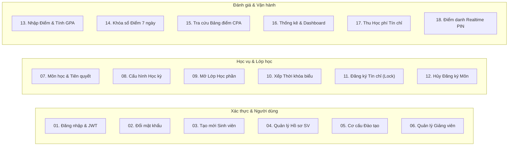

# 📊 BỘ SƠ ĐỒ THIẾT KẾ & PHÂN TÍCH HỆ THỐNG (UML DRAW.IO SUITE)
## HỆ THỐNG QUẢN LÝ ĐÀO TẠO & SINH VIÊN (SMS / UAMS)
> **Chuẩn mô hình hóa:** OMG UML 2.5 (Unified Modeling Language) & Phân tích BCE (Boundary - Control - Entity)  
> **Bộ sơ đồ bao gồm:** 5 Tập sơ đồ Master (76 Tabs tổng cộng: ERD 8 tabs, UseCase 5 tabs, Activity 21 tabs, Sequence 21 tabs, BCE 21 tabs) + 5 Sơ đồ Use Case đơn phân hệ  
> **Quy chuẩn thiết kế:** Academic Monochrome High-Contrast (Nền trắng, viền đen 1.5px, Zero Overlap, tối ưu in ấn đồ án)  
> **Tác giả:** Nguyễn Duy Minh (MSV: 23010359) · Khoa Công Nghệ Thông Tin · Đại học Phenikaa

---

## 📑 Mục lục
1. [Tổng quan Bộ hồ sơ Sơ đồ Draw.io](#1-tổng-quan-bộ-hồ-sơ-sơ-đồ-drawio)
2. [Danh mục 5 Bộ Sơ đồ Master Đa phân hệ (Multi-page Files)](#2-danh-mục-5-bộ-sơ-đồ-master-đa-phân-hệ-multi-page-files)
3. [Danh mục 5 Sơ đồ Use Case Đơn phân hệ (Single-tab Files)](#3-danh-mục-5-sơ-đồ-use-case-đơn-phân-hệ-single-tab-files)
4. [Ma trận 18 Chức năng Nghiệp vụ Cốt lõi đồng bộ trên toàn bộ sơ đồ](#4-ma-trận-18-chức-năng-nghiệp-vụ-cốt-lõi-đồng-bộ-trên-toàn-bộ-sơ-đồ)
5. [Quy chuẩn thiết kế Hàn lâm & Chống lỗi đồ họa](#5-quy-chuẩn-thiết-kế-hàn-lâm--chống-lỗi-đồ-họa)
6. [Hệ thống Scripts Python Tự động hóa & Xuất báo cáo](#6-hệ-thống-scripts-python-tự-động-hóa--xuất-báo-cáo)

---

## 1. Tổng quan Bộ hồ sơ Sơ đồ Draw.io

Thư mục `drawio/` quản lý toàn bộ các mô hình phân tích và thiết kế hệ thống theo chuẩn **OMG UML 2.5**. Tất cả các sơ đồ được thiết kế đồng bộ từ giai đoạn khảo sát nhu cầu (Use Case), mô hình hóa tương tác tuần tự (Sequence), quy trình hoạt động phân làn (Activity) đến bóc tách trách nhiệm lớp phân tích (Analysis Class BCE).

Toàn bộ các biểu đồ được sinh tự động và kiểm định cấu trúc XML thông qua bộ công cụ lập trình Python, bảo đảm độ chính xác từng tọa độ pixel và tính nhất quán 100% với mã nguồn Backend và Cơ sở dữ liệu.

---

## 2. Danh mục 5 Bộ Sơ đồ Master Đa phân hệ (Multi-page Files)

| STT | Tên tệp Master | Chuẩn mô hình hóa | Số Tabs | Nội dung mô tả chi tiết |
|:---:|:---|:---|:---:|:---|
| **1** | [UseCase_Diagrams.drawio](UseCase_Diagrams.drawio) | UML 2.5 Use Case Diagram | **5 tabs** | 5 phân hệ ca sử dụng: Tổng quan toàn trường, Quản trị viên, Cán bộ Đào tạo, Giảng viên, Sinh viên. Phân định ranh giới hệ thống chuẩn mực, đầy đủ quan hệ `«include»` và `«extend»`. |
| **2** | [ERD_Diagrams.drawio](ERD_Diagrams.drawio) | OMG UML / Relational ERD | **8 tabs** | Lược đồ Thực thể Quan hệ CSDL 2 tầng: 1 Tab Sơ đồ Tổng quan Thực thể Cốt lõi (15 thực thể) + 7 Tabs Lược đồ Phân hệ chi tiết mô hình hóa toàn bộ 41 bảng quan hệ CSDL MySQL 8. |
| **3** | [Activity_Diagrams.drawio](Activity_Diagrams.drawio) | UML 2.5 Activity Diagram | **21 tabs**| 21 biểu đồ hoạt động phân làn (Swimlanes): Làn Tác nhân (Actor Lane) và Làn Hệ thống (System Service & DB Lane), đầy đủ nút khởi đầu, điểm rẽ nhánh quyết định và xử lý ngoại lệ. |
| **4** | [AnalysisClass_BCE_Diagrams.drawio](AnalysisClass_BCE_Diagrams.drawio) | Boundary – Control – Entity | **21 tabs**| 21 biểu đồ phân tích kiến trúc BCE: Lớp Biên (Boundary UI), Lớp Điều khiển (Controller & Service), Lớp Thực thể (JPA Entity & DTO), khớp 1-1 với cấu trúc mã nguồn. |
| **5** | [Sequence_Diagrams.drawio](Sequence_Diagrams.drawio) | UML 2.5 Sequence Diagram | **21 tabs**| 21 biểu đồ tuần tự cho 21 nghiệp vụ cốt lõi theo 6 đường sinh mệnh (Lifelines): `Tác nhân` ➜ `Giao diện React SPA` ➜ `REST Controller` ➜ `Business Service` ➜ `JPA Repository` ➜ `CSDL MySQL`. |

---

## 3. Danh mục 5 Sơ đồ Use Case Đơn phân hệ (Single-tab Files)

Các tệp sơ đồ đơn phục vụ việc xem nhanh hoặc chèn trực tiếp vào các slide báo cáo độc lập:

| STT | Tên tệp | Chuẩn / Phân hệ | Số Tab | Nội dung đặc tả |
|:---:|:---|:---|:---:|:---|
| **6** | [1_UseCase_TongQuan.drawio](1_UseCase_TongQuan.drawio) | Sơ đồ Ca sử dụng Tổng quan | 1 tab | Sơ đồ tổng quát toàn bộ hệ thống SMS với 4 nhóm tác nhân (Admin, Cán bộ Đào tạo, Giảng viên, Sinh viên). |
| **7** | [2_UseCase_Admin.drawio](2_UseCase_Admin.drawio) | Sơ đồ Phân hệ Quản trị viên | 1 tab | Chi tiết các chức năng Admin: Phân quyền, quản lý tài khoản, cấu hình tham số hệ thống. |
| **8** | [3_UseCase_DaoTao.drawio](3_UseCase_DaoTao.drawio) | Sơ đồ Phân hệ Phòng Đào tạo | 1 tab | Chi tiết nghiệp vụ Đào tạo: CTĐT, mở lớp HP, xếp TKB, khóa đợt ĐKTC, xét cảnh báo & tốt nghiệp. |
| **9** | [4_UseCase_GiangVien.drawio](4_UseCase_GiangVien.drawio) | Sơ đồ Phân hệ Giảng viên | 1 tab | Chi tiết nghiệp vụ giảng viên: Lịch giảng dạy, Sổ điểm điện tử, Import Excel, Điểm danh trực tiếp PIN 6 số. |
| **10** | [5_UseCase_SinhVien.drawio](5_UseCase_SinhVien.drawio) | Sơ đồ Phân hệ Sinh viên | 1 tab | Chi tiết nghiệp vụ sinh viên: Cổng đăng ký tín chỉ, Smart Schedule, Tra cứu điểm CPA/GPA, nộp đơn phúc khảo. |

---

## 4. Ma trận 18 Chức năng Nghiệp vụ Cốt lõi đồng bộ trên toàn bộ sơ đồ

Tất cả 18 tab trong 3 bộ sơ đồ Tuần tự, Hoạt động và BCE đều đồng bộ số thứ tự và tên chức năng:



| Mã CN | Tên chức năng nghiệp vụ | Endpoint REST API tương ứng | Lớp Service xử lý chính |
|:---:|:---|:---|:---|
| **CN-01** | Đăng nhập hệ thống & Cấp phát JWT kép | `POST /api/auth/login` | `AuthService.java` |
| **CN-02** | Đổi mật khẩu tài khoản cá nhân | `POST /api/auth/change-password` | `AuthService.java` |
| **CN-03** | Thêm mới sinh viên & Cấp tài khoản tự động | `POST /api/students` | `StudentService.java` |
| **CN-04** | Quản lý hồ sơ sinh viên & Đình chỉ đào tạo | `PUT /api/students/{id}/status` | `StudentService.java` |
| **CN-05** | Quản lý cơ cấu đào tạo (Khoa, Ngành, Lớp) | `GET/POST /api/classes`, `/api/departments` | `DepartmentService`, `ClassService` |
| **CN-06** | Quản lý Giảng viên & Phân công giảng dạy | `GET/POST /api/lecturers` | `LecturerService.java` |
| **CN-07** | Quản lý Môn học, Tín chỉ & Môn tiên quyết | `GET/POST /api/subjects` | `SubjectService`, `PrerequisiteGraphEngine` |
| **CN-08** | Cấu hình Học kỳ & Kích hoạt đợt đào tạo | `GET/POST /api/semesters` | `SemesterService.java` |
| **CN-09** | Mở mới & Điều phối Lớp học phần | `GET/POST /api/course-sections` | `CourseSectionService.java` |
| **CN-10** | Xếp Thời khóa biểu & Chống va chạm phòng/giờ | `POST /api/schedules` | `ScheduleService.java` |
| **CN-11** | Sinh viên Đăng ký Tín chỉ (Khóa phân tán Redis) | `POST /api/enrollments` | `EnrollmentService`, `RedisLockService` |
| **CN-12** | Hủy đăng ký Học phần & Hoàn trả sĩ số lớp | `DELETE /api/enrollments/{id}` | `EnrollmentService.java` |
| **CN-13** | Giảng viên Nhập điểm thành phần & Tính GPA | `POST /api/grades` | `GradeService.java` |
| **CN-14** | Chốt sổ điểm & Cửa sổ ân hạn sửa điểm 7 ngày | `POST /api/grades?finalize=true` | `GradeService.java` |
| **CN-15** | Tra cứu Bảng điểm, Tiến độ CTĐT & Điểm CPA | `GET /api/transcripts/me` | `TranscriptService`, `DegreeAuditEngine` |
| **CN-16** | Báo cáo Thống kê Toàn trường, Cảnh báo học vụ | `GET /api/dashboard` | `DashboardService`, `AcademicWarningService` |
| **CN-17** | Quản lý Tài chính & Thu học phí theo tín chỉ | `GET/POST /api/tuition`, `/api/admin/tuition` | `TuitionService.java` |
| **CN-18** | Điểm danh lớp học trực tiếp qua mã PIN 6 số | `POST /api/attendance` | `AttendanceService.java` |

---

## 5. Quy chuẩn thiết kế Hàn lâm & Chống lỗi đồ họa

Toàn bộ các biểu đồ trong thư mục này tuân thủ các quy tắc thiết kế nghiêm ngặt:

1. **Bảng màu đơn sắc chuẩn in ấn (Monochrome High Contrast):**
   * Nền trắng tinh khiết (`#ffffff`), viền đen mỏng 1.5px (`#000000`).
   * Tuyệt đối không sử dụng dải màu gradient lòe loẹt hoặc nền đen, bảo đảm khi in ấn đen trắng trên giấy A4 đồ án không bị nhòe mực.
2. **Triệt tiêu lỗi đè chữ & đè nhãn (Zero Overlap Guarantee):**
   * Mọi nhãn thông điệp trong Biểu đồ tuần tự đều có nền trắng (`labelBackgroundColor=#ffffff`) ngăn chặn đường lifeline gạch ngang qua chữ.
   * Khoảng cách giữa các ca sử dụng tối thiểu 75px theo chiều dọc và 190px theo chiều ngang.
3. **Phân làn Swimlane rành mạch:**
   * Biểu đồ hoạt động phân tách rành rẽ làn Người dùng (Actor Lane) và làn Hệ thống (Backend Service & MySQL DB Lane).

---

## 6. Hệ thống Scripts Python Tự động hóa & Xuất báo cáo

Thư mục `drawio/scripts/` chứa các kịch bản Python hỗ trợ tự động sinh và kiểm định cấu trúc XML của toàn bộ sơ đồ:

```text
drawio/scripts/
├── build_drawio_diagrams.py        # Kịch bản sinh sơ đồ Use Case các phân hệ
├── build_full_sequence_diagrams.py # Kịch bản sinh toàn bộ 21 tab Biểu đồ tuần tự chuẩn UML
├── build_full_activity_diagrams.py # Kịch bản sinh toàn bộ 21 tab Biểu đồ hoạt động phân làn
├── build_full_bce_diagrams.py      # Kịch bản sinh toàn bộ 21 tab Biểu đồ lớp phân tích BCE
├── build_full_erd_diagrams.py      # Kịch bản sinh toàn bộ 8 tab Lược đồ quan hệ thực thể ERD
└── check_diagrams.py               # Kịch bản kiểm toán: phát hiện trùng lặp Cell ID, kiểm tra XML
```

### Cách thức thực thi sinh sơ đồ & kiểm định:
```bash
# 1. Sinh sơ đồ Use Case
python drawio/scripts/build_drawio_diagrams.py

# 2. Sinh biểu đồ Tuần tự (Sequence Diagrams)
python drawio/scripts/build_full_sequence_diagrams.py

# 3. Sinh biểu đồ Hoạt động (Activity Diagrams)
python drawio/scripts/build_full_activity_diagrams.py

# 4. Sinh biểu đồ Lớp phân tích BCE (Boundary - Control - Entity)
python drawio/scripts/build_full_bce_diagrams.py

# 5. Sinh lược đồ Thực thể Quan hệ ERD (8 tabs)
python drawio/scripts/build_full_erd_diagrams.py

# 6. Kiểm định cấu trúc XML và tính hợp lệ của toàn bộ Cells
python drawio/scripts/check_diagrams.py
```

---
<div align="center">
  <sub>Hệ Thống Quản Lý Đào Tạo & Sinh Viên (SMS) · Đại học Phenikaa · 2026</sub>
</div>
