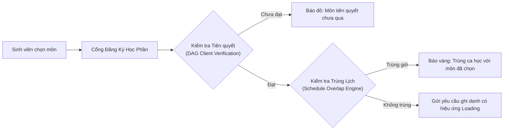

# 💻 CỔNG THÔNG TIN GIAO DIỆN NGƯỜI DÙNG (FRONTEND SPA)
## HỆ THỐNG QUẢN LÝ ĐÀO TẠO & SINH VIÊN (SMS / UAMS)
> **React 19.2 · Vite 8.2 · Tailwind CSS · Zustand 5 · Recharts 3.10 · Native Fetch Client**  
> **Ngôn ngữ thiết kế:** Apple Vision & Aurora Glassmorphism (Hỗ trợ Dark / Light Theme)  
> **Tác giả:** Nguyễn Duy Minh (MSV: 21010696)  
> **Vị trí trong kiến trúc:** Tầng tương tác người dùng (Client Presentation Tier)

---

## 📑 Mục lục
1. [Tổng quan & Ngôn ngữ thiết kế](#1-tổng-quan--ngôn-ngữ-thiết-kế)
2. [Ngăn xếp công nghệ & Thư viện](#2-ngăn-xếp-công-nghệ--thư-viện)
3. [Cấu trúc mã nguồn chi tiết](#3-cấu-trúc-mã-nguồn-chi-tiết)
4. [Mạng lưới màn hình theo 5 phân hệ người dùng](#4-mạng-lưới-màn-hình-theo-5-phân-hệ-người-dùng)
5. [Tầng dịch vụ mạng Native Fetch (Zero External Dependencies)](#5-tầng-dịch-vụ-mạng-native-fetch-zero-external-dependencies)
6. [Quản trị trạng thái toàn cục với Zustand](#6-quản-trị-trạng-thái-toàn-cục-với-zustand)
7. [Các tính năng tương tác nổi bật (UX Innovations)](#7-các-tính-năng-tương-tác-nổi-bật-ux-innovations)
8. [Kiểm thử tự động giao diện (Vitest)](#8-kiểm-thử-tự-động-giao-diện-vitest)
9. [Hướng dẫn cài đặt, phát triển & Đóng gói Production](#9-hướng-dẫn-cài-đặt-phát-triển--đóng-gói-production)

---

## 1. Tổng quan & Ngôn ngữ thiết kế

Cổng thông tin **SMS Frontend** là ứng dụng Single Page Application (SPA) hiệu năng cao, tích hợp đầy đủ giao diện làm việc cho cả 5 vai trò: **Quản trị viên Phòng Đào Tạo**, **Chuyên viên Học vụ**, **Cán bộ Khảo thí**, **Giảng viên** và **Sinh viên**.

### Đặc trưng ngôn ngữ thiết kế Apple Vision & Aurora Glassmorphism:
* **Hiệu ứng kính mờ chiều sâu (Backdrop Blur):** Bề mặt kính trong suốt nhiều lớp (`backdrop-blur-md`, `backdrop-blur-xl`), viền sáng vi mô (`border-white/10`) tạo cảm giác hiện đại, thanh lịch.
* **Bảng màu Aurora linh hoạt:** Tích hợp chuyển đổi mượt mà giữa **Dark Mode** (nền tối sâu thẳm `#0a0e1a`, điểm nhấn tím Aurora/xanh Cyber) và **Light Mode** (nền trắng ngọc trai, tương phản cao, chống mỏi mắt).
* **Tương tác vi mô (Micro-interactions):** Chuyển cảnh mềm mại, thông báo Toast trực quan, hiệu ứng gợn sóng khi tương tác và thanh đo độ mạnh mật khẩu bảo mật (Password Strength Meter).

---

## 2. Ngăn xếp công nghệ & Thư viện

| Thư viện / Công cụ | Phiên bản | Vai trò & Mục đích sử dụng |
| :--- | :--- | :--- |
| **React** | 19.2.8 | Thư viện UI hạt nhân, khai thác React Hooks, Suspense và tối ưu Concurrent Rendering. |
| **Vite** | 8.2.2 | Build tool thế hệ mới với Hot Module Replacement (HMR) cực nhanh, tối ưu Bundle Rollup. |
| **React Router DOM** | 7.18.2 | Định tuyến SPA mượt mà, phân trang, hỗ trợ Role-Based Protected Routes. |
| **Tailwind CSS** | 3.4.x | Utility-first CSS framework, quy chuẩn Design Tokens, responsive đa màn hình. |
| **Zustand** | 5.0.15 | State management siêu nhẹ (< 1KB), quản trị phiên đăng nhập (`authStore`) và giao diện (`themeStore`). |
| **Recharts** | 3.10.1 | Trực quan hóa dữ liệu biểu đồ phân bố điểm, tỷ lệ sinh viên, tiến độ hoàn thành CTĐT. |
| **Lucide React** | 1.34.0 | Bộ biểu tượng vector chuẩn công nghệ, nhất quán và sắc nét. |
| **Native Fetch Client** | Web API | Trình gọi API độc quyền xây dựng trên nền tảng Fetch chuẩn ES2022 (Zero External Axios Dependency). |
| **Vitest & Testing Library**| 5.0.2 | Khung kiểm thử tự động đơn vị và tích hợp linh kiện UI chạy trực tiếp trên luồng song song. |
| **Oxlint** | 1.87.0 | Trình kiểm tra cú pháp và chất lượng mã nguồn Rust siêu tốc. |

---

## 3. Cấu trúc mã nguồn chi tiết

```text
frontend/
├── public/                 # Tài nguyên tĩnh, Favicon biểu trưng trường học
├── src/
│   ├── assets/             # Hình ảnh biểu trưng, logo các khoa viện
│   ├── components/         # Các khối giao diện dùng chung (Reusable UI Components)
│   │   ├── common/         #   Skeleton loaders, ErrorBoundary, Modal đổi mật khẩu, Toast, Badge
│   │   └── layout/         #   AppHeader, AppSidebar đa cấp độ theo phân quyền, Footer
│   ├── pages/              # Màn hình chức năng phân chia theo từng phân hệ người dùng
│   │   ├── academic/       #   Màn hình Chuyên viên Đào tạo (Academic Dashboard, Xét tốt nghiệp)
│   │   ├── admin/          #   16 Màn hình Quản trị (CTĐT, Khoa, Ngành, Môn, Lớp HP, TKB, Học phí...)
│   │   ├── auth/           #   Cổng đăng nhập thống nhất PortalLoginPage, PortalHubPage
│   │   ├── lecturer/       #   Màn hình Giảng viên (Lịch dạy, Nhập điểm, Import Excel, Hồ sơ)
│   │   ├── shared/         #   Màn hình nghiệp vụ liên phân hệ (Phúc khảo, Duyệt sửa điểm, Audit Logs)
│   │   └── student/        #   Màn hình Sinh viên (Đăng ký tín chỉ, Smart Schedule, TKB tuần, Bảng điểm)
│   ├── services/           # Tầng kết nối mạng và ánh xạ dữ liệu nghiệp vụ
│   │   ├── api.js          #   Native Fetch Client tích hợp tự động gán Bearer Token & Interceptor lỗi
│   │   └── dataService.js  #   Tổng hợp các phương thức gọi API RESTful Backend theo từng thực thể
│   ├── store/              # Zustand Stores quản lý trạng thái ứng dụng
│   │   ├── authStore.js    #   Lưu trữ Token, thông tin người dùng, quyền hạn RBAC và hàm logout
│   │   └── themeStore.js   #   Lưu trữ cấu hình giao diện Dark/Light mode vào LocalStorage
│   ├── tests/              # Bộ kiểm thử tự động linh kiện UI và luồng nghiệp vụ phía Client
│   │   ├── *.test.jsx      #   Các kịch bản kiểm thử Vitest cho Login, Đăng ký môn, Học phí, Lộ trình
│   │   └── setup.js        #   Cấu hình môi trường DOM ảo (JSDOM) và Mock API Fetch
│   ├── utils/              # Tiện ích tính toán điểm, định dạng ngày tháng, xuất file và tiền tệ
│   ├── App.jsx             # Định tuyến trung tâm (App Routing) với các lớp bảo vệ phân quyền
│   ├── index.css           # Cấu hình Tailwind directives, biến màu CSS và hiệu ứng Glassmorphism
│   └── main.jsx            # Điểm khởi đầu ứng dụng React DOM
├── nginx.conf              # Cấu hình máy chủ Nginx phục vụ SPA tĩnh trong môi trường Docker đơn
├── nginx_main.conf         # Cấu hình Nginx Core tối ưu bộ nhớ đệm và nén Gzip
├── nginx.cluster.conf      # Cấu hình Nginx Cân bằng tải cho cụm 3 Backend Replicas
├── vite.config.js          # Thiết lập cấu hình Vite, alias `@/` và Proxy chuyển tiếp `/api`
└── package.json            # Khai báo các gói phụ thuộc và câu lệnh thực thi
```

---

## 4. Mạng lưới màn hình theo 5 phân hệ người dùng

### 🧑‍💼 1. Phân hệ Quản trị & Đào tạo (Admin - 16 Màn hình & Modals)
* `DashboardPage.jsx`: Thống kê toàn trường (tổng số SV, giảng viên, môn học, lớp mở, doanh thu).
* `SemestersPage.jsx`: Quản lý học kỳ, kích hoạt kỳ hiện tại, đóng mở đợt học.
* `DepartmentsPage.jsx` & `ClassesPage.jsx`: Quản lý cây cơ cấu tổ chức Khoa, Chuyên ngành và Lớp sinh hoạt.
* `SubjectsPage.jsx`: Danh mục học phần, số tín chỉ, thiết lập quan hệ môn tiên quyết và môn song hành.
* `CourseSectionsPage.jsx`: Mở lớp học phần mới, phân bổ giảng viên, giới hạn sĩ số tối đa/tối thiểu.
* `SchedulesPage.jsx`: Ma trận xếp lịch học, phân bổ phòng học, cảnh báo xung đột tài nguyên.
* `RegistrationWavesModal.jsx`: Cấu hình thời gian mở cổng đăng ký tín chỉ theo từng khóa sinh viên.
* `TuitionCashierPage.jsx`: Bàn thu ngân điện tử, tra cứu công nợ sinh viên, xác nhận thanh toán học phí.
* `StudentsPage.jsx` & `LecturersPage.jsx`: Quản lý hồ sơ, thêm mới, import danh sách hàng loạt.
* `ExamRoomsPage.jsx` & `ExamGradeImportModal.jsx`: Quản lý phòng thi, ca thi, import điểm thi kết thúc học phần.
* `PasswordResetsPage.jsx`: Duyệt yêu cầu cấp lại mật khẩu từ người dùng quên thông tin.

### 🏛️ 2. Phân hệ Chuyên viên Học vụ (Academic Affairs)
* `AcademicDashboardPage.jsx`: Theo dõi biểu đồ phân tích tỷ lệ cảnh báo học vụ, xu hướng điểm rèn luyện.
* `AcademicWarningsPage.jsx`: Rà soát tự động danh sách sinh viên vi phạm quy chế (Mức 1, Mức 2, Buộc thôi học).
* `GraduationPage.jsx`: Bảng điều khiển xét tốt nghiệp tự động qua `DegreeAuditEngine`, rà soát chuẩn đầu ra 5 khối kiến thức và in danh sách công nhận tốt nghiệp.

### 👨‍🏫 3. Phân hệ Giảng viên (Lecturer)
* `LecturerDashboard.jsx`: Bảng tin giảng viên, tổng hợp số lớp đang phụ trách, sĩ số và nhắc nhở hạn chốt điểm.
* `LecturerSchedulePage.jsx`: Thời khóa biểu tuần giảng dạy trực quan với thông tin phòng học và ca dạy.
* `GradeEntryPage.jsx`: Sổ điểm điện tử tương tác trực tiếp, tự động tính tổng kết và quy đổi hệ 4/chữ.
* `ImportExcelModal.jsx`: Tải lên bảng điểm từ file Excel mẫu, tự động khớp mã sinh viên và báo lỗi sai định dạng.
* Điểm danh trực tiếp: Kích hoạt mã PIN 6 số ngẫu nhiên có thời hạn để sinh viên check-in tức thời.

### 🎓 4. Phân hệ Sinh viên (Student)
* `StudentDashboard.jsx`: Tổng hợp tiến độ tích lũy tín chỉ, điểm trung bình CPA, lịch học trong ngày và thông báo học vụ.
* `EnrollPage.jsx`: Cổng đăng ký học phần thông minh với bộ lọc môn học theo CTĐT, kiểm tra tiên quyết tức thời.
* `SmartScheduleModal.jsx`: Thuật toán tự động tìm và gợi ý tổ hợp các lớp học phần không bị trùng giờ.
* `MyEnrollmentsPage.jsx`: Quản lý danh sách các học phần đã ghi danh thành công, hỗ trợ hủy môn trong thời hạn cho phép.
* `StudentSchedulePage.jsx`: Ma trận thời khóa biểu tuần dạng Grid trực quan, hỗ trợ xem theo từng học kỳ.
* `TranscriptPage.jsx`: Bảng điểm toàn khóa chi tiết từng học kỳ, hiển thị rõ ràng các môn học cải thiện (Best-Grade).
* `CurriculumRoadmapPage.jsx`: Bản đồ trực quan lộ trình đào tạo 8 học kỳ và tiến độ hoàn thành 5 khối kiến thức.
* `StudentProfilePage.jsx`: Xem lý lịch cá nhân, thông tin lớp sinh hoạt và đổi mật khẩu an toàn.

### ⚖️ 5. Phân hệ Dùng chung & Phúc khảo (Shared)
* `GradeAppealsPage.jsx`: Nộp đơn khiếu nại điểm thi (SV), chấm thẩm định lại (GV/Khảo thí) và phê duyệt điểm mới (Admin).
* `GradeAmendmentsPage.jsx`: Tiếp nhận đơn xin sửa điểm sau thời hạn ân hạn 7 ngày từ giảng viên và quy trình phê duyệt.
* `GradeAuditLogsPage.jsx`: Nhật ký kiểm toán lịch sử thay đổi từng đầu điểm phục vụ thanh tra, minh bạch dữ liệu.

---

## 5. Tầng dịch vụ mạng Native Fetch (Zero External Dependencies)

Thay vì sử dụng thư viện cồng kềnh `axios`, dự án đã chuẩn hóa toàn bộ tầng mạng bằng **Native Fetch API** tùy biến cao (`src/services/api.js`), mang lại tốc độ vượt trội và loại bỏ hoàn toàn các rủi ro bảo mật từ thư viện bên ngoài:

```javascript
// Trích xuất từ frontend/src/services/api.js
const fetchApi = async (method, url, config = {}) => {
  const token = localStorage.getItem("token");
  const headers = { "Content-Type": "application/json", ...config.headers };
  if (token) headers.Authorization = `Bearer ${token}`;

  // Tự động kiểm soát Timeout qua AbortController chuẩn ES
  const controller = new AbortController();
  const timeoutMs = config.timeout || 15000;
  const timer = setTimeout(() => controller.abort(), timeoutMs);

  try {
    const response = await fetch(fullUrl, { ...options, signal: controller.signal });
    clearTimeout(timer);

    // Tự động phát hiện phiên đăng nhập hết hạn (401) để kích hoạt đăng xuất an toàn
    if (response.status === 401 && token) {
      localStorage.removeItem("token");
      localStorage.removeItem("user");
      window.dispatchEvent(new CustomEvent("auth:session-expired"));
    }
    // ...
  }
};
```

---

## 6. Quản trị trạng thái toàn cục với Zustand

Dự án áp dụng **Zustand** để duy trì trạng thái ứng dụng một cách tinh gọn, phản ứng tức thì và không gây re-render dư thừa:
* **`authStore.js`:** Quản lý phiên làm việc của người dùng (`token`, `user`, `role`, `isAuthenticated`), tự động đồng bộ trạng thái vào `localStorage` và cung cấp cơ chế đăng xuất tập trung.
* **`themeStore.js`:** Quản lý giao diện hiển thị Dark / Light mode, tự động gắn lớp `dark` lên thẻ gốc HTML và ghi nhớ tùy chọn người dùng qua các phiên làm việc.

---

## 7. Các tính năng tương tác nổi bật (UX Innovations)



1. **Smart Schedule Generator (Xếp lịch thông minh):**
   Sinh viên chỉ cần tích chọn danh sách các môn học muốn đăng ký trong kỳ, hệ thống sẽ tự động tính toán các tổ hợp lớp học phần khả thi nhất không có bất kỳ xung đột thời gian nào.
2. **Khóa sổ điểm & Đếm ngược ân hạn 7 ngày:**
   Giao diện Sổ điểm của Giảng viên hiển thị đồng hồ đếm ngược trực quan. Trong 7 ngày đầu, giảng viên có thể mở khóa sửa điểm nhanh; sau 7 ngày, nút chức năng tự động chuyển thành "Nộp đơn đề xuất sửa điểm".
3. **Thanh đo độ mạnh mật khẩu bảo mật (Password Strength Meter):**
   Tại màn hình đổi mật khẩu và cấp mới tài khoản, hệ thống tích hợp thuật toán phân tích độ phức tạp thời gian thực (chữ hoa, chữ thường, số, ký tự đặc biệt, độ dài tối thiểu) kèm phản hồi trực quan.
4. **Bản đồ Lộ trình Đào tạo tương tác (Interactive Curriculum Roadmap):**
   Sinh viên có thể tương tác trực tiếp với từng khối kiến thức đào tạo, xem tiến độ tín chỉ đã hoàn thành dạng thanh tiến trình sinh động.

---

## 8. Kiểm thử tự động giao diện (Vitest)

Hệ thống được trang bị bộ kiểm thử tự động toàn diện viết trên nền **Vitest** kết hợp với `@testing-library/react`:
* Kiểm thử đăng nhập người dùng và kiểm tra điều hướng theo vai trò.
* Kiểm thử chặn truy cập trái phép vào các tuyến đường riêng tư (`ProtectedRoute`).
* Kiểm thử tính năng kiểm tra điều kiện tiên quyết và tính học phí trên giao diện.
* Kiểm thử thành phần sổ điểm và cảnh báo sai định dạng file Excel.

### Lệnh chạy kiểm thử Frontend:
```bash
cd frontend
npm test
```
*(Chế độ theo dõi liên tục: `npm run test:watch` | Kiểm tra cú pháp nhanh: `npm run lint`)*

---

## 9. Hướng dẫn cài đặt, phát triển & Đóng gói Production

### Yêu cầu môi trường
* **Node.js** phiên bản 20.x trở lên.
* **npm** hoặc **pnpm**.

### Cài đặt thư viện:
```bash
cd frontend
npm install
```

### Chạy môi trường phát triển (Dev Server):
```bash
npm run dev
```
* **Địa chỉ giao diện:** `http://localhost:5173`
* Tệp `vite.config.js` đã được cấu hình Reverse Proxy tự động chuyển hướng các yêu cầu `/api/*` về máy chủ Backend đang chạy tại `http://localhost:8080`.

### Đóng gói sản phẩm (Production Build):
```bash
npm run build
```
* Kết quả đóng gói được xuất ra thư mục `frontend/dist/`.
* Có thể chạy thử bản build qua lệnh: `npm run preview`.
* Khi chạy trong container Docker, thư mục `dist/` sẽ được máy chủ Nginx tĩnh phục vụ trực tiếp với hiệu năng tải trang tối đa và nén Gzip.

---
<div align="center">
  <sub>Hệ Thống Quản Lý Đào Tạo & Sinh Viên (SMS) · Đại học Phenikaa · 2026</sub>
</div>
