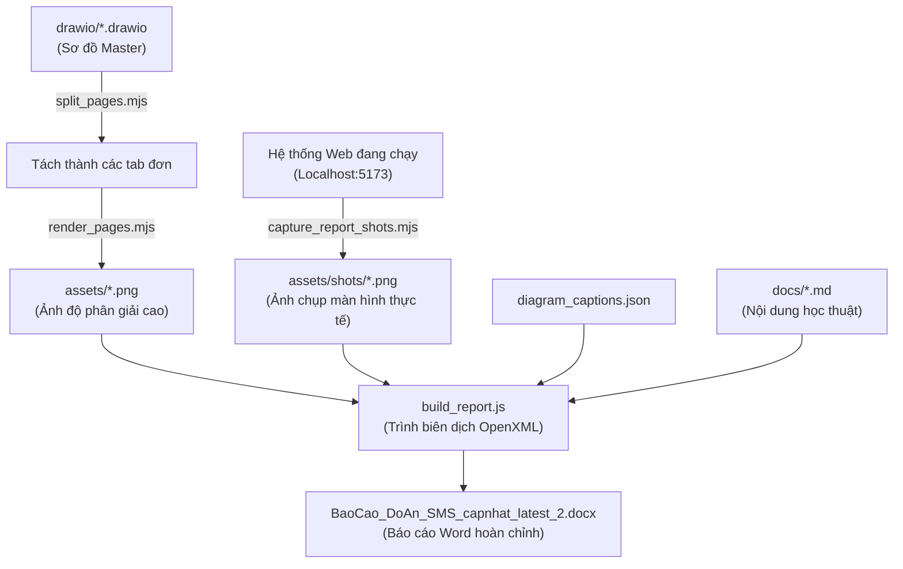

# 📄 BỘ CÔNG CỤ TỰ ĐỘNG SINH BÁO CÁO ĐỒ ÁN CHUYÊN NGÀNH
## AUTOMATED ACADEMIC REPORT GENERATOR PIPELINE
> **Tiêu chuẩn trình bày:** Quy định về Định dạng và Trình bày Báo cáo Đồ án Tốt nghiệp — Trường Đại học Phenikaa  
> **Định dạng xuất bản:** Microsoft Word OpenXML (`.docx`)  
> **Tác giả:** Nguyễn Duy Minh (MSV: 21010696) · Khoa Công Nghệ Thông Tin · Đại học Phenikaa

---

## 📑 Mục lục
1. [Tổng quan Bộ công cụ Sinh báo cáo](#1-tổng-quan-bộ-công-cụ-sinh-báo-cáo)
2. [Cấu trúc Thư mục `report/`](#2-cấu-trúc-thư-mục-report)
3. [Quy chuẩn định dạng Báo cáo Khoa học Đại học Phenikaa](#3-quy-chuẩn-định-dạng-báo-cáo-khoa-học-đại-học-phenikaa)
4. [Quy trình biên dịch Báo cáo Tự động (End-to-End Pipeline)](#4-quy-trình-biên-dịch-báo-cáo-tự-động-end-to-end-pipeline)
5. [Hướng dẫn cài đặt & Thực thi lệnh sinh file Word](#5-hướng-dẫn-cài-đặt--thực-thi-lệnh-sinh-file-word)

---

## 1. Tổng quan Bộ công cụ Sinh báo cáo

Thư mục `report/` lưu trữ toàn bộ hệ thống kịch bản lập trình Node.js và Python được xây dựng nhằm tự động hóa 100% quy trình tổng hợp, biên tập và xuất bản cuốn **Báo cáo Đồ án Chuyên ngành / Đồ án Tốt nghiệp** ra tệp Microsoft Word (`.docx`).

### Lợi ích của phương pháp Sinh báo cáo bằng mã nguồn (Docs-as-Code):
* **Tính nhất quán tuyệt đối:** Không bao giờ bị lỗi nhảy định dạng, lệch font chữ, sai khoảng cách dòng hay vỡ bảng biểu thường gặp khi chỉnh sửa thủ công trên Microsoft Word.
* **Tự động nhúng sơ đồ và bảng dữ liệu:** Tự động đồng bộ toàn bộ 30+ hình vẽ biểu đồ UML từ `drawio/`, từ điển 41 bảng CSDL từ `database/schema.sql` và bảng kết quả kiểm thử từ `tests/reports/`.
* **Tự động đánh chỉ mục Danh mục:** Tự động sinh Danh mục hình vẽ (List of Figures), Danh mục bảng biểu (List of Tables) và đánh số phân cấp tiêu đề (Chương 1, 1.1, 1.1.1).

---

## 2. Cấu trúc Thư mục `report/`

```text
report/
├── build_report.js                         # Kịch bản hạt nhân tổng hợp toàn bộ nội dung và xuất file Word .docx
├── supplement_content.js                   # Khối nội dung bổ sung (kiến trúc phân tầng, đặc tả kiểm thử, quy chuẩn)
├── diagram_captions.json                   # Từ điển chú thích tự động cho toàn bộ sơ đồ và ảnh chụp màn hình
├── list_figures.py                         # Tiện ích Python thống kê, rà soát và đánh chỉ mục danh mục hình vẽ
├── split_pages.mjs                         # Tiện ích bóc tách các file DrawIO đa tab thành các tệp XML đơn trang
├── render_pages.mjs                        # Tiện ích kết xuất các file DrawIO đơn trang thành ảnh PNG độ nét cao
├── capture_report_shots.mjs                # Tiện ích Puppeteer tự động chụp ảnh các màn hình hệ thống thực tế
├── capture_warning_shot.mjs                # Tiện ích chụp minh chứng màn hình cảnh báo học vụ và xét tốt nghiệp
├── assets/                                 # Kho lưu trữ hình ảnh biểu trưng, sơ đồ UML và ảnh chụp giao diện
├── BaoCao_DoAn_SMS_capnhat_latest_2.docx   # Tệp Word Báo cáo Đồ án hoàn chỉnh được sinh ra tự động
└── package.json                            # Khai báo các gói phụ thuộc (thư viện hạt nhân: docx ^9.9.0)
```

---

## 3. Quy chuẩn định dạng Báo cáo Khoa học Đại học Phenikaa

Tập lệnh `build_report.js` đã lập trình sẵn các thông số định dạng chuẩn xác theo quy chế trình bày đồ án tốt nghiệp của Trường Đại học Phenikaa:

| Tiêu chí định dạng | Quy chuẩn được lập trình |
| :--- | :--- |
| **Phông chữ (Font)** | `Times New Roman` cho toàn bộ tài liệu. |
| **Cỡ chữ (Size)** | Thân bài: **13 pt** · Tiêu đề chính: **14 pt Bold** · Tiêu đề cấp 2/3: **13 pt Bold / Italic**. |
| **Dãn dòng (Line Spacing)** | **1.3 – 1.4 lines** (không quá dày, không quá thưa). |
| **Dãn đoạn (Spacing)** | Before: **3 pt** · After: **3 pt** (tạo nhịp đọc dễ chịu). |
| **Căn lề trang (Page Margins)**| **Top: 2.0 cm** · **Bottom: 2.0 cm** · **Left: 3.0 cm** (lề đóng gáy sách) · **Right: 2.0 cm**. |
| **Đánh số trang** | Bắt đầu đánh số 1 từ phần Lời nói đầu / Mở đầu (đặt tại chính giữa phía dưới trang). |
| **Đầu trang (Header)** | Chạy tiêu đề rút gọn của đề tài ở góc phải trang chẵn/lẻ. |
| **Quy cách Bảng & Hình** | Chú thích hình đặt **phía dưới** ảnh (căn giữa, *in nghiêng*). Chú thích bảng đặt **phía trên** bảng (căn trái/giữa, **in đậm**). |

---

## 4. Quy trình biên dịch Báo cáo Tự động (End-to-End Pipeline)



---

## 5. Hướng dẫn cài đặt & Thực thi lệnh sinh file Word

### Bước 1: Cài đặt thư viện phụ thuộc
Trong thư mục `report/`, cài đặt thư viện `docx`:
```bash
cd report
npm install
```

### Bước 2: (Tùy chọn) Chụp lại toàn bộ ảnh giao diện thực tế
Khởi chạy Frontend và Backend, sau đó chạy:
```bash
node capture_report_shots.mjs
```

### Bước 3: Biên dịch và kết xuất file Word hoàn chỉnh
Thực thi kịch bản chính:
```bash
node build_report.js
```

Sau khi hoàn tất, màn hình console sẽ thông báo:
```text
[OK] Da tao thanh cong file BaoCao_DoAn_SMS_capnhat_latest_2.docx!
Dung luong file: ~15 MB
Tong so trang: ~120+ trang
```
File Word hoàn chỉnh đã sẵn sàng để in ấn, nộp cho giảng viên hướng dẫn hoặc chuyển đổi trực tiếp sang định dạng PDF.

---
<div align="center">
  <sub>Hệ Thống Quản Lý Đào Tạo & Sinh Viên (SMS) · Đại học Phenikaa · 2026</sub>
</div>
