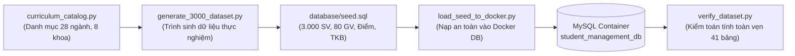

# 🛠️ CÔNG CỤ & TIỆN ÍCH DỰ ÁN (PROJECT SCRIPTS & DATA PIPELINES)
## HỆ THỐNG QUẢN LÝ ĐÀO TẠO & SINH VIÊN (SMS / UAMS)
> **Ngôn ngữ phát triển:** Python 3.10+ · Node.js 20+ (ESM) · PowerShell  
> **Chức năng:** Tự động sinh dữ liệu thực nghiệm (3.000 SV), kiến tạo khung CTĐT đồ thị DAG, tạo tệp Excel chấm điểm và chụp ảnh UI tự động  
> **Tác giả:** Nguyễn Duy Minh (MSV: 21010696) · Khoa Công Nghệ Thông Tin · Đại học Phenikaa

---

## 📑 Mục lục
1. [Tổng quan Thư mục `scripts/`](#1-tổng-quan-thư-mục-scripts)
2. [Phân nhóm 1: Sinh & Nạp Dữ liệu CSDL Thực nghiệm (Database Seeding)](#2-phân-nhóm-1-sinh--nạp-dữ-liệu-csdl-thực-nghiệm-database-seeding)
3. [Phân nhóm 2: Tự động hóa Excel Mẫu & Kiểm định Dữ liệu (Excel & Verification)](#3-phân-nhóm-2-tự-động-hóa-excel-mẫu--kiểm-định-dữ-liệu-excel--verification)
4. [Phân nhóm 3: Pipeline Xử lý Ảnh & Tư liệu Giao diện (UI & Media Pipeline)](#4-phân-nhóm-3-pipeline-xử-lý-ảnh--tư-liệu-giao-diện-ui--media-pipeline)
5. [Yêu cầu Môi trường & Hướng dẫn Cài đặt Thư viện](#5-yêu-cầu-môi-trường--hướng-dẫn-cài-đặt-thư-viện)

---

## 1. Tổng quan Thư mục `scripts/`

Thư mục `scripts/` quy hoạch toàn bộ các kịch bản lập trình phụ trợ phục vụ chu trình kỹ thuật của hệ thống SMS:
* Nạp dữ liệu mẫu chân thực ở quy mô trường đại học (3.000 sinh viên, 80 giảng viên, 5 học kỳ) để phục vụ đo kiểm tải cao và demo.
* Bảo đảm tính đúng đắn toán học của Đồ thị môn học có hướng không chu trình (DAG) cho 28 chương trình đào tạo.
* Chuẩn bị sẵn hàng chục tệp Excel mẫu để giảng viên và cán bộ khảo thí thực hành nhập điểm trực tiếp trong buổi trình diễn.
* Tự động hóa chụp màn hình toàn bộ 32+ màn hình hệ thống và tối ưu hóa dung lượng hình ảnh cho cuốn báo cáo đồ án Word.

---

## 2. Phân nhóm 1: Sinh & Nạp Dữ liệu CSDL Thực nghiệm (Database Seeding)



| Tên kịch bản | Ngôn ngữ | Chức năng kỹ thuật chi tiết | Lệnh thực thi |
| :--- | :---: | :--- | :--- |
| **`generate_3000_dataset.py`** | Python 3 | **Bộ sinh dữ liệu thực nghiệm quy mô lớn:** Sinh ngẫu nhiên có phân bố học thuật cho 3.000 sinh viên (thuộc 4 khóa K16–K19), 80 giảng viên, 28 ngành đào tạo, 8 khoa viện, 5 học kỳ, hàng trăm lớp học phần, bảng điểm 4 thành phần, điểm rèn luyện và hóa đơn học phí. Kết xuất ra file chuẩn `database/seed.sql`. | `python scripts/generate_3000_dataset.py` |
| **`curriculum_catalog.py`** | Python 3 | **Module Danh mục Học thuật Chuẩn:** Khai báo cấu trúc danh mục nền tảng: 9 khoa viện, 9 ngành trọng điểm, 4 khóa tuyển sinh, 36 lớp sinh hoạt, 45 giảng viên mẫu, 306 môn học và 260 quan hệ tiên quyết/song hành. Được import làm nguồn dữ liệu cho các generator khác. | *(Module thư viện)* |
| **`generate_curriculum_catalog.py`** | Python 3 | **Động cơ phân tích lộ trình CTĐT:** Duyệt và phân bổ ma trận 8 học kỳ cho các chương trình đào tạo; chạy thuật toán Topological Sort để bảo đảm đồ thị môn học tiên quyết có **0 chu trình phụ thuộc vòng kín**. | `python scripts/generate_curriculum_catalog.py` |
| **`create_views.py`** | Python 3 | **Khởi tạo Database Views:** Kết nối trực tiếp vào MySQL container để thực thi tạo 2 views tối ưu hóa hiệu năng: `v_student_transcript` (bảng điểm toàn diện) và `v_student_gpa` (thuật toán Best-Grade tính CPA). | `python scripts/create_views.py` |
| **`load_seed_to_docker.py`** | Python 3 | **Nạp dữ liệu mẫu an toàn:** Nạp tệp `database/seed.sql` vào MySQL container với cơ chế làm sạch bảng tự động, tạm thời vô hiệu hóa `FOREIGN_KEY_CHECKS` và bảo vệ tài khoản `DEFINER` của các Views. | `python scripts/load_seed_to_docker.py` |
| **`verify_dataset.py`** | Python 3 | **Kiểm toán dữ liệu CSDL:** Tự động đếm số lượng bản ghi của toàn bộ 41 bảng, kiểm tra phân bố phổ điểm học kỳ, tỷ lệ cảnh báo học vụ và phát hiện các bản ghi mồ côi (Orphan records). | `python scripts/verify_dataset.py` |
| **`verify_live_api.py`** | Python 3 | **Kiểm thử API thời gian thực:** Gọi trực tiếp qua HTTP REST client tới Backend đang chạy để xác nhận các endpoints tính toán phức tạp: Degree Audit Engine, Prerequisite Graph Engine, và Cảnh báo học vụ. | `python scripts/verify_live_api.py` |

---

## 3. Phân nhóm 2: Tự động hóa Excel Mẫu & Kiểm định Dữ liệu (Excel & Verification)

Để phục vụ kiểm thử tính năng Import/Export của phân hệ Giảng viên và Khảo thí:

| Tên kịch bản | Ngôn ngữ | Chức năng kỹ thuật chi tiết | Lệnh thực thi |
| :--- | :---: | :--- | :--- |
| **`generate_demo_excels.py`** | Python 3 | Tự động tạo hàng loạt file Excel mẫu (`.xlsx`) danh sách sinh viên theo từng lớp học phần. Tệp được lập trình sẵn công thức tính điểm của Excel: `CC1 (5%) + CC2 (5%) + GK (30%) + CK (60%)`, định dạng ô màu và khóa bảo vệ cột họ tên. | `python scripts/generate_demo_excels.py` |
| **`generate_exam_demo_excels.py`** | Python 3 | Tạo các file Excel mẫu danh sách phòng thi kết thúc học phần, danh sách thí sinh có Số báo danh (SBD) và cột chữ ký để cán bộ khảo thí nhập điểm bài thi cuối kỳ. | `python scripts/generate_exam_demo_excels.py` |
| **`verify_demo_excels.py`** | Python 3 | Quét toàn bộ các file Excel đã sinh để kiểm tra tính hợp lệ: tiêu đề cột đúng quy chuẩn, định dạng số thực cho điểm số (thang 10, một chữ số thập phân), mã sinh viên tồn tại trong hệ thống. | `python scripts/verify_demo_excels.py` |
| **`verify_exam_data.py`** | Python 3 | Kiểm tra tính toàn vẹn quan hệ giữa phòng thi, ca thi, danh sách sinh viên dự thi và lớp học phần trong CSDL MySQL. | `python scripts/verify_exam_data.py` |

---

## 4. Phân nhóm 3: Pipeline Xử lý Ảnh & Tư liệu Giao diện (UI & Media Pipeline)

| Tên kịch bản | Ngôn ngữ | Chức năng kỹ thuật chi tiết | Lệnh thực thi |
| :--- | :---: | :--- | :--- |
| **`capture_screenshots.mjs`** | Node.js (Puppeteer) | Tự động mở trình duyệt Chromium ngầm, đăng nhập lần lượt với từng vai trò (`admin`, `lecturer`, `student`), điều hướng qua tất cả 32+ màn hình chức năng và chụp ảnh lưu vào thư mục `tests/test-results/devtools_screenshots/`. | `node scripts/capture_screenshots.mjs` |
| **`convert_to_jpg.ps1`** | PowerShell | Tự động nén và chuyển đổi hàng loạt ảnh chụp màn hình từ định dạng `.png` sang `.jpg` với tỷ lệ chất lượng 85%, giúp giảm kích thước file báo cáo Word từ 60MB xuống còn 15MB mà vẫn giữ nguyên độ sắc nét. | `powershell -File scripts/convert_to_jpg.ps1` |

---

## 5. Yêu cầu Môi trường & Hướng dẫn Cài đặt Thư viện

### 1. Môi trường Python
* Yêu cầu **Python phiên bản 3.10 trở lên**.
* Cài đặt các thư viện phụ thuộc:
  ```bash
  pip install openpyxl mysql-connector-python requests
  ```

### 2. Môi trường Node.js
* Yêu cầu **Node.js phiên bản 20.x trở lên**.
* Thư viện `puppeteer` được cài đặt tại thư mục `tests/` hoặc môi trường gốc:
  ```bash
  npm install puppeteer
  ```

---
<div align="center">
  <sub>Hệ Thống Quản Lý Đào Tạo & Sinh Viên (SMS) · Đại học Phenikaa · 2026</sub>
</div>
