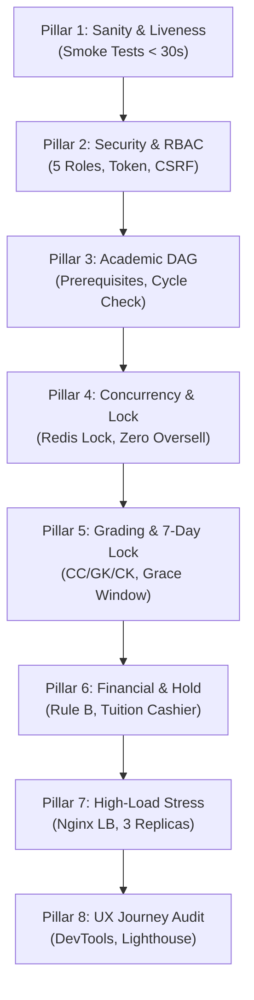

# 🧪 BỘ KIỂM THỬ TỰ ĐỘNG & KIỂM TOÁN CHẤT LƯỢNG (AUTOMATED TEST SUITE)
## HỆ THỐNG QUẢN LÝ ĐÀO TẠO & SINH VIÊN (SMS / UAMS)
> **Kiến trúc kiểm thử:** 8 Trụ cột Đảm bảo Chất lượng (8 Pillars of QA)  
> **Phạm vi kiểm thử:** Backend Unit Tests (285+) · Frontend Component Tests (43+) · E2E Regression (65+) · Stress Testing (600 SV)  
> **Tác giả:** Nguyễn Duy Minh (MSV: 21010696)

---

## 📑 Mục lục
1. [Khung đảm bảo chất lượng 8 Trụ cột (8 Pillars QA Framework)](#1-khung-đảm-bảo-chất-lượng-8-trụ-cột-8-pillars-qa-framework)
2. [Cấu trúc Thư mục `tests/`](#2-cấu-trúc-thư-mục-tests)
3. [Giao diện Kiểm thử Tải trực quan 100 Sinh viên (Visual Load Test Demo)](#3-giao-diện-kiểm-thử-tải-trực-quan-100-sinh-viên-visual-load-test-demo)
4. [Trình thực thi Menu 1-Click tương tác (`run_tests.bat`)](#4-trình-thực-thi-menu-1-click-tương-tác-run_testsbat)
5. [Hướng dẫn thực thi chi tiết từng bộ kiểm thử qua CLI](#5-hướng-dẫn-thực-thi-chi-tiết-từng-bộ-kiểm-thử-qua-cli)
6. [Hệ thống Báo cáo Kiểm toán Chất lượng (QA Reports)](#6-hệ-thống-báo-cáo-kiểm-toán-chất-lượng-qa-reports)
7. [Tiêu chuẩn Nghiệm thu Cổng chất lượng (Quality Gate Acceptance)](#7-tiêu-chuẩn-nghiệm-thu-cổng-chất-lượng-quality-gate-acceptance)

---

## 1. Khung đảm bảo chất lượng 8 Trụ cột (8 Pillars QA Framework)

Để bảo đảm một hệ thống học vụ quy mô lớn hoạt động ổn định, chính xác và không có lỗi logic trong các kỳ thi hay đợt đăng ký tín chỉ, dự án thiết lập quy trình kiểm thử toàn diện dựa trên **8 Trụ cột Đảm bảo Chất lượng**:



| Trụ cột QA | Tên phân hệ kiểm thử | Mục tiêu xác thực |
| :---: | :--- | :--- |
| **Pillar 1** | Sanity & Liveness | Kiểm tra tính sẵn sàng của các cổng dịch vụ (MySQL, Redis, Backend, Frontend SPA) trong vòng dưới 30 giây. |
| **Pillar 2** | Security & RBAC | Xác thực phân quyền 5 vai trò (`ADMIN`, `ACADEMIC_AFFAIRS`, `LECTURER`, `STUDENT`, `EXAMINATION_OFFICER`), chống leo thang đặc quyền và kiểm tra mã hóa mật khẩu BCrypt. |
| **Pillar 3** | Academic Catalog & DAG | Xác thực tính toàn vẹn của Đồ thị môn học có hướng (DAG), kiểm tra ngăn chặn chu trình phụ thuộc vòng và logic qua môn tiên quyết. |
| **Pillar 4** | High-Concurrency Enrollment | Kiểm thử tranh chấp ghi danh của hàng trăm sinh viên trong 1 giây; chứng minh sĩ số thực tế không bao giờ vượt ngưỡng tối đa (`enrolled <= max`). |
| **Pillar 5** | Grading & 7-Day Lock | Kiểm tra công thức tính điểm 4 thành phần (`CC1 5% · CC2 5% · GK 30% · CK 60%`), cửa sổ ân hạn 7 ngày, quy trình đề xuất sửa điểm và phúc khảo bài thi. |
| **Pillar 6** | Financial & Tuition Hold | Kiểm tra tính toán hóa đơn học phí theo tín chỉ, lớp học phần mở riêng và thực thi Rule B tự động chặn đăng ký khi nợ học phí quá hạn. |
| **Pillar 7** | High-Load Stress & Cluster | Kiểm tra khả năng chịu tải leo thang (500 ➜ 5.000 requests) qua Nginx Load Balancer điều phối đến cụm 3 Backend Replicas. |
| **Pillar 8** | UX Journey & DevTools Audit | Tự động hóa trải nghiệm hành trình người dùng xuyên suốt các màn hình bằng Puppeteer, kiểm tra không có lỗi Console hay Layout Shift. |

---

## 2. Cấu trúc Thư mục `tests/`

```text
tests/
├── smoke/                           # 💨 Kiểm thử khói (Sanity Gate - Fail Fast < 30s)
│   └── smoke_test.js                # Kiểm tra kết nối DB, Redis, REST API Liveness, xác thực Token
├── e2e/                             # 🛡️ Kiểm thử hồi quy chức năng End-to-End
│   ├── comprehensive_system_test.js # Bộ 65+ ca kiểm thử toàn diện: RBAC, Học phí, Điểm danh, Phúc khảo, Lớp riêng
│   ├── system_e2e_test.js           # Bộ 39 ca kiểm thử: Khảo sát vòng đời học phần và người dùng
│   ├── test_admin_coordination_and_tuition.js # Kiểm thử điều phối đào tạo, bàn thu ngân học phí
│   ├── test_analytics_and_cohort_feature.js   # Kiểm thử báo cáo phân tích khóa học và cảnh báo học vụ
│   ├── test_grade_amendment_e2e.cjs # Kiểm thử quy trình đề xuất - xét duyệt sửa điểm sau khóa sổ & audit log
│   └── user_experience_journey_test.js        # Hành trình trải nghiệm người dùng tự động đa vai trò
├── integration/                     # 🧩 Kiểm thử tích hợp tính năng chuyên sâu
│   ├── test_attendance_feature.js   # Kiểm thử quy trình điểm danh realtime bằng mã PIN 6 số
│   └── test_excel_import_flow.js    # Kiểm thử luồng import/export điểm từ tệp Excel chuẩn Apache POI
├── performance/                     # ⚡ Kiểm thử hiệu năng, áp lực & tải đồng thời
│   ├── demo_100/                    # 🎯 Visual Concurrency Dashboard phục vụ Demo bảo vệ đồ án
│   │   ├── server.js                # Máy chủ Web Demo độc lập lắng nghe tại cổng 5050
│   │   ├── run_concurrency_test.js  # Kịch bản kích hoạt đồng thời 100 luồng sinh viên đăng ký môn
│   │   ├── prepare_tokens.js        # Tiện ích tiền xử lý sinh trước 100 JWT Tokens để đo tải thuần
│   │   └── public/index.html        # Giao diện trực quan biểu đồ Waterfall và tỷ lệ thành công
│   ├── enrollment_load_test.js      # Đo lường thời gian phản hồi ghi danh dưới tải trung bình
│   ├── overload_stress_test.js      # Benchmark ngưỡng chịu tải kết nối HikariCP Pool & Tomcat threads
│   ├── simulate_600_enrollment.js   # Mô phỏng áp lực cực hạn: 600 sinh viên cùng ghi danh 1 lớp
│   ├── stress_test.js               # Kiểm thử tải leo thang qua Nginx Load Balancer (500 ➜ 5.000 requests)
│   └── stress_test_to_death.js      # Kiểm thử ép tải cực hạn để đo điểm gãy (Breaking Point)
├── security/                        # 🔒 Kiểm thử an toàn bảo mật
│   └── basic_security_test.js       # Quét lỗ hổng phân quyền, CSRF, Token Tampering, Brute-force
├── reports/                         # 📊 Hồ sơ báo cáo kết quả kiểm thử & kiểm toán chất lượng
│   ├── FULL_8_PILLARS_QA_REPORT.md  # Báo cáo tổng kiểm toán 8 trụ cột chất lượng hoàn chỉnh
│   ├── COMPREHENSIVE_TEST_REPORT.md # Báo cáo kết quả bộ kiểm thử 65+ E2E Cases
│   ├── OVERLOAD_TEST_REPORT.md      # Báo cáo phân tích hiệu năng tải cao và dung lượng RAM
│   └── STRESS_TEST_TO_DEATH_REPORT.md # Báo cáo kiểm thử tải phá hủy và giới hạn phần cứng
├── results/                         # Dữ liệu kết quả chạy kiểm thử dạng tệp JSON
├── test-results/                    # Minh chứng chụp ảnh màn hình và kết quả audit DevTools
├── utils/                           # Tiện ích hỗ trợ kiểm thử (Helper DB, tạo token, healthcheck)
└── README.md                        # Cẩm nang tài liệu này
```

---

## 3. Giao diện Kiểm thử Tải trực quan 100 Sinh viên (Visual Load Test Demo)

Để phục vụ trình diễn và bảo vệ trực tiếp trước Hội đồng chấm Đồ án tốt nghiệp, một công cụ trực quan hóa thời gian thực đã được phát triển tại thư mục `tests/performance/demo_100/`:

```bash
# Khởi động máy chủ Web Demo tải trực quan
node tests/performance/demo_100/server.js
```
* **Địa chỉ truy cập:** `http://localhost:5050`

### Tính năng vượt trội của Dashboard:
1. **Nút bấm 1-Click kích hoạt:** Bắt đầu bài test tải 100 sinh viên đăng ký đồng thời vào 1 lớp học phần giới hạn 30 chỗ ngồi.
2. **Biểu đồ Waterfall thời gian thực:** Trực quan hóa độ trễ (latency) của từng sinh viên từ mili-giây thứ nhất đến sinh viên cuối cùng.
3. **Thống kê phân bổ phản hồi:** Tỷ lệ thành công (200 OK - Đăng ký thành công), Tỷ lệ hết chỗ (400 Bad Request - Lớp đã đủ sĩ số), Tỷ lệ lỗi (0%).
4. **Minh chứng toàn vẹn dữ liệu (Zero Overselling Proof):** Tự động truy vấn trực tiếp vào CSDL MySQL để chứng minh lớp chỉ ghi nhận đúng tối đa 30 sinh viên, không vượt quá dù chỉ 1 suất.

---

## 4. Trình thực thi Menu 1-Click tương tác (`run_tests.bat`)

Từ thư mục gốc dự án, người dùng chỉ cần chạy file kịch bản:
```cmd
run_tests.bat
```
Giao diện Menu trực quan cho phép lựa chọn linh hoạt theo nhu cầu kiểm thử:
* **[1] 💨 Smoke Test siêu tốc (< 30s):** Kiểm tra sức khỏe toàn bộ hệ thống sau khi triển khai.
* **[2] ⚡ Concurrency Test (600 SV):** Kiểm thử tranh chấp đăng ký tín chỉ chịu tải cao.
* **[3] 📈 Multi-Level Stress Test:** Kiểm tra hiệu năng leo thang (500 ➜ 5.000 requests) qua Nginx.
* **[4] 💥 Stress Test to Failure:** Ép tải cực hạn đến ngưỡng quá tải để đo giới hạn phần cứng.
* **[5] 🛡️ Comprehensive E2E Test Suite (65+ Cases):** Chạy toàn bộ ma trận kiểm thử nghiệp vụ tự động.
* **[6] 🎯 Visual Concurrency Dashboard (Port 5050):** Bật giao diện Demo trực quan cho hội đồng.

---

## 5. Hướng dẫn thực thi chi tiết từng bộ kiểm thử qua CLI

Đảm bảo Backend (`http://localhost:8080`) và Frontend (`http://localhost:5173`) đang hoạt động trước khi chạy:

### 1. Kiểm thử khói (Smoke Test - Fail Fast)
```bash
node tests/smoke/smoke_test.js
```
* Thời gian chạy: ~15 giây.
* Kiểm tra: Kết nối MySQL, Kết nối Redis, Đăng nhập Admin, Lấy danh mục Khoa/Ngành, Liveness Frontend.

### 2. Kiểm thử E2E Toàn diện 65+ Cases
```bash
node tests/e2e/comprehensive_system_test.js
```
* Kiểm tra liên hoàn chuỗi nghiệp vụ: Tạo tài khoản ➔ Mở lớp ➔ Đăng ký môn ➔ Chặn nợ học phí Rule B ➔ Điểm danh PIN ➔ Nhập điểm ➔ Khóa sổ 7 ngày ➔ Phúc khảo bài thi ➔ Thu học phí ➔ Xét tốt nghiệp.

### 3. Mô phỏng tranh chấp đồng thời 600 Sinh viên
```bash
node tests/performance/simulate_600_enrollment.js
```
* Bắn 600 HTTP requests đăng ký cùng 1 lớp học phần trong vòng 1.000ms.
* Đo lường: Tỷ lệ tranh chấp thành công, độ trễ trung bình, kiểm tra bộ đếm CSDL.

### 4. Kiểm thử Tải đa cấp độ qua Nginx Cân bằng tải
```bash
node tests/performance/stress_test.js
```
* Tạo tải tăng dần từ 500 đến 5.000 requests qua cụm 3 Backend Replicas.

### 5. Kiểm thử Điểm danh PIN & Luồng Import Excel
```bash
node tests/integration/test_attendance_feature.js
node tests/integration/test_excel_import_flow.js
```

### 6. Kiểm thử An toàn bảo mật (Security Gate)
```bash
node tests/security/basic_security_test.js
```
* Kiểm tra: Truy cập trái phép endpoint Admin bằng quyền Student, giả mạo Token, SQL Injection cơ bản.

---

## 6. Hệ thống Báo cáo Kiểm toán Chất lượng (QA Reports)

Các bản báo cáo kỹ thuật chi tiết đã được biên soạn đầy đủ tại thư mục `tests/reports/`:
* 📘 **[FULL_8_PILLARS_QA_REPORT.md](reports/FULL_8_PILLARS_QA_REPORT.md):** Báo cáo kiểm toán tổng thể 8 trụ cột chất lượng, phân tích chi tiết từng trường hợp kiểm thử và tỷ lệ thành công.
* 📗 **[COMPREHENSIVE_TEST_REPORT.md](reports/COMPREHENSIVE_TEST_REPORT.md):** Bảng tổng hợp chi tiết kết quả chạy 65+ ca kiểm thử End-to-End.
* 📙 **[OVERLOAD_TEST_REPORT.md](reports/OVERLOAD_TEST_REPORT.md):** Đánh giá mức độ tiêu thụ RAM của JVM và thời gian đáp ứng của hồ chứa kết nối HikariCP.
* 📕 **[STRESS_TEST_TO_DEATH_REPORT.md](reports/STRESS_TEST_TO_DEATH_REPORT.md):** Báo cáo thực nghiệm giới hạn sụp đổ của hệ thống khi vượt quá ngưỡng tài nguyên phần cứng.

---

## 7. Tiêu chuẩn Nghiệm thu Cổng chất lượng (Quality Gate Acceptance)

Một bản dựng (build) chỉ được coi là đạt yêu cầu phát hành khi thỏa mãn đầy đủ các chỉ số nghiệm thu sau:

1. **Độ tin cậy nghiệp vụ (Functional Correctness):** 100% các ca kiểm thử E2E và Unit Tests phải vượt qua (`Passed`), không có bất kỳ ngoại lệ `500 Internal Server Error` không mong muốn nào.
2. **Bảo toàn dữ liệu đồng thời (Zero Concurrency Defect):** Sĩ số sinh viên đăng ký thành công vào bất kỳ lớp học phần nào tuyệt đối không được vượt quá chỉ tiêu sĩ số tối đa (`enrolled_students <= max_students`).
3. **Thời gian đáp ứng (Response Time SLA):**
   * Các yêu cầu đọc dữ liệu danh mục & thời khóa biểu: Thời gian đáp ứng dưới **100ms**.
   * Yêu cầu ghi nhận đăng ký tín chỉ trong điều kiện tải cao: Thời gian đáp ứng trung bình dưới **350ms**.
4. **Phân quyền bất khả xâm phạm:** 100% các nỗ lực truy cập vào tài nguyên trái quyền hạn phải bị máy chủ từ chối với mã lỗi `403 Forbidden` hoặc `401 Unauthorized`.

---
<div align="center">
  <sub>Hệ Thống Quản Lý Đào Tạo & Sinh Viên (SMS) · Đại học Phenikaa · 2026</sub>
</div>
