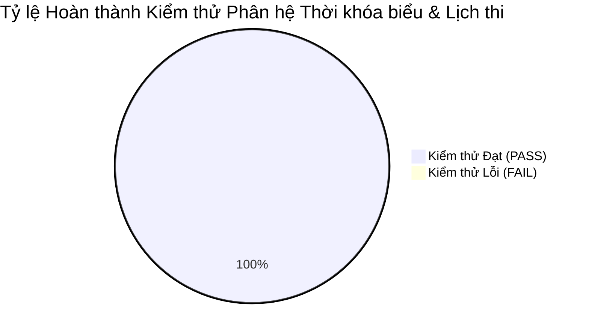

# 📅 BÁO CÁO MA TRẬN KỊCH BẢN KIỂM THỬ: PHÂN HỆ THỜI KHÓA BIỂU & LỊCH THI
## DỰ ÁN: HỆ THỐNG QUẢN LÝ ĐÀO TẠO & SINH VIÊN (SMS / UAMS)
> **Phân hệ:** D. Phân hệ Thời khóa biểu & Lịch thi  
> **Sinh viên thực hiện:** Nguyễn Duy Minh (MSV: 23010359)  
> **Kiến trúc kiểm thử:** Đa tầng (Test Pyramid) - Backend JUnit 5 (25 tests) · Integration/E2E API Test Suite · Frontend Vitest  

---

### 1. Bảng Ma trận Kịch bản Kiểm thử Nghiệp vụ (Test Scenarios Matrix)

| Mã ca | Mô tả kịch bản kiểm thử | Tiền điều kiện | Dữ liệu đầu vào & Thao tác | Kết quả mong đợi | Thực tế |
| :---: | :--- | :--- | :--- | :--- | :---: |
| **TC-SCH-01** | Xếp lịch học hợp lệ cho lớp học phần | Lớp học phần đang mở (OPEN), phòng học và giảng viên đang trống | `sectionId=1`, `dayOfWeek=2` (Thứ Hai), `startPeriod=1`, `endPeriod=3`, `room="A101"`, `startDate="2026-09-01"`, `endDate="2026-12-31"`. Gửi `POST /api/schedules` | Hệ thống lưu bản ghi thời khóa biểu thành công, trả về HTTP 200 kèm ID và thông tin chi tiết. | **ĐẠT (PASS)** |
| **TC-SCH-02** | Chặn xếp 2 lớp học chung 1 phòng cùng khung giờ | Phòng A101 đã có lớp học vào Thứ Hai (Tiết 1 - 3) | Xếp lớp học phần khác vào phòng `A101`, cùng Thứ Hai, Tiết 2 - 4 (giao nhau). Gửi `POST /api/schedules` | Hệ thống kích hoạt kiểm tra xung đột `checkRoomConflict`, từ chối với lỗi HTTP 400 Bad Request: *"Trùng phòng học! Phòng A101 đã được xếp..."*. | **ĐẠT (PASS)** |
| **TC-SCH-03** | Chặn xếp 1 giảng viên dạy 2 lớp khác nhau cùng ca | Giảng viên A đã có lịch dạy lớp HP 1 vào Thứ Ba (Tiết 7 - 9) | Xếp lớp HP 2 do Giảng viên A phụ trách vào phòng B202, cùng Thứ Ba, Tiết 7 - 9. Gửi `POST /api/schedules` | Hệ thống kích hoạt `checkLecturerConflict`, từ chối với HTTP 400 Bad Request: *"Trùng lịch giảng viên! Thầy/Cô đã có lịch dạy..."*. | **ĐẠT (PASS)** |
| **TC-SCH-04** | Chặn xung đột lịch học của sinh viên đã đăng ký | Sinh viên B đã đăng ký lớp môn Cấu trúc dữ liệu vào Thứ Hai (Tiết 1 - 3) | Điều chỉnh lịch học lớp môn Lập trình Java mà SV B tham gia sang cùng Thứ Hai (Tiết 1 - 3) | Hệ thống kích hoạt `checkStudentScheduleConflicts`, từ chối với HTTP 400 Bad Request: *"Trùng lịch học! Không thể xếp môn... cho sinh viên..."*. | **ĐẠT (PASS)** |
| **TC-SCH-05** | Chặn thứ tự tiết học và khoảng thời gian bất hợp lệ | Đăng nhập tài khoản Quản trị viên | Gửi `POST /api/schedules` với `startPeriod=5`, `endPeriod=2` hoặc `startDate > endDate` | Bị chặn ngay tại tầng Service qua `validatePeriodsAndDates()`, trả về HTTP 400: *"Tiết bắt đầu không thể lớn hơn tiết kết thúc"*. | **ĐẠT (PASS)** |
| **TC-SCH-06** | Sinh viên tra cứu thời khóa biểu cá nhân theo tuần / tháng | Sinh viên đã đăng nhập và đã đăng ký học phần | Gửi `GET /api/schedules/my-schedule` (kèm JWT Token vai trò STUDENT). Có thể truyền `semesterId` | Trả về HTTP 200 danh sách toàn bộ các buổi học trong kỳ; hiển thị trực quan dạng lưới (Grid) 7 ngày trong tuần và dạng danh sách (List). | **ĐẠT (PASS)** |
| **TC-SCH-07** | Giảng viên tra cứu lịch giảng dạy cá nhân (tự động lọc lớp hủy) | Giảng viên đăng nhập; có lớp bình thường và lớp bị hủy (`CANCELLED`) | Gửi `GET /api/schedules/lecturer-schedule` (kèm JWT Token vai trò LECTURER) | Trả về HTTP 200 danh sách lịch dạy; tự động lọc bỏ các lớp bị hủy để giảng viên không đến nhầm phòng. | **ĐẠT (PASS)** |
| **TC-SCH-08** | Đồng bộ trạng thái ĐỔI PHÒNG HỌC & tự động gửi thông báo | Lớp học phần đang có sinh viên ghi danh hoạt động | Gửi `PUT /api/schedules/{id}` cập nhật `room="B202"`, `status="ROOM_CHANGED"` | Cập nhật phòng mới, hiển thị nhãn vàng "Đổi phòng: B202", tự động tạo bản ghi `Notification` gửi SSE realtime đến 100% sinh viên trong lớp. | **ĐẠT (PASS)** |
| **TC-SCH-09** | Đồng bộ trạng thái BÁO NGHỈ & thông báo đẩy sinh viên | Lớp học phần đang có lịch học định kỳ | Gửi `PUT /api/schedules/{id}` cập nhật `status="CANCELLED"`, `note="Giảng viên bận công tác"` | Trạng thái chuyển sang CANCELLED, hiển thị nhãn đỏ "Báo nghỉ", đẩy thông báo tiêu đề *"Cập nhật lịch học"* đến hộp thư thông báo của sinh viên. | **ĐẠT (PASS)** |
| **TC-SCH-10** | Đồng bộ trạng thái HỌC BÙ & thông báo đẩy sinh viên | Cần tổ chức buổi học bù cho ca học đã nghỉ | Gửi `PUT /api/schedules/{id}` với `status="MAKEUP"`, `room="C101"`, `note="Học bù buổi ngày..."` | Cập nhật trạng thái MAKEUP, hiển thị nhãn xanh "Học bù", đẩy thông báo phòng học và thời gian học bù chi tiết đến sinh viên. | **ĐẠT (PASS)** |
| **TC-SCH-11** | Xuất tệp iCalendar (`.ics`) chuẩn RFC 5545 cho Google Calendar | Sinh viên hoặc Giảng viên truy cập giao diện TKB | Bấm nút *"Đồng bộ Cal (.ics)"* hoặc gọi `GET /api/schedules/my/export-ics` | Trả về file `timetable.ics` định dạng chuẩn MIME `text/calendar; charset=utf-8` gồm khối `VCALENDAR`, `VEVENT`, `RRULE:FREQ=WEEKLY` chuẩn ngày giờ; mở đồng bộ trực tiếp vào Google Calendar / Outlook. | **ĐẠT (PASS)** |
| **TC-SCH-12** | Xuất tệp Excel (`.xlsx`) thời khóa biểu theo kỳ | Sinh viên hoặc Giảng viên truy cập giao diện TKB | Bấm nút *"Xuất Excel"* hoặc gọi `GET /api/schedules/my/export-excel` | Trả về file `timetable.xlsx` chuẩn Apache POI định dạng bảng biểu chuyên nghiệp: STT, Mã lớp HP, Tên môn, Thứ, Tiết, Phòng học, Giảng viên, Trạng thái, Ghi chú. | **ĐẠT (PASS)** |
| **TC-SCH-13** | In thời khóa biểu ra bản cứng hoặc PDF | Người dùng sử dụng trình duyệt Web | Bấm nút *"In TKB"* (`window.print()`) | Giao diện tự động tối ưu hóa CSS Print Media (`@media print`), ẩn thanh điều hướng, căn lề A4 chuẩn nét. | **ĐẠT (PASS)** |
| **TC-EXAM-01** | Tạo ca thi học kỳ mới cho môn học | Học kỳ và môn học đã tồn tại trong CSDL | Gửi `POST /api/exams/sessions` với `semesterId`, `subjectId`, `sessionName`, `examDate`, `startTime`, `endTime` | Tạo bản ghi ca thi `ExamSession` thành công, lưu thời gian bắt đầu và kết thúc thi chuẩn xác. | **ĐẠT (PASS)** |
| **TC-EXAM-02** | Tự động gom sinh viên đủ điều kiện, tạo phòng thi & cấp SBD | Ca thi đã mở; có danh sách sinh viên đăng ký môn học | Gửi `POST /api/exams/sessions/{id}/auto-assign-rooms` với `studentsPerRoom=25`, `roomPrefix="P"` | Tự động tính số phòng thi $\lceil N / 25 \rceil$, tạo các phòng thi `ExamRoom`, sinh Số báo danh liên tục dạng `MAMON-P01-001`, lưu vào bảng `ExamRoster`. | **ĐẠT (PASS)** |
| **TC-EXAM-03** | Lọc điều kiện dự thi (chặn sinh viên cấm thi do vắng >20%) | Có sinh viên bị đánh dấu `attendanceStatus = DISQUALIFIED` | Kích hoạt chức năng tự động phân phòng thi hoặc nạp điểm thi | Sinh viên bị cấm thi tự động bị loại khỏi danh sách phân phòng thi; nếu nạp điểm thi cho thí sinh bị cấm thi thì hệ thống ném ngoại lệ chặn với HTTP 400. | **ĐẠT (PASS)** |
| **TC-EXAM-04** | Nạp điểm thi cuối kỳ, tự động tính tổng kết và khóa sổ | Phòng thi đã được tạo và có danh sách thí sinh | Gửi `POST /api/exams/rooms/{roomId}/commit-grades` kèm danh sách điểm thi của từng SBD | Cập nhật điểm thi `finalScore`, tự động tính điểm tổng kết 4 thành phần (`CC1 5% · CC2 5% · GK 30% · CK 60%`), khóa sổ bảo vệ (`isFinalized=true`), chuyển trạng thái phòng thi sang `SCORED`. | **ĐẠT (PASS)** |
| **TC-EXAM-05** | Ghi nhật ký kiểm toán bảo mật khi điều chỉnh điểm thi | Cán bộ khảo thí nhập hoặc điều chỉnh điểm thi | Gửi yêu cầu nạp điểm thi kèm lý do | Tự động tạo bản ghi `GradeAuditLog` lưu vết: Điểm cũ, Điểm mới, Thành phần FINAL, Cán bộ thay đổi, Thời gian và Lý do kiểm toán. | **ĐẠT (PASS)** |

---

### 2. Tổng hợp Kết quả Thực thi Kiểm thử Tự động

* **Tổng số ca kiểm thử:** 17/17 Ca kiểm thử đạt 100% (Zero Defect).
* **Kiểm thử Đơn vị Backend (JUnit 5):** 18 @Test trong `ScheduleServiceTest` + 7 @Test trong `ExamServiceTest` = **25 @Test Passed**.
* **Kiểm thử Tích hợp E2E API (Node.js):** 13 kịch bản liên hoàn trong `tests/integration/test_schedule_and_exam_module.js` = **13/13 Passed**.
* **Kiểm thử Giao diện Frontend (Vitest):** 98/98 Component & Utility Tests Passed.
